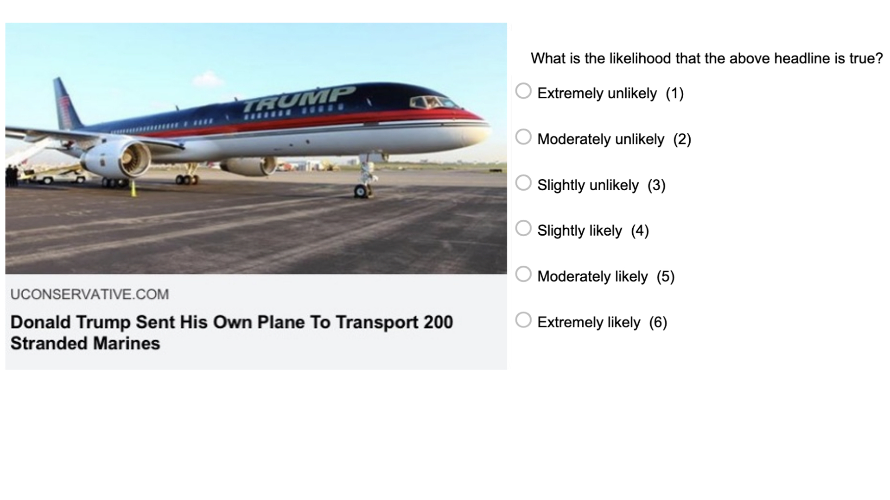
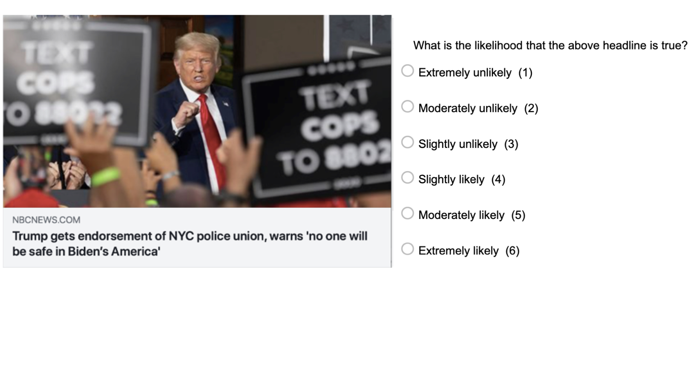

## Two weeks ago

::: {.columns}
::: {.column width="35%"}
![[Photo: ETH Zürich, D-USYS]{.citation}](images/reto_knutti_eth.jpg){width="100%"}
:::
::: {.column width="65%"}
Reto Knutti told us what it is like to be a climate scientist in public: he is attacked personally and discredited, rather than argued with.
:::
:::

::: {.notes}
Recap of the guest lecture in week 7 (27.10.): the personal attacks, the attempts to discredit him as a person rather than engage with the science, and how he deals with it.

Today's reading has a section on exactly this, "Disinformation versus scientists" (Lewandowsky 2021, section 3.3): "Several researchers have suggested that the constant barrage of public criticism and attacks on individual scientists has induced the scientific community to exercise undue caution or to 'err on the side of least drama'." And: "interviews with researchers have revealed that some forms of contrarian activities, such as the use of freedom-of-information requests, have led to changes in how scientists communicate and have imposed an additional work burden that draws time away from research."
:::

## Not an isolated experience

::: {.columns}
::: {.column width="35%"}
![[@mannScienceSiegeHow2025]{.citation}](images/science_under_siege_cover.jpg){width="100%"}
:::
::: {.column width="65%"}
Climate and health action are "hampered by a common threat: politically and ideologically motivated opposition to science".
:::
:::

::: {.notes}
Michael Mann, climate scientist, and Peter Hotez, vaccine researcher, two scientists who have "spent the last twenty years on the front lines of the battle to convey accurate, reliable, and trustworthy information about science in the face of determined and nihilistic opposition". Today is about the first three forces, and about what psychology can say about the audience.

Mann & Hotez 2025, Science Under Siege: How to Fight the Five Most Powerful Forces That Threaten Our World, PublicAffairs, 368 pages, published 9 September 2025. Quotes from the publisher's description (Hachette Book Group page): "From pandemics to the climate crisis, humanity faces tougher challenges than ever. [...] But our efforts to effectively tackle these existential crises are now hampered by a common threat: politically and ideologically motivated opposition to science. Michael E. Mann and Peter J. Hotez are two of the most respected and well-known scientists in the world and have spent the last twenty years on the front lines of the battle to convey accurate, reliable, and trustworthy information about science in the face of determined and nihilistic opposition. In this powerful manifesto, they reveal the five main forces threatening science: plutocrats, pros, petrostates, phonies, and the press."

Mann himself has been a target of organised attacks on climate scientists for two decades.

Bridge to the lecture: plutocrats, pros and petrostates are the supply side, Part I. The audience, what reaches it and what can be done about it, is Part II. Whether all of this matters, and the role of the press, the fifth force, is Part III.
:::

## How common are such attacks?

Of 468 climate scientists who answered a voluntary survey in 2023, 39% had experienced online harassment or abuse related to their research. Among those who appear in the media at least once a month, 73% had. [@globalwitnessGlobalHatingHow2023]

. . .

Of 321 scientists who answered a voluntary survey after speaking publicly about COVID-19, 15% had received death threats and 22% threats of physical or sexual violence. [@nogradyHopeYouHow2021]

::: {.notes}
Global Witness, "Global hating", 4 April 2023, https://globalwitness.org/en/campaigns/digital-threats/global-hating/introduction/. Verbatim: "Overall, 39% of all scientists polled (183 out of 468) have experienced online harassment or abuse"; "increases to 49% of scientists who have published more than 10 journal articles"; "Of those scientists who are in the media at least once a month (13% of respondents), 73% have experienced abuse"; "8% have received death threats"; "41% of affected scientists polled said their experience had made them less likely to post". The invitation went to about 24,000 scientists, and the 468 are a voluntary sample, so the shares are not representative. Reported in Nature by Vidal Valero 2023 [@vidalvaleroDeathThreatsTrolling2023]: "Among the 468 respondents, 39% said they had experienced online harassment or abuse related to their climate research."

Nogrady 2021, Nature 598, 250–253, DOI 10.1038/d41586-021-02741-x, Nature's survey of scientists who had spoken to the media about COVID-19: "15% of 321 respondents said they had received death threats"; "22% had received threats of physical or sexual violence"; "more than 40% reported experiencing emotional or psychological distress"; "more than two-thirds of researchers reported negative experiences".

Michael Mann v. Steyn and Simberg: Mann sued in 2012 over blog posts comparing him to a convicted child abuser and calling his research fraudulent. On 8 February 2024 a Washington, DC jury awarded him 1 dollar in compensatory damages from each writer and punitive damages of 1,000 dollars from Simberg and 1 million dollars from Steyn (AP, 8 February 2024; Tollefson 2024, Nature 626, 698–699, DOI 10.1038/d41586-024-00396-y). In 2025 the judge reduced the award against Steyn to 5,000 dollars, and Mann was ordered to pay about 530,000 dollars in legal fees to the National Review, which had been dropped from the case (Philadelphia Inquirer, 20 March 2025). So: a symbolic win after twelve years, at considerable cost.

Other figures: a German representative survey of about 2,600 researchers (DZHW, 2024) found that 45% had experienced at least one form of hostility, with death threats or threats of violence at about 2%. An Australian survey of 2,086 academics (Peetz et al. 2024) found that 41% had experienced intimidation in the past five years.
:::

## Overview {.smaller}

**I. The production of misinformation**

1. A short history of organised climate change denial
2. From denial to delay

**II. The consumption of misinformation**

3. How much misinformation is there?
4. How do we measure belief in misinformation?
5. Countering misinformation

**III. Beyond misinformation: trust in true information and the news ecosystem**

# I. The production of misinformation

::: {.notes}
Part I is the supply: who produced doubt about climate science, how, and how the message has changed.
:::

# 1. A short history of organised climate change denial

## What Exxon knew

::: {.columns}
::: {.column width="35%"}
![[Protest sign in Washington, DC, 2015. Photo: Johnny Silvercloud, Wikimedia Commons]{.citation}](images/exxon_knew_protest_2015.jpg){width="100%"}
:::
::: {.column width="65%"}
In 1978, the Exxon scientist James Black showed the company's management committee a projection of the warming to expect if CO~2~ doubled. 

A 1982 internal primer spoke of "unanimous agreement in the scientific community" that a warming of about 3 °C would change the earth's climate significantly. [@supranAssessingExxonMobilsClimate2017]
:::
:::

::: {.notes}
Week 8 covered this in more detail (the 1977 memo, the Supran et al. 2023 projection chart, the New York Times advertisements, Supran & Oreskes 2017).

In 2015, journalists showed that the oil company's own scientists had understood climate change since the late 1970s. The company: Exxon, since 1999 ExxonMobil, the successor of Rockefeller's Standard Oil, for decades the largest publicly traded oil company in the world. The story became public through the InsideClimate News series "Exxon: The Road Not Taken" (2015, Pulitzer finalist, https://www.pulitzer.org/finalists/insideclimate-news) and the hashtag #ExxonKnew on the sign.

What the company knew, in numbers (Supran, Rahmstorf & Oreskes 2023): "63 to 83% of the climate projections reported by ExxonMobil scientists were accurate", average projected warming "0.20° ± 0.04°C per decade", warming predicted to become detectable "in the year 2000 ± 5".

The 1982 internal memo with the CO2 projection chart is at https://www.climatefiles.com/exxonmobil/1982-memo-to-exxon-management-about-CO2-greenhouse-effect.

Supran & Oreskes 2017, documents from 1977 to 2014. Abstract: "83% of peer-reviewed papers and 80% of internal documents acknowledge that climate change is real and human-caused", while for advertorials 12% acknowledge this and 81% express doubt.

From the outlook paragraph of Supran, Rahmstorf & Oreskes 2023: "ExxonMobil didn't just know 'something' about global warming decades ago—they knew as much as academic and government scientists knew. But whereas those scientists worked to communicate what they knew, ExxonMobil worked to deny it—including overemphasizing uncertainties, denigrating climate models, mythologizing global cooling, feigning ignorance about the discernibility of human-caused warming, and staying silent about the possibility of stranded fossil fuel assets in a carbon-constrained world."

Supran & Oreskes 2017, Environmental Research Letters, DOI 10.1088/1748-9326/aa815f (open access). The 1978 presentation: "in a 1978 presentation to the Exxon Corporation Management Committee, Exxon scientist James Black showed a graph of projected warming 'model[ed] with the assumption that the carbon dioxide levels will double by 2050 A.D.'" The 1982 primer: "There is unanimous agreement in the scientific community that a temperature increase of this magnitude [(3.0 ± 1.5) °C] would bring about significant changes in the earth's climate, including rainfall distribution and alterations in the biosphere." The paper also notes that Exxon's expected warming of 1.3 to 3.1 °C was comparable to leading research institutions' 1.5 to 4.5 °C, and that Black and his colleagues stressed the uncertainties of the models even then.

Supran, Rahmstorf & Oreskes 2023, Science, DOI 10.1126/science.abk0063, abstract: "we quantitatively evaluated all available global warming projections documented by, and in many cases modeled by, Exxon and ExxonMobil Corp scientists between 1977 and 2003. We find that most of their projections accurately forecast warming that is consistent with subsequent observations. Their projections were also consistent with, and at least as skillful as, those of independent academic and government models. [...] On each of these points, however, the company's public statements about climate science contradicted its own scientific data."
:::

## What Exxon said

::: {.columns}
::: {.column width="35%"}
![[ExxonMobil advertorial "Unsettled Science", New York Times, 2000, annotated reproduction from Figure 4 in @cookAmericaMisledHow2019]{.citation}](images/america_misled_fig4_unsettled_science.png)
:::
::: {.column width="65%"}
In 1980, with help from outside public relations advisers, the company drew up a "CO~2~ Greenhouse Communications Plan" aimed at "opinion leaders who are not scientists".  

By 1989 its stated aim was to "emphasize the uncertainty in scientific conclusions". That year the first of 36 paid, editorial-style advertisements appeared in the New York Times. [@supranAssessingExxonMobilsClimate2017]
:::
:::

::: {.notes}
All from Supran & Oreskes 2017. Communications plan: "In 1980, with input from outside public relations counsel, Exxon developed a 'CO2 Greenhouse Communications Plan,' including advertorials, to target 'opinion leaders who are not scientists'. By 1988−9, this plan explicitly aimed to 'extend the science' and 'emphasize the uncertainty in scientific conclusions regarding the potential enhanced Greenhouse effect'. That year, 1989, they ran their first AGW advertorial." A 1978 memo had already noted the "great public relations value" of the company's climate research.

The numbers: 187 documents in total, of which 36 advertorials in the New York Times between 1989 and 2004, 72 peer-reviewed papers, 47 non-peer-reviewed documents and 32 internal documents. Abstract: "accounting for expressions of reasonable doubt, 83% of peer-reviewed papers and 80% of internal documents acknowledge that climate change is real and human-caused, yet only 12% of advertorials do so, with 81% instead expressing doubt."

Keigwin: "Featured in an advertorial entitled 'Unsettled Science' in the NYT and The Wall Street Journal, the latter figure was taken from an article in Science by Lloyd Keigwin of the Woods Hole Oceanographic Institution. Keigwin called the use of his data 'very misleading'. They were a historical reconstruction of sea-surface temperatures in the Sargasso Sea and, in his words, 'not representative of the planet as a whole'." Note the method: a real scientific result, taken out of context, presented as if it unsettled the whole picture. That is the method the next slides generalise.

The annotations are by Cook, Supran, Lewandowsky, Oreskes and Maibach (America Misled, 2019).
:::

## Not only Exxon

::: {.columns}
::: {.column width="35%"}
![[Total logo, 1980. Wikimedia Commons]{.citation}](images/total_logo_1980.png){width="100%"}
:::
::: {.column width="65%"}
Historians who went through Total's archives found that its staff received warnings of potentially catastrophic global warming from its products by 1971. [@bonneuilEarlyWarningsEmerging2021]
:::
:::

::: {.notes}
Bonneuil, Choquet & Franta 2021, Global Environmental Change, DOI 10.1016/j.gloenvcha.2021.102386, open access. Abstract: "We show that Total personnel received warnings of the potential for catastrophic global warming from its products by 1971, became more fully informed of the issue in the 1980s, began promoting doubt regarding the scientific basis for global warming by the late 1980s, and ultimately settled on a position in the late 1990s of publicly accepting climate science while promoting policy delay or policies peripheral to fossil fuel control. Additionally, we find that Exxon, through the International Petroleum Industry Environmental Conservation Association (IPIECA), coordinated an international campaign to dispute climate science and weaken international climate policy, beginning in the 1980s."

Primary documents quoted in the paper (French originals): 1971, company magazine Total Information, "Ses conséquences catastrophiques sont faciles à imaginer". 1992, Total's environment director in the company magazine: "il n'existe aucune certitude sur l'impact des activités humaines". 1992, honorary chairman François-Xavier Ortoli at the World Energy Council (English original): "Hippocrates says yes. Galen says no, there is some doubt". 12 March 1993, internal Elf note to the executive committee: promote the idea that "il existe des doutes scientifiques en matière d'effet de serre" and support "scientifiques de renom pouvant intervenir positivement dans le débat".

Shell (CIEL 2018, "A Crack in the Shell", NGO report, https://www.ciel.org/news/crackintheshell/): a confidential 1988 report, "The Greenhouse Effect", found "reasonable scientific agreement that increased levels of greenhouse gases would cause a global warming", and the 1991 public film "Climate of Concern" warned that climate might "change too fast, perhaps, for life to adapt without severe dislocation". Shell was in the Global Climate Coalition from 1989 to 1998. The evidence that Shell itself spread doubt in public is weaker than for Exxon or Total.
:::

## Merchants of doubt

::: {.columns}
::: {.column width="35%"}
![[@oreskesMerchantsDoubtHow2010]{.citation}](images/merchants_of_doubt_cover.jpg){width="100%"}
:::
::: {.column width="65%"}
A small group of senior physicists, among them Fred Seitz, a former president of the US National Academy of Sciences, founded the George C. Marshall Institute, a think tank that from 1989 on campaigned against climate science. 

ExxonMobil was among its funders. [@oreskesMerchantsDoubtHow2010]
:::
:::

::: {.notes}
Before that, Seitz had been a paid consultant to the tobacco company R.J. Reynolds, helping to decide how its research money was spent, at a time when the industry's aim was to keep the health risks of smoking looking uncertain. 

Oreskes and Conway stress that nothing in this story was illegal or hidden. The campaigns were run in the open, by scientists with political connections and a conviction that environmental regulation would lead to socialism. 

Oreskes & Conway, Merchants of Doubt: How a Handful of Scientists Obscured the Truth on Issues from Tobacco Smoke to Global Warming (Bloomsbury Press, 2010). Naomi Oreskes is a historian of science at Harvard, Erik Conway a historian at NASA's Jet Propulsion Laboratory. Their own summary (merchantsofdoubt.org): "a loose-knit group of high-level scientists, with extensive political connections, ran effective campaigns to mislead the public and deny well-established scientific knowledge over four decades."

The people: Fred Seitz (physicist, worked on the atomic bomb, president of the National Academy of Sciences 1962 to 1969, president of Rockefeller University 1968 to 1978), Fred Singer (physicist, space and satellite research), William Nierenberg (physicist, former director of the Scripps Institution of Oceanography) and Robert Jastrow (founder of NASA's Goddard Institute for Space Studies). All fiercely anti-communist. Seitz, Jastrow and Nierenberg founded the George C. Marshall Institute in 1984 to defend Reagan's Strategic Defense Initiative. From 1989 the institute turned to "a critical examination of the scientific basis for global climate change policy", starting with a Nierenberg report attributing warming to solar activity. A 1990 report by Jastrow, Nierenberg and Seitz informed the first Bush administration's position. The institute received 715,000 dollars from ExxonMobil between 1998 and 2008 (Guardian, 30 September 2008). It closed in 2015.

The tobacco link: shortly before his retirement from Rockefeller University in 1979, Seitz became a permanent consultant to R.J. Reynolds, advising its medical research programme until 1988 and helping to allocate research funding. Seitz's own defence: "The money was all spent on basic science, medical science." Oreskes and Conway's reading: he "used normal uncertainties of scientific evidence to spread doubt about the harmfulness of tobacco smoke". In 1994 Seitz wrote that "there is no good scientific evidence that passive inhalation is truly dangerous under normal circumstances."

The Lewandowsky reading makes the same comparison: contrarian rhetoric "resembles the tobacco industry's campaigns to undermine the medical evidence about the health risks from smoking" (section 3).
:::

## Doubt as a political strategy

In 2002 the Republican consultant Frank Luntz wrote a confidential memo for his party on how to talk about the environment. [@luntzresearchcompaniesEnvironmentCleanerSafer2002]

. . .

> "Should the public come to believe that the scientific issues are settled, their views about global warming will change accordingly. Therefore, you need to continue to make the lack of scientific certainty a primary issue in the debate."

[@luntzresearchcompaniesEnvironmentCleanerSafer2002, p. 137]

::: {.notes}
The Guardian reported the memo on 4 March 2003 (Oliver Burkeman): "The memo, by the leading Republican consultant Frank Luntz, concedes the party has 'lost the environmental communications battle' and urges its politicians to encourage the public in the view that there is no scientific consensus on the dangers of greenhouse gases." It quotes: "The scientific debate is closing [against us] but not yet closed. There is still a window of opportunity to challenge the science", and the environment "is probably the single issue on which Republicans in general - and President Bush in particular - are most vulnerable". The memo was obtained by the Environmental Working Group. Luntz also advised replacing "global warming" with "climate change" and calling Republican policies "conservationist" instead of "environmentalist". Reprint: https://www.corpwatch.org/article/usa-memo-exposes-bushs-new-greenwash-strategy

Quote from the memo, printed page 137, section "Winning the Global Warming Debate – An Overview", point 1. The full passage: "The scientific debate remains open. Voters believe that there is no consensus about global warming within the scientific community. Should the public come to believe that the scientific issues are settled, their views about global warming will change accordingly. Therefore, you need to continue to make the lack of scientific certainty a primary issue in the debate, and defer to scientists and other experts in the field." It closes with "and defer to scientists and other experts in the field." Scan: http://www.sindark.com/NonBlog/Articles/LuntzResearch_environment.pdf (scan metadata dated December 2002, reported in the press in March 2003).

The memo says the strategy out loud. Today's reading lists the same rhetorical strategies, curated by public relations professionals: undermine the consensus, highlight uncertainty and demand certainty as a condition for action, attack individual scientists, undermine institutions such as peer review, and project pseudoscientific alternatives through a network of blogs (Lewandowsky 2021, sidebar "Rhetorical strategies of disinformation").
:::

# 2. From denial to delay

## From "it's not happening" to "solutions won't work"

![[Panels b and c of Figure 2 in @coanComputerassistedClassificationContrarian2021]{.citation}](images/coan2021_fig2bc.png)

::: {.notes}
Coan, Boussalis, Cook & Nanko 2021, Scientific Reports, DOI 10.1038/s41598-021-01714-4. A classifier trained on 255,449 documents from 20 conservative think tanks (CTTs) and 33 contrarian blogs, sorted into five "super-claims": it's not happening, it's not us, it's not bad, solutions won't work, and climate science or the movement is unreliable.

From the paper: "In general, CTTs focus predominantly on the shortcomings of climate solutions (category 4) and attacks on climate science and scientists (category 5)." The categories 1 to 3 "are the least prevalent forms". They describe a "clear transition in 2005 towards accusations of alarmism, bias, hypocrisy, conspiracy, and corruption". For 14 think tanks with funding data, the share of funding from ten key donors was positively associated with category 5 and with categories 1 to 3.

What the figure shows: the share of 515,005 claim-making paragraphs that fall into each of the five super-claims, per year, for 20 conservative think tanks (panel b, top) and 33 contrarian blogs (panel c, bottom). The paper's caption: "Note that estimates prior to 2007 in (c) are derived from a relatively small number of blogs", which is why the left part of the blog panel is drawn transparent. The omitted panel (a) lists the sub-claims and their overall prevalence.

The five super-claims with their most common sub-claims (the paper's own labels, Table 3): 1. Global warming is not happening (ice isn't melting, we're heading into an ice age, weather is cold, climate hasn't warmed over the last decades, sea level rise is exaggerated, extreme weather isn't increasing). 2. Humans are not causing it (it's natural cycles, no evidence that CO2 drives climate change). 3. Impacts are not bad (climate sensitivity is low, species aren't showing impacts or are benefiting, CO2 is beneficial). 4. Solutions won't work (climate policies are harmful, climate policies are ineffective, clean energy technology won't work, people need fossil fuels). 5. Climate movement or science is unreliable (climate science is unreliable, uncertain or unsound; climate movement is unreliable, alarmist or corrupt).

Panel (b), think tanks: "solutions won't work" climbs from about a quarter of claims in 2000 to well over half by 2020, "science is unreliable" stays around 30 percent, and the three outright-denial categories are each around 5 to 15 percent and declining. The single most common sub-claim of think tanks is "climate policies are harmful". Panel (c), blogs: "science is unreliable" is the largest category throughout, but declining, while attacks on solutions rise from near zero in 2007 to about 20 percent in 2020. The paper: "the blogs seem to be acting as the pseudo-scientific arm of the climate change counter-movement", and "future contrarian claims are likely to increasingly focus on climate solutions." The paper does not assess whether the claims are true, it only counts them.

The lesson for communicators: outright denial of the science is no longer the main message. The argument has moved to the solutions.
:::

## Discourses of climate delay

Discourses of climate delay are arguments that "accept the existence of climate change, but justify inaction or inadequate efforts". [@lambDiscoursesClimateDelay2020]

::: {.notes}
Lamb et al. 2020, Global Sustainability, DOI 10.1017/sus.2020.13. Quote from the abstract, which continues: proponents of delay "would argue for minimal action or action taken by others. They focus attention on the negative social effects of climate policies and raise doubt that mitigation is possible." The paper is a guide for recognising these discourses, which is the syllabus question for today: what are discourses that delay action on climate change?
:::

##

![[@lambDiscoursesClimateDelay2020]{.citation}](images/lamb2020_fig1.png)

::: {.notes}
Four families, reading clockwise from the top: redirect responsibility (someone else should take action first: individualism, whataboutism, the free-rider excuse), push non-transformative solutions (technological optimism, all talk little action, fossil fuel solutionism, no sticks just carrots), emphasize the downsides (policy perfectionism, appeal to well-being, appeal to social justice), and surrender (change is impossible, doomism).
:::

## Individualism, made by an oil company

::: {.columns}
::: {.column width="35%"}
![[BP filling station. Photo: Richard Sutcliffe, geograph.org.uk, via Wikimedia Commons]{.citation}](images/bp_station_geograph.jpg){width="100%"}
:::
::: {.column width="65%"}
In the early 2000s, BP hired the advertising agency Ogilvy & Mather for a campaign. 

The campaign popularised the term "carbon footprint", and in 2004 BP launched a calculator that let people work out how much of the problem was their own daily life. In that first year, 278,000 people used it. [@kaufmanCarbonFootprintSham2020]

. . .

The campaign shifted the focus from the producer, oil companies, to individual consumers.
:::
:::

::: {.notes}
Kaufman, "The Carbon Footprint Sham", Mashable, 13 July 2020: "British Petroleum, the second largest non-state owned oil company in the world, with 18,700 gas and service stations worldwide, hired the public relations professionals Ogilvy & Mather to promote the slant that climate change is not the fault of an oil giant, but that of individuals. It's here that British Petroleum, or BP, first promoted and soon successfully popularized the term 'carbon footprint' in the early aughts. The company unveiled its 'carbon footprint calculator' in 2004". "In 2004 alone, 278,000 people calculated their footprints." "4 million barrels a day in 2005 versus 3.8 million barrels today" (2020). Benjamin Franta, then at Stanford: "This is one of the most successful, deceptive PR campaigns maybe ever." Rebecca Solnit retold the story in the Guardian on 23 August 2021.
:::

## Does spreading misinformation work?

Denial is more popular than ever: 

. . .

In the EU, the share who say it is true that "climate change is for the most part caused by natural cycles rather than human activities" rose from 26% in 2021 to 35% in 2024. [@europeancommissiondirectorate-generalforresearchandinnovationEuropeanCitizensKnowledge2021; @europeancommissiondirectorate-generalforresearchandinnovationEuropeanCitizensKnowledge2025]

. . .

Whether this is due to misinformation is a hard question to answer.

# II. The consumption of misinformation

::: {.notes}
Part I was the supply. Part II is the receiving end: how much misinformation reaches people, how belief in it is measured, and what can be done about it, with one climate study in depth.
:::

## Some definitions

**Misinformation** is false or misleading information, regardless of whether anyone intended to mislead.

. . .

**Disinformation** is misinformation that is spread deliberately, to deceive.

. . .

**Fake news** imitates the form of news media content without its editorial process.

::: {.notes}
Part I was about disinformation. Most of the psychological research we turn to now is about misinformation, because experiments rarely know what the sender intended.

Today's reading defines misinformation as false information in general and disinformation as "intentionally disseminated false information" (Lewandowsky 2021, margin definitions).
:::

# 3. How much misinformation is there?

## Poll

What share of what people consume online is misinformation, according to studies that measure actual behaviour (browsing histories, feeds)?

- less than 2%
- 2 to 10%
- 10 to 25%
- more than 25%

## How much misinformation is there?

A review of 443 studies found that, in the studies that measured actual behaviour, misinformation is a median **1.3%** of what people consume online. [@altayRareScreensEveryones2026]

. . .

Asked in surveys, however, 58% of respondents say they have seen misinformation. [@altayRareScreensEveryones2026]

::: {.notes}
The top 1% of users account for 70% of misinformation sharing or exposure. [@altayRareScreensEveryones2026]

Altay 2026, systematic review. The 443 studies include surveys and content analyses. The 1.3% is from the behavioural studies only. Abstract: "In behavioural studies, misinformation is a median 1.3% of what people consume online; it reaches 12.0% of people at least once and makes up 13.0% of what they share. In surveys, 57.7% say they have seen misinformation and 19.8% say they have shared it. In content analyses, 23.0% of items are classified as misinformation. How misinformation was identified (by fact-checkers, domain lists, researchers, or classifiers) and at which level (sources or items) explained more of the variance between estimates than what the study was about; platform and topic explained less. [...] The top 1% of users account for a median 70% of misinformation sharing or exposure."

Earlier single studies pointing the same way [@grinbergFakeNewsTwitter2019; @guessLessYouThink2019; @allenEvaluatingFakeNews2020]. Grinberg et al. 2019, Science (Twitter, 2016 US election): "Only 1% of individuals accounted for 80% of fake news source exposures, and 0.1% accounted for nearly 80% of fake news sources shared." Guess, Nagler & Tucker 2019, Science Advances (Facebook): "8.5% of respondents for whom we have linked Facebook data shared at least one such article", and "users over 65 shared nearly seven times as many articles from fake news domains as the youngest age group". Allen et al. 2020, Science Advances: "fake news comprises only 0.15% of Americans' daily media diet".

The famous counter-example is Vosoughi, Roy & Aral 2018, Science [@vosoughiSpreadTrueFalse2018a]: on Twitter "falsehoods were 70% more likely to be retweeted than the truth". Altay, Berriche & Acerbi 2023 [@altayMisinformationMisinformationConceptual2023] list as one of six misconceptions that "falsehoods do not spread faster than the truth": the Vosoughi sample was fact-checked stories, which are selected for being contested, not a random sample of true and false content.

Budak, Nyhan, Rothschild, Thorson & Watts 2024, Nature, DOI 10.1038/s41586-024-07417-w, review the same literature and describe "a pattern of low exposure to false and inflammatory content that is concentrated among a narrow fringe" with strong motivations to seek it out [@budakMisunderstandingHarmsOnline2024].

Most of these estimates come from the US and concern fact-checked "fake news". The next slides say what that leaves out.
:::

## And for climate change specifically?

On average across eight countries, 25% said they had seen false or misleading information about climate change in the past week. [@ejazClimateChangeNews2025]

::: {.notes}
Ejaz, Mukherjee & Fletcher 2025, Reuters Institute "Climate Change and News Audiences Report 2024" (DOI 10.60625/risj-vsjy-zm64, 8 countries: Brazil, France, Germany, India, Japan, Pakistan, UK, USA). Report text: "On average across eight countries, 25% of respondents in 2024 say that they had 'personally seen, read, or heard'" false or misleading information about climate change in the past week; "This is very similar to the 27% figure from 2023 and 2022"; highest in "India (43%)", lowest in "UK (17%) and Japan (16%)". Their caveat: "these are perceptions and do not necessarily reflect the prevalence".
:::

## Why quantifying exposure to misinformation is hard

Most prevalence studies quantify misinformation with posts from untrustworthy fringe websites. Misleading claims by politicians, think tanks and mainstream outlets are usually not counted. [@eckerWhyMisinformationMust2025]

. . .

Also not entering the count: when journalists give a contrarian the same weight as the scientific consensus. Today's reading calls this "one of the most insidious [...] forms of climate misinformation". [@lewandowskyClimateChangeDisinformation2021]

::: {.notes}
Ecker et al. 2025, American Psychologist, DOI 10.1037/amp0001448. Abstract: "the prevalence of misinformation is nonnegligible if reasonably inclusive definitions are applied". Their companion comment, Ecker et al. 2024, Nature, DOI 10.1038/d41586-024-01587-3 [@eckerMisinformationPosesBigger2024]: "the fight against misinformation is valid, warranted and urgently required."

The studies behind the 1.3% identify misinformation through fact-checkers, domain lists or classifiers, which capture fringe fake news well and elite misinformation poorly (Altay 2026 shows that how misinformation was identified explains more of the variance between estimates than the topic).

Lewandowsky 2021, section 3.2.1, on false balance: media coverage that gives contrarian voices equal weight "constitutes one of the most insidious, albeit sometimes inadvertent, forms of climate misinformation". A fake-news count does not see it. Part III returns to the media.
:::

# 4. How do we measure belief in misinformation?

## What typical studies look like

::: {.columns}
::: {.column width="50%"}
{width="100%"}
:::
::: {.column width="50%"}
{width="100%"}
:::
:::

[Example items from @pennycookPracticalGuideDoing2021]{.citation}

::: {.notes}
Participants see a mix of true and false headlines, formatted like social media posts (picture, source, headline), and rate each one. The left headline (the Trump plane) is false, the right one (NBC on the police union endorsement) is true. Pennycook, Binnendyk, Newton & Rand 2021, Collabra: Psychology, DOI 10.1525/collabra.25293, is the methods guide these items come from. Most of the studies in the next sections use this design.
:::

## The main outcome

Discernment 

= 

average accuracy rating of true news − average accuracy rating of false news

::: {.notes}
The higher the difference, the better people tell true from false. This is the main outcome of most studies in the next sections, including the intervention studies. The slide "Telling true from false" in Part III shows why measuring it matters: an intervention can lower belief in false news just by making people doubt everything, and discernment then does not improve. Pfänder & Altay 2025 [@pfanderSpottingFalseNews2025] use the same definition.
:::

# 5. Countering misinformation

## A toolbox

An influential review sorts nine kinds of intervention into three families [@kozyrevaToolboxIndividuallevelInterventions2024]: 

| Nudges | Boosts and educational interventions | Refutation strategies |
|:---|:---|:---|
| [[Accuracy prompts]{.fragment .bold-in fragment-index=2}]{.fragment fragment-index=1} | [[Media-literacy tips]{.fragment .bold-in fragment-index=2}]{.fragment fragment-index=1} | [[Debunking]{.fragment .bold-in fragment-index=2} and rebuttals]{.fragment fragment-index=1} |
| [Friction]{.fragment fragment-index=1} | [[Inoculation]{.fragment .bold-in fragment-index=2}]{.fragment fragment-index=1} | [Warning and fact-checking labels]{.fragment fragment-index=1} |
| [Social norms]{.fragment fragment-index=1} | [Lateral reading and verification]{.fragment fragment-index=1} | [Source-credibility labels]{.fragment fragment-index=1} |

::: {.notes}
Kozyreva et al. 2024, Nature Human Behaviour, DOI 10.1038/s41562-024-01881-0. Abstract: "81 scientific papers ... nine main types of interventions ... accuracy prompts, debunking and rebuttals, friction, inoculation, lateral reading and verification strategies, media-literacy tips, social norms, source-credibility labels, and warning and fact-checking labels."

Media literacy example: Guess et al. 2020, PNAS [@guessDigitalMediaLiteracy2020]: tips "improved discernment between mainstream and false news headlines among both a nationally representative sample in the United States (by 26.5%) and a highly educated online sample in India (by 17.5%)", still measurable weeks later in the US but not in India.

Kozyreva et al., in their own words: the nine types "fall under three intervention categories: nudges, which target behaviours; boosts and educational interventions, which target competences; and refutation strategies, which target beliefs. Note that interventions may fall under more than one category." Inoculation in particular "is also a refutation strategy because it can be used to pre-emptively refute false information." The table reproduces their Table 1 assignment. Lateral reading means leaving a page to check what other sources say about it. Labels, friction and social norms are platform-side tools.

We start with the boosts: media literacy, that is teaching people to recognise the techniques of misinformation. It is the most common kind of intervention in practice and the core of inoculation, so it comes first.
:::

## Media literacy: recognising techniques

You do not need to know every false claim. Most misinformation relies on a small set of rhetorical techniques, and those can be learned.

::: {.notes}
Cook, J. (2020). Deconstructing climate science denial. In D. Holmes & L. M. Richardson (Eds.), Research Handbook on Communicating Climate Change. Edward Elgar. DOI 10.4337/9781789900408.00014. The five categories in Cook's own words on Skeptical Science: "Fake experts, Logical fallacies, Impossible expectations, Cherry picking, and Conspiracy theories" (https://skepticalscience.com/history-FLICC-5-techniques-science-denial.html). The five techniques go back to Hoofnagle (2007), the acronym to Cook (2013). A graphic of the full taxonomy is on Wikimedia Commons (CC BY-SA 4.0), a German version ("PLURV") at klimafakten.de.

Media literacy interventions range from school curricula to a list of tips shown once online. What they have in common is the attempt to give people a transferable skill rather than a correction of one claim. FLICC is the content such interventions teach.

Today's reading lists the strategies of organised disinformation in similar terms (sidebar "Rhetorical strategies of disinformation"): undermine and question the scientific consensus, highlight uncertainty and demand certainty as a condition for action, attack individual scientists, undermine institutions such as peer review, project pseudoscientific alternatives through a network of blogs.
:::

## FLICC [@cookDeconstructingClimateScience2020]

| Technique | Typical climate claim |
|:--------------|:--------------------------------------------------|
| **F**ake experts | "There is no expert consensus because 31,487 Americans with a science degree signed a petition saying humans aren't disrupting climate." |
| **L**ogical fallacies | "Climate has changed naturally in the past so what's happening now must be natural." |
| **I**mpossible expectations | "Scientists can't even predict the weather next week. How can they predict the climate in 100 years?" |
| **C**herry picking | "Global warming stopped in 1998." |
| **C**onspiracy theories | "The climategate emails prove that climate scientists have engaged in a conspiracy to deceive the public." |

[Examples from @cookHistoryFLICC52020]{.citation}

::: {.notes}
Examples from Cook's FLICC table (Skeptical Science, 31 March 2020). The fake-experts example is his "bulk fake experts" entry. The cherry-picking example is the "pause" argument, which compared later years with the exceptionally warm El Niño year 1998.

The fake-experts example is the Oregon Petition. Today's reading: "a petition that purports to show that 31,000 scientists disagree with the scientific consensus (virtually none of the signatories have relevant scientific credentials) has been identified as particularly damaging", and "The most frequently shared climate article on social media in 2016 featured this misleading petition" (Lewandowsky 2021, section 3.2.2).
:::

## Do media literacy tips work?

Two recent meta-analyses, of 49 and 33 experiments, find that media literacy interventions on average help people judge false news more accurately. [@huangMediaLiteracyInterventions2026; @luCanMediaLiteracy2024]

. . .

These analyses pool very different formats. Programmes with several sessions work better than a single session.

::: {.notes}
Huang, Jia & Yu 2026 (online 2024), Communication Research, DOI 10.1177/00936502241288103. Abstract: "49 experimental studies (N = 81,155) [...] media literacy interventions generally improve resilience to misinformation (d = 0.60). Specifically, the interventions reduce belief in misinformation (d = 0.27), improve misinformation discernment (d = 0.76), and decrease misinformation sharing (d = 1.04). Moreover, media literacy interventions have stronger effects (1) when multiple sessions rather than a single session are implemented, (2) in high (vs. low) uncertainty avoidance cultures, and (3) among college students than among adults recruited from online crowdsourcing platforms".

Lu et al. 2024, Cyberpsychology, Behavior, and Social Networking, DOI 10.1089/cyber.2023.0324. Abstract: "33 independent studies [...] (n=36,256). The results showed that media literacy interventions significantly improved fake news credibility assessments (Hedges' g=0.53 [...]). Gaming interventions were the most effective intervention form."

Neither meta-analysis separates discernment from general scepticism in the signal-detection sense (see "Telling true from false" below). Further studies outside the US: Arechar et al. 2023, Nature Human Behaviour (16 countries, minimal tips improved the truthfulness of what people were willing to share), Badrinathan 2021, APSR (one hour of training in Bihar, no effect on average), Amar et al. 2025, APSR (a four-month school curriculum in Bihar improved discernment, still there four months later).

Guess, Lerner, Lyons, Montgomery, Nyhan, Reifler & Sircar 2020, PNAS, DOI 10.1073/pnas.1920498117. Abstract: "exposure to this intervention reduced the perceived accuracy of both mainstream and false news headlines, but effects on the latter were significantly larger. As a result, the intervention improved discernment between mainstream and false news headlines among both a nationally representative sample in the United States (by 26.5%) and a highly educated online sample in India (by 17.5%)", and "we find no effects among a representative sample of respondents in a largely rural area of northern India". The tips were Facebook's "Tips to spot false news", shown in the news feed in 2017. Effects "in the United States were still measurable several weeks later", in India they were not. In the Kozyreva table, this is a boost of the "media-literacy tips" type, the cheapest and most scalable form of media literacy. Part III returns to a side effect of such tips: they can make people more sceptical of true news as well (Hoes et al. 2024), unless they are written to build trust in reliable news (Altay et al. 2024).
:::

## Accuracy prompts

A simple reminder to think about accuracy improved the quality of what people went on to share, also in a field experiment on Twitter. [@pennycookShiftingAttentionAccuracy2021]

. . .

The effect is small: across 20 experiments, prompts reduced intentions to share false headlines by about 10%. [@pennycookAccuracyPromptsAre2022] 

. . . 

An independent replication failed at first and found a small effect only after doubling its sample. [@roozenbeekHowAccurateAre2021]

::: {.notes}
Pennycook, Epstein, Mosleh, Arechar, Eckles & Rand 2021, Nature, DOI 10.1038/s41586-021-03344-2. Abstract: "four survey experiments and a field experiment on Twitter; the results show that subtly shifting attention to accuracy increases the quality of news that people subsequently share." From the preprint (osf.io/3n9u8): in Study 1, whether a headline was true or false made a 55.9 percentage point difference to accuracy ratings but only 5.9 points to sharing intentions, which is the "disconnect" the intervention exploits. The field experiment messaged 5,379 Twitter users who had previously shared links to Breitbart or Infowars.
:::

## Debunking

Corrections work, but rarely completely. People continue to rely on information they know has been corrected: the *continued influence effect*. [@lewandowskyMisinformationItsCorrection2012; @chanDebunkingMetaAnalysisPsychological2017; @walterHowUnringBell2018]

. . .

"Debunking can often correct factual misperceptions but may not shift attitudes or policy preferences." [@lewandowskyClimateChangeDisinformation2021]

. . . 

(which raises the question on how important the misinformation was for these attitudes and policy preferences in the first place)

::: {.notes}
Lewandowsky, Ecker, Seifert, Schwarz & Cook 2012, Psychological Science in the Public Interest, DOI 10.1177/1529100612451018: "why retractions of misinformation are so ineffective in memory updating and why efforts to retract misinformation can even backfire and, ironically, increase misbelief." Ecker et al. 2022, Nature Reviews Psychology, define the effect: belief in misinformation "exerts a lingering influence on people's reasoning after it has been corrected — an effect known as the continued influence effect."

Chan, Jones, Hall Jamieson & Albarracín 2017, Psychological Science: "This meta-analysis (k = 52, N = 6,878) revealed large effects for presenting misinformation (ds = 2.41–3.08), debunking (ds = 1.14–1.33), and the persistence of misinformation in the face of debunking (ds = 0.75–1.06)." Walter & Murphy 2018, Communication Monographs: "corrective messages have a moderate influence on belief in misinformation (r = .35); however, it is more difficult to correct for misinformation in the context of politics (r = .15) and marketing (r = .18) than health (r = .27)." Walter et al. 2020, Political Communication [@walterFactCheckingMetaAnalysisWhat2020]: "(k = 30, N = 20,963). Fact-checking has a significantly positive overall influence on political beliefs (d = 0.29)".

Lewandowsky 2021, sidebar "Countering disinformation": "Debunking can often correct factual misperceptions but may not shift attitudes or policy preferences." Section 4.3.2: when climate misinformation by Donald Trump is corrected, "people are responsive—that is, they update their factual understanding irrespective of partisanship—but their policy attitudes toward climate change remain unaffected".

Fact-checking outside the US: Porter & Wood 2021, PNAS [@porterGlobalEffectivenessFactchecking2021] (Argentina, Nigeria, South Africa, UK, 22 fact-checks): "fact-checks reduced belief in misinformation by at least 0.59 points on a 5-point scale. Exposure to misinformation, however, only increased false beliefs by less than 0.07 points on the same scale." and "most effects still apparent more than 2 wk later".
:::

## Prebunking and inoculation

*Prebunking* is any warning or correction delivered before people meet the misinformation. 

. . .

*Inoculation* describes how prebunking is supposed to protect: expose people to a weakened dose of a persuasive attack, together with a refutation, and they build "mental antibodies" against the full attack later.

::: {.notes}
La Selva, Monacis & van der Linden 2026, Journal of Environmental Psychology, DOI 10.1016/j.jenvp.2026.103029, abstract: "13 articles published between 2017 and 2025 [...] Overall, inoculation strategies effectively reduced susceptibility to climate misinformation and enhanced trust in climate science. Interventions combining inoculation with scientific consensus messaging showed amplified and sustained positive effects on climate beliefs and policy support. [...] Evidence regarding the effectiveness of targeting specific manipulation techniques was mixed. Notably, only two studies employed longitudinal designs." Van der Linden is a co-author.

van der Linden, Leiserowitz, Rosenthal & Maibach 2017, Global Challenges, DOI 10.1002/gch2.201600008, N = 2,167. Abstract: "communicating the scientific consensus on human‐caused climate change significantly increases public perception of the expert consensus by about 20 percentage points". Table 3, change in perceived consensus in percentage points: consensus message alone +19.72, misinformation (the fake "Oregon Petition" style counter-message) alone −8.99, consensus followed by misinformation −0.51, general inoculation plus misinformation +6.47, detailed inoculation plus misinformation +12.71.

Cook, Lewandowsky & Ecker 2017, PLoS ONE, DOI 10.1371/journal.pone.0175799, Exp 1 N = 714, Exp 2 N = 392. Abstract: "inoculating messages that (1) explain the flawed argumentation technique used in the misinformation or that (2) highlight the scientific consensus on climate change were effective in neutralizing those adverse effects of misinformation."

On the two terms. Kozyreva et al. 2024 define inoculation as "a pre-emptive intervention that exposes people to a weakened form of common misinformation and/or manipulation strategies to build up their ability to resist them", and prebunking as the objective "to warn people about misinformation before they encounter it", listing "prebunking or inoculation" together as the pre-emptive application of refutation. Lewandowsky & van der Linden 2021 (European Review of Social Psychology, DOI 10.1080/10463283.2021.1876983, "Countering misinformation and fake news through inoculation and prebunking") carry both terms as keywords and use them almost interchangeably. So: prebunking is the broader, applied word, inoculation the specific mechanism from McGuire's inoculation theory (forewarning plus weakened attack plus refutation). In practice nearly everything called prebunking in this literature is inoculation.

Today's reading, summary point 5: "Through a process known as inoculation, climate misinformation can be rebutted or, ideally, defanged before it is encountered." The reading's recommended approach is exactly this.
:::

## Inoculation as a game

In the game *Bad News*, players run a fake news site and use six common manipulation techniques. Afterwards, they tend to spot misinformation better. [@roozenbeekFakeNewsGame2019; @basolGoodNewsBad2020]

. . .

In five long-term experiments, text and video inoculations stayed effective for a month, while the game's effect decayed faster. [@maertensPsychologicalBoosterShots2025]

. . .

Short inoculation videos against five misinformation techniques, shown as YouTube ads to millions of users, improved recognition of those techniques, but only by a small margin. [@roozenbeekPsychologicalInoculationImproves2022]

::: {.notes}
Maertens et al. 2025, Nature Communications, DOI 10.1038/s41467-025-57205-x, abstract: "five pre-registered longitudinal experiments (N total = 11,759) [...] We find that text-based and video-based inoculation interventions can remain effective for one month—whereas game-based interventions appear to decay more rapidly—and that memory-enhancing booster interventions can enhance the diminishing effects of counter-misinformation interventions." The earlier Maertens et al. 2021 study [@maertensLongtermEffectivenessInoculation2021] is below.

Roozenbeek & van der Linden 2019, Palgrave Communications, DOI 10.1057/s41599-019-0279-9: "N = 15,000 participants in a pre-post gameplay design", "ability to spot and resist misinformation improves after gameplay, irrespective of education, age, political ideology, and cognitive style." No control group, hence the replication: Basol, Roozenbeek & van der Linden 2020, Journal of Cognition, N = 196: "playing Bad News significantly improves people's ability to spot misinformation techniques compared to a gamified control group, and crucially, also increases people's level of confidence in their own judgments."

Maertens et al. 2021, JEP: Applied, N = 151, 194, 170: "the inoculation effect remains stable for at least three months" with regular testing; without, "significant decay over a two-month time period so that the long-term inoculation effect was no longer significant." Same lesson in Capewell et al. 2024, Journal of Applied Social Psychology [@capewellMisinformationInterventionsDecay2024]: an immediate post-test preserved the effect after 48 h (d = 0.416), no immediate test did not (d = 0.010).

Roozenbeek et al. 2022, Science Advances: "six randomized controlled studies (n = 6464) and an ecologically valid field study on YouTube (n = 22,632)". Full text: "The effect sizes for technique recognition range from Cohen's d = 0.28 (for the scapegoating study) to d = 0.68 (for the false dichotomies study)". YouTube: about 5.4 million people saw the ads over 15 days at about 0.05 dollars per view, and the recognition effect in the field was small (Cohen's h = 0.09).
:::

##

::: {.columns}
::: {.column width="70%"}
::: {.exercise}
**Make your own misinformation** (10 minutes)

In pairs, on one phone, play *Bad News* at [getbadnews.com](https://www.getbadnews.com/en) or [getbadnews.de](https://www.getbadnews.de). Stop after your third badge.
:::
:::
::: {.column width="30%"}
{width="100%"}

[getbadnews.com/en]{.citation}
:::
:::

::: {.notes}
This is the inoculation logic applied to the room: producing a weakened dose of the manipulation yourself.
:::

## Does inoculation work against climate misinformation?

A review of 13 climate studies finds that inoculation reduced susceptibility to climate misinformation, but only two followed people over time. [@laselvaPrebunkingInterventionsClimate2026]

. . .

Yet the largest study in that review found almost no protection. [@spampattiPsychologicalInoculationStrategies2023]

::: {.notes}
La Selva, Monacis & van der Linden 2026, Journal of Environmental Psychology, DOI 10.1016/j.jenvp.2026.103029. Abstract: "13 articles published between 2017 and 2025 [...] Overall, inoculation strategies effectively reduced susceptibility to climate misinformation and enhanced trust in climate science. Interventions combining inoculation with scientific consensus messaging showed amplified and sustained positive effects on climate beliefs and policy support. [...] Evidence regarding the effectiveness of targeting specific manipulation techniques was mixed. Notably, only two studies employed longitudinal designs."

Sample sizes from the review's Table 1: Spampatti et al. (6,816 participants in 12 countries) is by far the largest of the 14 studies. The next largest are Lutzke et al. 2019 (2,750) and van der Linden et al. 2017 (2,167). Spampatti et al. is also one of only three studies the review judged to have low risk of bias in all domains, together with Maertens et al. 2020 and van der Linden et al. 2017.
:::

## Inoculation against climate misinformation in 12 countries

Tobia Spampatti and colleagues tested six inoculation strategies on 6,816 participants in 12 countries. Afterwards, participants read twenty pieces of real-world climate disinformation. [@spampattiPsychologicalInoculationStrategies2023]

. . .

The six strategies: scientific consensus, trust in scientists, transparent communication, moralisation of climate action, accuracy, positive emotions.

. . .

The study answers two questions at once: what does exposure to disinformation do, and does inoculation protect against it?

::: {.notes}
Spampatti, Hahnel, Trutnevyte & Brosch 2023, Nature Human Behaviour. Abstract: "In a large-scale preregistered experiment (N = 6,816), we tested six inoculation strategies [...] across twelve countries". The six strategies are named in the abstract: "protecting the scientific consensus, trust in scientists, transparent communication, moralization of climate action, accuracy, and positive emotions". Participants were then "exposed to twenty real-world climate disinformation statements". A control group read no disinformation, which is what makes the exposure effect measurable.

Why this study: the earlier inoculation studies measured recognition of techniques or belief in a single counter-message. This one uses real climate disinformation, many countries, and behaviour as an outcome.
:::

## Two results

1. Exposure to the disinformation lowered belief in climate change, made people feel less positive about reducing emissions, and reduced pro-environmental behaviour.

. . .

2. Inoculation strategies hardly helped prevent this. 

. . .

"While exposure to disinformation had strong detrimental effects [...], we found almost no evidence for protective effects of the inoculations." [@spampattiPsychologicalInoculationStrategies2023]

::: {.notes}
Abstract: "exposure to disinformation had strong detrimental effects on participants' climate change beliefs (δ = −0.16), affect towards climate mitigation action (δ = −0.33), ability to detect disinformation (δ = −0.14) and pro-environmental behaviour (δ = −0.24)". The behaviour measure was trees planted via completed pages of a task. By convention these effects are small to moderate, after twenty statements read in one sitting and measured right away.

La Selva et al. 2026 on this study: "the protective effect of the accuracy message was evident at the onset of the intervention but diminished when multiple false news items were presented consecutively", and "climate misinformation exerts a powerful and resilient influence due to repeated exposure, which remains difficult to counteract even when targeted psychological interventions are applied." The review also classes the study as "general prebunking" (accuracy, consensus, trust and similar messages). Three of the 14 studies were general prebunking, the other 11 used specific inoculation strategies.

Two results matter for Part III: disinformation does something when people read it, and one short inoculation message did little against twenty pieces of it.
:::

##

![[@spampattiPsychologicalInoculationStrategies2023]{.citation}](images/spampatti2023_fig2.png)

::: {.notes}
The figure shows the six inoculation conditions and the two controls on beliefs (a–c), truth discernment (d) and behaviour (e). The conditions sit on top of each other.

A sobering result: against twenty pieces of real disinformation, one short inoculation message did little. The authors argue for structural measures in the discussion of the paper: "behavioural science interventions do not seem to be efficacious enough to tackle systemic problems such as climate disinformation by themselves. Systemic interventions, such as content moderation, virality circuit breakers, deplatforming or changing online engagement metrics towards the accuracy of information, may be better at curbing climate disinformation. However, systemic actions are enforceable only by the same platforms that might be incentivized to let climate disinformation spread. For this reason, both behavioural and systemic intervention approaches need to be further developed and applied." (reference numbers omitted). Their levers are all on the platform side. Part III ends on a different structural lever, independent journalism.
:::

# III. Beyond misinformation: trust in true information and the news ecosystem

::: {.notes}
Four steps. Does misinformation matter? What individual-level interventions can and cannot do: scale and reach, then side effects. People are more sceptical than gullible, and trust in news and contact with news and science are low. The news ecosystem has structural problems, and that is where flooding works.
:::

## Everyone is worried about misinformation

![[Figure C in @worldeconomicforumGlobalRisksReport2024]{.citation}](images/wef2024_figC.png)

::: {.notes}
In 2024, the World Economic Forum asked its network of experts and decision makers to rank global risks by severity. Over a two-year horizon, "misinformation and disinformation" came first, ahead of extreme weather events. Over ten years, extreme weather came first and misinformation fifth. In the 2026 report, misinformation and disinformation ranked second over two years, behind geoeconomic confrontation, and fourth over ten years (WEF Global Risks Report 2026, p. 9: "Misinformation and disinformation and Cyber insecurity ranked #2 and #6, respectively, on the two-year outlook"). The ranking says something about how worried elites are, not necessarily about how big the problem is. That is the question of this part: does misinformation matter, and in what way?
:::

## Misinformation can clearly cause harm

![[Anne Schneider, ARD Washington, "Mehr Verunsicherung, mehr Masernfälle", 10 November 2026. Photo: Reuters]{.citation}](images/ard_measles_2026-11-10.png)

## Misinformation can clearly cause harm

Today's reading: "Misinformation demonstrably undermines the public's knowledge and acceptance of climate change." [@lewandowskyClimateChangeDisinformation2021]

. . .

The IPCC: misinformation "has created polarisation in public and policy domains in North America, particularly in the USA, limiting climate action (high confidence)". [@hickeNorthAmerica2022]

. . .

To quantify this harm is hard (as we've seen before). But assuming that the harm is real, are the kinds of interventions we saw before the right way to fight misinformation?

::: {.notes}
Lewandowsky 2021, section 3.2.2: "Misinformation demonstrably undermines the public's knowledge and acceptance of climate change. Just a handful of misleading numbers often used by 'skeptics' can lower acceptance of climate change. Misinformation can also cancel out the impact of accurate information. When people are presented with two conflicting pieces of information, the two can cancel each other out." Abstract: "an environment of rhetorical adversity in which disinformation abounds".

Hicke et al. 2022, IPCC AR6 WGII, Chapter 14 (North America), Executive Summary, p. 1931 (https://www.ipcc.ch/report/ar6/wg2/chapter/chapter-14/): "misinformation and politicisation of climate-change science has created polarisation in public and policy domains in North America, particularly in the USA, limiting climate action (high confidence). Vested interests have generated rhetoric and misinformation that undermines climate science and disregards risk and urgency (medium confidence). Resultant public misperception of climate risks and polarised public support for climate actions is delaying urgent adaptation planning and implementation (high confidence)." Not in the Summary for Policymakers, only in the chapter.

Spampatti et al. 2023: δ = −0.16 (beliefs), −0.33 (affect), −0.24 (behaviour), see section 5.

So exposure has effects in experiments.
:::

## The limits of individual-level interventions

The effects of debunking, prebunking and accuracy prompts are real, at least in some contexts, but modest, and many fade within weeks. [@fazioCombatingMisinformationMegastudy2024; @maertensPsychologicalBoosterShots2025; @capewellMisinformationInterventionsDecay2024]

. . .

Beyond that, three limits:

1. **Scale**: there is far more misinformation than anyone can correct.
2. **Reach**: interventions reach the people who choose to engage, rarely those most exposed.
3. **Side effects**: they can make people doubt true news as well.

::: {.notes}
Callbacks to section 5 (Fazio et al. 2024: nine interventions, 33,233 participants, effects measured immediately; Maertens et al. 2025: text and video lasted a month, games decayed faster; Capewell et al. 2024: d = 0.416 with an immediate post-test, d = 0.010 without) and the Spampatti et al. 2023 study.

Three limits follow. Scale: can corrections keep up at all? Reach: who do the interventions actually get to? Then the side effects.
:::

## 1. Scale

Brandolini's law: "The amount of energy needed to refute bullshit is an order of magnitude bigger than to produce it." [@BrandolinisLaw2014; @williamsonTakeTimeEffort2016]

. . . 

On Twitter, false rumours reached more people than true ones, and spread faster. [@vosoughiSpreadTrueFalse2018a]

::: {.notes}
Vosoughi, Roy & Aral 2018, Science, DOI 10.1126/science.aap9559. From the editor's summary: "used a data set of rumor cascades on Twitter from 2006 to 2017. About 126,000 rumors were spread by ∼3 million people. False news reached more people than the truth; the top 1% of false news cascades diffused to between 1000 and 100,000 people, whereas the truth rarely diffused to more than 1000 people. Falsehood also diffused faster than the truth." The rumours were stories checked by fact-checking organisations, which are selected for being contested. For that reason Altay, Berriche & Acerbi 2023 [@altayMisinformationMisinformationConceptual2023] count "falsehoods spread faster than the truth" among common misconceptions about misinformation. The volume argument holds either way: professional fact-checkers can check only a small fraction of what is published.

Brandolini's law, also called the bullshit asymmetry principle, goes back to a tweet by the Italian programmer Alberto Brandolini (\@ziobrando) of 11 January 2013, quoted in the Ordre Spontané post: "The bullshit asimmetry: the amount of energy needed to refute bullshit is an order of magnitude bigger than to produce it." Williamson 2016 in Nature, a climate scientist on correcting misinformation online: "Most researchers who have tried to engage online with ill-informed journalists or pseudoscientists will be familiar with Brandolini's law (also known as the Bullshit Asymmetry Principle): the amount of energy needed to refute bullshit is an order of magnitude bigger than that needed to produce it." It is an adage, not a measured result.

Whether language models could take over fact-checking at scale is in the backup.
:::

## 2. Reach

Exposure to misinformation concentrates in a narrow fringe of highly motivated users, who are probably among the least likely to play a game or watch a prebunking video. [@budakMisunderstandingHarmsOnline2024]

::: {.notes}
Roozenbeek et al. 2025, Royal Society Open Science, DOI 10.1098/rsos.251377, abstract: "we ran two Twitter/X ad campaigns, targeting a total of 967 640 Twitter/X users [...] We do not find evidence for our hypotheses, observing no meaningful changes in posting or retweeting post-intervention. Our findings are most likely compromised by Twitter/X's 'fuzzy matching' policy, which introduced substantial noise in our data (approx. 7.5% of targeted individuals were actually exposed to the intervention)." The authors read this as non-compliance rather than a true null. A more positive case: van der Linden et al. 2026, HKS Misinformation Review [@lindenPrebunkingMisinformationTechniques2026], an Instagram ad shown to 375,597 UK users, where "treatment group users were 21 percentage points better than controls at identifying manipulation in a news headline, with effects persisting for five months" among the 806 who answered a quiz (a self-selected group).

YouTube campaign in Roozenbeek et al. 2022: about 5.4 million people saw the ads over 15 days, at about 0.05 dollars per view, and the recognition effect in the field was small (Cohen's h = 0.09).

Budak, Nyhan, Rothschild, Thorson & Watts 2024, Nature: "a pattern of low exposure to false and inflammatory content that is concentrated among a narrow fringe" with strong motivations to seek it out (section 3). The second half of the sentence, that this fringe is among the least likely to engage with an intervention, is an argument, not a finding.
:::

## 3. Side effects: telling true from false

| | Rated as true | Rated as false |
|:---|:---|:---|
| **True news** | correct | [scepticism error]{.fragment fragment-index=2} |
| **False news** | [gullibility error]{.fragment fragment-index=1} | correct |

::: {.fragment fragment-index=3}
An intervention can lower belief in false news just by making people sceptical of all news (including true ones).
:::

::: {.notes}
This distinction carries the next slides (Hoes 2024, the inoculation games, Pfänder & Altay 2025, the trust tips). Much of the misinformation literature has counted only the bottom-left cell.
:::

## 3. Side effects: scepticism towards true news

In experiments in three countries, fact-checks, media literacy tips and news coverage of misinformation all lowered belief in false news, but they also made people believe true news less. [@hoesProminentMisinformationInterventions2024]

. . .

Replications of *Bad News* found the same pattern: the game lowered belief in true news about as much as in false news. [@modirrousta-galianGamifiedInoculationInterventions2023a; @grahamMixedNewsBad2023; @pennycookInoculationAccuracyPrompting2024]

. . .

But: a reanalysis co-authored by one of the game's developers disagrees, so the debate is not settled. [@simchonSignalDetectionTheory2025; @luPsychologicalInoculationCredibility2023]

::: {.notes}
Hoes, Aitken, Zhang, Gackowski & Wojcieszak 2024, Nature Human Behaviour, DOI 10.1038/s41562-024-01884-x. Abstract: "Current interventions to combat misinformation, including fact-checking, media literacy tips and media coverage of misinformation, may have unintended consequences for democracy. We propose that these interventions may increase scepticism towards all information, including accurate information. Across three online survey experiments in three diverse countries (the United States, Poland and Hong Kong; total n = 6,127), we tested the negative spillover effects of existing strategies and compared them with three alternative interventions against misinformation. We examined how exposure to fact-checking, media literacy tips and media coverage of misinformation affects individuals' perception of both factual and false information, as well as their trust in key democratic institutions. Our results show that while all interventions successfully reduce belief in false information, they also negatively impact the credibility of factual information."

The same point applies to the inoculation games: an intervention that lowers belief in everything looks successful if you only measure belief in false news. Emma Hoes's related work: media attention to misinformation can itself undermine trust in scientists (Hoes et al. 2025, Political Behavior, DOI 10.1007/s11109-025-10090-y).

Graham et al. 2023, Journal of Cognition, DOI 10.5334/joc.324, abstract: four replications of Basol et al. 2020, "Playing the BNG reduced belief in false Tweets. But playing the BNG also reduced belief in true Tweets to the same or almost the same extent. Exploratory signal detection theory analyses indicated that the BNG increased response bias but did not improve discrimination." Pennycook et al. 2024, Nature Human Behaviour, DOI 10.1038/s41562-024-02023-2: "Although an emotional manipulation inoculation did help participants identify emotional manipulation, there was no improvement in participants' ability to tell truth from falsehood. However, when the inoculation was paired with an intervention that draws people's attention to accuracy, the combined intervention did successfully improve truth discernment (by increasing belief in true content)." Sun et al. 2025, network meta-analysis of 30 experiments [@sunImpactPrebunkingInterventions2025]: prebunking interventions "did not enhance discrimination ability but instead led to stricter discrimination criterion, making individuals more likely to judge information as false." On the supportive side, Lu et al. 2023, JMIR, 42 studies, credibility discernment d = 0.20. Loughnan et al. 2025 argue some of its studies should have been excluded.

Modirrousta-Galian & Higham 2023, JEP: General, "Gamified inoculation interventions do not improve discrimination between true and fake news: Reanalyzing existing research with receiver operating characteristic analysis."

Simchon et al. 2025, Current Opinion in Psychology, DOI 10.1016/j.copsyc.2025.102194. Abstract: "We re-analyzed 33 inoculation experiments (combined N = 37,025) using Signal Detection Theory within a hierarchical Bayesian framework. Results show that both gamified and video-based interventions consistently improve discrimination between reliable and unreliable news, without increasing response bias".

The methodological point for students: an intervention that makes people reject everything looks good if you only measure belief in false news. You need true items too.
:::

## People are more sceptical than gullible

Across 67 experimental papers from 40 countries, people rated true news as much more accurate than fact-checked false news. When they made mistakes, they more often doubted true news than believed false news. [@pfanderSpottingFalseNews2025]

. . . 

"There is more room to increase the acceptance of true news than to reduce the acceptance of fact-checked false news." [@pfanderSpottingFalseNews2025]

::: {.notes}
Pfänder & Altay 2025, Nature Human Behaviour, DOI 10.1038/s41562-024-02086-1. Abstract: "We conducted a systematic literature review and pre-registered meta-analysis of 303 effect sizes from 67 experimental articles evaluating accuracy ratings of true and fact-checked false news (NParticipants = 194,438 from 40 countries across 6 continents). We found that people rated true news as more accurate than false news (Cohen's d = 1.12 [1.01, 1.22]) and were better at rating false news as false than at rating true news as true (Cohen's d = 0.32 [0.24, 0.39]). [...] We found no evidence that the political concordance of the news had an effect on discernment, but participants were more skeptical of politically discordant news (Cohen's d = 0.78 [0.62, 0.94])." The congruence result: discernment was the same for politically concordant and discordant news, but people gave lower accuracy ratings to discordant news overall, so worldview shows up as extra doubt about news from the other side, true and false alike, and not as gullibility for one's own side. The paper concludes: "there is more room to increase the acceptance of true news than to reduce the acceptance of fact-checked false news."
:::

## Trust in news is low in most countries

![[@newmanReutersInstituteDigital2019]{.citation}](images/reuters2019_trust_news.png)

::: {.notes}
Reuters Institute Digital News Report 2019, p. 21, chart "Proportion that trust most news most of the time, all markets" (fieldwork early 2019). Report text: "Trust is down 11 points in Brazil after the recent fractious election, but perhaps the biggest surprise is a 11-point fall in trust in France from 35% to 24%, driven by the partisan nature of the Yellow Vest protests." Finland 59%, Switzerland 46%, Germany 47%, USA 32%, France 24%, South Korea 22%. Most markets are below half.

Update from the 2026 report [@eganDigitalNewsReport2026], executive summary: "Having held steady at 40% for three years, the percentage of people globally saying they trust news overall dropped to 37%, the lowest figure since we started measuring trust in 2015. Out of our 48 markets, 29 reported significant falls in trust in news this year". Switzerland page (read 2026-11-09): "Trust in news overall 42% (-4)", French-speaking 37%, German-speaking 45%, "Global average: 37%". The report's text: "Overall trust levels tend to fluctuate and are currently slightly lower than in 2025."

Why this matters here: people err towards doubting true news, as the previous slide showed. Most news is true, and people do not trust it much. The 2026 Swiss page also notes the SRG SSR referendum debate on halving the licence fee, which is a Swiss version of the next slides.
:::

## And interest in news is declining

![[@newmanReutersInstituteDigital2024]{.citation}](images/reuters2024_interest_news.png)

::: {.notes}
Update from the 2026 report [@eganDigitalNewsReport2026]: interest in news fell "from 59% to just under 46%" since 2021 across markets.

Reuters Institute Digital News Report 2024, chart "Proportion extremely or very interested in news (2015–2024)", selected countries. Read from the chart: UK 70% to 38%, France 59% to 36%, Germany 74% to 55%, Spain 85% to 52%, USA 67% to 52%, Finland 64% to 65%.

Falling trust and falling interest are the demand side of a weaker news environment. After the next slide comes the supply side.
:::

## {.big-center}

Individual-level interventions, whether focused on misinformation or strengthening trust, tend to miss bigger-picture issues of today's media landscape.

## The economics of news

::: {.columns}
::: {.column width="35%"}
![[@cageSavingMedia2016]{.citation}](images/cage_saving_the_media_cover.jpg){width="100%"}
:::
::: {.column width="65%"}
"There have never been as many information producers as there are today. Paradoxically, the media have never been in worse shape." [@cageSavingMedia2016]
:::
:::

::: {.notes}
Julia Cagé, economist at Sciences Po Paris, Saving the Media: Capitalism, Crowdfunding, and Democracy (Harvard University Press, 2016, French original Sauver les médias, Seuil 2015). The quote is from the excerpt adapted from the book in Nieman Reports ("News is a public good", https://niemanreports.org/news-is-a-public-good/), verbatim: "There have never been as many information producers as there are today. Paradoxically, the media have never been in worse shape". Her diagnosis in that text: newspapers cutting staff (Libération lost a third of its staff in early 2015), papers bought and shut down by chains (E.W. Scripps), and a growing dependence on wealthy investors.

Angelucci & Cagé 2019, AEJ: Microeconomics, DOI 10.1257/mic.20170306. Abstract: "We show that a reduction in advertising revenues lowers newspapers' incentives to produce journalistic-intensive content. We also build a unique dataset on French newspapers between 1960 and 1974 and perform a difference-in-differences analysis exploiting the introduction of advertising on television, which affected national newspapers more severely than local ones. We find robust evidence of a decrease in the amount of journalistic-intensive content produced and the subscription price." The slide sentence is a paraphrase of the model's mechanism: journalistic-intensive content is the expensive part.

Cagé, Hervé & Viaud 2020, Review of Economic Studies, DOI 10.1093/restud/rdz061. Abstract: "we build a unique dataset combining all the online content produced by French news media during the year 2013"; "one quarter of the news stories are reproduced online in under 4 min. We show that this is accompanied by substantial copying, both at the extensive and at the intensive margins, which may constitute a severe threat to the commercial viability of the news media." They also find that "original content producers tend to receive more viewers", which mitigates the problem.
:::

## Less money, less quality journalism

When advertising revenue falls, newspapers cut the journalism that is expensive to produce. [@angelucciNewspapersTimesLow2019]

. . .

Online, a quarter of news stories are copied by other outlets within four minutes. The authors see this copying as a threat to the commercial viability of news media. [@cageProductionInformationOnline2020]

## Who owns the news? {.smaller}

| Owner | Newspaper |
|:---|:---|
| Jeff Bezos, founder of Amazon | The Washington Post |
| John Henry, owner of the Boston Red Sox | The Boston Globe |
| Patrick Soon-Shiong, biotech billionaire | Los Angeles Times |
| Christoph Blocher, former Swiss justice minister | Basler Zeitung |

[@melleyBiotechBillionaireBuys2018; @NewspaperTakeoverReveals2011]{.citation}

::: {.notes}
Melley 2018, Associated Press, in The Boston Globe, 7 February 2018: "A biotech billionaire struck a $500 million deal Wednesday to buy the Los Angeles Times [...] With the newspaper industry thrown into deep turmoil by the internet, Amazon founder Jeff Bezos bought The Washington Post in 2013 for $250 million. The same year, Boston Red Sox owner John Henry purchased The Boston Globe for $70 million." Al Tompkins of the Poynter Institute, in the same article: "We find ourselves returning to where we were a century ago when a handful of wealthy owners controlled big, influential newspapers. Here's the difference: The ownership today does not promise lucrative returns. You take it over knowing it isn't nearly as profitable as it might have been 20 or 50 years ago."

swissinfo.ch, 13 December 2011: "Moritz Suter, founder of the airline Crossair, bought the Basler Zeitung's parent company Basler Zeitung Media around a year ago and became president of the board of directors. Behind him, despite their denials, was billionaire businessman and former Justice Minister Christoph Blocher and his daughter. [...] He fronted the SFr70 million ($74 million) loan from Blocher to Suter. Ultimately, because of differences in opinion in how the company should be restructured, the Blochers exercised the option to claim Suter's shares". In 2018 the Basler Zeitung went to Tamedia, in exchange for free local papers that went to Blocher's Zeitungshaus AG (swissinfo.ch, 11 October 2018, "Tamedia given green light to buy Basler Zeitung").
:::

## Who owns the news?

"If the media of the future must depend on wealthy investors for their financing, many dangers lie ahead." [@cageSavingMedia2016]

. . .

Cagé's argument: news, like education, is a public good. Her proposal is a nonprofit media organisation, financed by readers, employees and crowdfunding rather than by a dominant shareholder.

::: {.notes}
From the same excerpt (Nieman Reports), verbatim fragments: "Some see the interest of billionaire investors such as Jeff Bezos, Pierre Omidyar, and John Henry" as the harbinger of a new golden age. "But if the media of the future must depend on wealthy investors for their financing, many dangers lie ahead." On joint-stock companies: "a dominant shareholder can see to it that the company serves his or her own economic or political agenda". On the public-good argument: "inspired by a central idea: that news, like education, is a public good", and "the news media provide a public good, just as universities and other contributors to the knowledge economy", "For that reason they deserve special treatment by the government." On the proposal: "Let us call this new entity a nonprofit media organization (NMO)", "based on crowdfunding and power-sharing", "The NMO model falls between the two extremes of a foundation and a joint-stock company."

Link back: Mann & Hotez name the press as one of their five forces. Part I showed that funding shapes what think tanks say (Farrell 2016). The same question, who pays, applies to the news.
:::

## {.big-center}

Where independent journalism is weak, misinformation campaigns have an easy field.

::: {.notes}
The bridge to flooding: campaigns that aim at confusion need no persuasion where few trusted, well-funded outlets remain.
:::

## Flooding the zone

::: {.columns}
::: {.column width="35%"}
![[Steve Bannon, 2017. Photo: Gage Skidmore, Wikimedia Commons]{.citation}](images/bannon_skidmore_2017.jpg){width="100%"}
:::
::: {.column width="65%"}
Steve Bannon, 2018: "The real opposition is the media. And the way to deal with them is to flood the zone with shit." [@lewisHasAnyoneSeen2018]
:::
:::

::: {.notes}
Bannon quote: Michael Lewis, "Has Anyone Seen the President?", Bloomberg View, 9 February 2018, on watching the State of the Union with Steve Bannon. The passage as quoted by Political Wire the same day (https://politicalwire.com/2018/02/09/through-bannons-eyes/): "'The Democrats don't matter,' he had said to me over our lunch. 'The real opposition is the media. And the way to deal with them is to flood the zone with shit.'" Column URL: https://www.bloomberg.com/view/articles/2018-02-09/has-anyone-seen-the-president (paywalled). The quote is about politics and the media in general, not climate.
:::

## Does flooding work?

"Disinformation strategies are often deployed by professionals to elicit confusion rather than to persuade." [@szegofiFloodingUsingDisinformation2027]

. . .

In two experiments on sunscreens and GMOs, flooding sometimes left people less sure what to believe, and made them feel overwhelmed by information.

::: {.notes}
Szegőfi, Altay & Heintz, British Journal of Social Psychology, DOI 10.1111/bjso.70151, online 8 November 2026. Abstract: "Disinformation strategies are often deployed by professionals to elicit confusion rather than to persuade. One key method for this is 'flooding': inserting a large number of incongruent propositions into the communication environment, with the goal of preventing people from identifying and acting on reliable information. We assess some of the basic elements of this strategy with two pre-registered experimental studies (N = 2607) on the topics of sunscreens and GMOs. We pitted a flooded versus a non-flooded information environment against each other, with varying levels of accurate and inaccurate propositions. Our findings suggest that, in some cases, flooding can influence attitudes, push the evaluation of information into the realm of uncertainty and increase subjective feelings of information overload. We further speculate that flooding may elicit rational inattention and have other downstream consequences such as fatigue and passivity."

The point for the argument: earlier in this part we saw that people are not easily persuaded of specific false claims, and that trust in news is low. Flooding does not need to persuade. It needs people to give up on telling reliable from unreliable information. That is the Luntz strategy from Part I ("make the lack of scientific certainty a primary issue") and the tobacco logic of manufacturing doubt, scaled up. It also fits the Nohlen result in the backup: the persuasion techniques lowered agreement with true claims rather than raising agreement with false ones.
:::

## To take home

Companies that knew the science funded doubt about it. The message has shifted from denying the problem to attacking the solutions.

. . .

Studies suggest that exposure to misinformation is rare online. However, the counts of these studies tend to miss some of the most harmful organised, elite misinformation that matters for climate change.

. . .

Individual-level interventions can help people recognise misinformation. Debunking, prebunking and accuracy prompts all help somewhat.

## To take home

But individual-level interventions have modest effects, reach few of the people most exposed, and can make people doubt true news too.

. . .

Trust in news is low, and few people regularly come across news or science. Where journalism is weak, flooding the zone works. Strong and independent journalism may be the best protection.

# Backup

## A different goal: increasing trust in true information

Tips that encouraged trust in reliable news improved people's ability to tell true from false news as much as tips that encouraged scepticism, and they also increased trust in traditional media. [@altayMediaLiteracyTips2024]

. . .

In France and Germany, following two news accounts on Instagram or WhatsApp for two weeks improved people's ability to tell true from false news and increased their trust in the news. [@altayFollowingNewsSocial2025a]

::: {.notes}
Altay, Hoes & Wojcieszak 2025, Nature Human Behaviour, DOI 10.1038/s41562-025-02205-6. Abstract: "a preregistered two-wave online field experiment in France and Germany (N = 3,395) [...] Participants were asked to follow two accounts for 2 weeks and activate the notifications. In the treatment condition, the accounts were those of news organizations, while in the control condition they covered cooking, cinema or art. The treatment enhanced current affairs knowledge, participants' ability to discern true from false news stories and awareness of true news stories, as well as trust in the news. The treatment had no significant effects on feelings of being informed, political efficacy, affective polarization and interest in news or politics."
:::

## Can AI scale up fact-checking?

Fact-checkers cannot keep up with the volume of online content. Could language models? [@hoesLeveragingChatGPTEfficient2023]

. . .

By 2026, the best models agreed with professional fact-checkers as closely as the fact-checkers agreed with each other. [@renaultFactCheckingUsingAI2026]

. . .

But a machine's correction works only if people trust the machine. Telling readers that a correction came from Grok made Republicans update more and Democrats less.

::: {.notes}
Hoes, Altay & Bermeo 2023 (PsyArXiv, DOI 10.31234/osf.io/qnjkf), abstract: "We conducted a systematic evaluation to measure ChatGPT's fact-checking performance by submitting 21,152 fact-checked statements to ChatGPT as a zero-shot classification. We find that ChatGPT is able to accurately categorize statements as true or false in 69% of cases." Performance was similar on claims after the training cutoff, so not memorised.

Renault, Mosleh, Lin, Pennycook & Rand 2026, PsyArXiv, DOI 10.31234/osf.io/85quw_v5, posted 30 September 2026. Abstract: "We analyze an exhaustive sample of 1,555,281 English-language fact-check requests sent to Grok and Perplexity bots on X from February through September 2025 and a random sample of 184,124 fact-checks from Grok from September 2025 to August 2026. We also benchmark 19 frontier LLMs against professional fact-checkers' evaluations of hundreds of news headlines, and conduct a preregistered survey experiment (N=1,592) to evaluate correction efficacy. [...] LLM fact-checks can match or exceed agreement among professional fact-checkers. Yet we also show that this capacity is readily undermined by designers' choices: for example, restricting sources (e.g. Truth Social AI) or disabling search can degrade accuracy." Also: "Grok requesters skew heavily Republican", and "revealing that a fact-check comes from Grok reduces belief updating among Democrats while increasing belief updating among Republicans". That last result is the trust point of Part III in miniature: the same correction works differently depending on who people think is speaking.

DeVerna, Yan, Yang & Menczer 2024, PNAS, DOI 10.1073/pnas.2322823121. Design (from the paper): N = 2,159 US participants, 40 real political headlines (half true, half false, half pro-Democrat, half pro-Republican), belief and sharing groups, four conditions: control, ChatGPT fact-check shown under every headline, ChatGPT fact-check behind a button, human fact-check. ChatGPT's judgements: false headlines 90% correctly "false" (18/20), 10% unsure; true headlines 15% correctly "true" (3/20), 20% wrongly "false" (4/20), 65% unsure (13/20). Main result: discernment (true minus false headlines believed) was unchanged by the ChatGPT fact-checks in every condition, while human fact-checks raised belief discernment by 18 points, mostly through more belief in true headlines (+16). Mechanism: belief in the true headlines ChatGPT wrongly called false fell by 13 points, belief in the false headlines it was unsure about rose by 9 points. Abstract: "Although the LLM accurately identifies most false headlines (90%), we find that this information does not significantly improve participants' ability to discern headline accuracy or share accurate news. In contrast, viewing human-generated fact checks enhances discernment in both cases." The AI fact-checker "decreases beliefs in true headlines that it mislabels as false and increases beliefs in false headlines that it is unsure about."

In short: the technical side of scaling is largely solved, the human side is not. A label from a machine is only a correction if the reader trusts the machine, and that trust is now split along the same lines as trust in news.
:::

## Dialogues with an AI

Short personalised conversations with an AI reduced belief in conspiracy theories by about 20%, for at least two months. [@costelloDurablyReducingConspiracy2024]

. . .

In the US, similar dialogues shifted beliefs about climate change, most strongly among people who were sceptical at the start. [@kotzConversationalAIShifts2026]

::: {.notes}
Costello, Pennycook & Rand 2024, Science, DOI 10.1126/science.adq1814. Abstract: "we leveraged developments in generative artificial intelligence and engaged 2044 conspiracy believers in personalized evidence-based dialogues with GPT-4 Turbo. The intervention reduced conspiracy belief by ~20%. The effect remained 2 months later, generalized across a wide range of conspiracy theories, and occurred even among participants with deeply entrenched beliefs."

We saw this study in week 4 under "revisiting the deficit model". It answers the scaling problem: a model can hold thousands of tailored, evidence-based conversations at once, and facts are not useless. Two cautions: the study measured conspiracy beliefs, not climate attitudes, and the DeVerna result shows that AI output presented as a label rather than a conversation did not help. Today's reading, summary point 3: "Providing information about climate change, in particular about the scientific consensus and explanations of why it occurs, can enhance people's acceptance of science."

Kotz, Tiede, Meyer, Sterba, Breunig & Gaissmaier 2026, PsyArXiv, DOI 10.31234/osf.io/7szrn_v1. Abstract: "In a preregistered experiment with 6,558 American participants, we tested the generalizability of evidence-based AI dialogue as a tool to shift beliefs and policy support across three structurally distinct societal issues (climate change, vaccination, and economic inequality) [...] AI dialogues shifted beliefs across all three domains, suggesting generalizable persuasive potential, and increased support for politically contested policies, especially carbon and estate taxes. Estimated effects were strongest among initially skeptical participants, who are typically hardest to reach, and those with higher trust in science."

Hornsey, Smith, Pearson, Bretter & Nylund 2026 [@hornseyUsingConversationalAI2026], Current Opinion in Psychology, DOI 10.1016/j.copsyc.2025.102216. Abstract: "These studies find negligible evidence that LLM responds to human queries by reproducing conspiracy theories or misinformation about scientific topics. Rather, conversations with LLMs typically reduce participants' levels of science skepticism and misinformation endorsement. We conclude that LLMs (in their current form) have potential to complement existing science communication strategies, provided their use is accompanied by safeguards that preserve informational integrity and public trust."

Why this belongs under scale: a chatbot can answer each person's own doubts, and people already use these tools.
:::

## Lazy or biased?

"Susceptibility to fake news is driven more by lazy thinking than it is by partisan bias per se." [@pennycookLazyNotBiased2019]

. . .

But paying people for accurate answers reduced partisan bias, the tendency to doubt true news from the other political side, by about 30%. [@rathjeAccuracySocialMotivations2023]

. . .

Another study found partisan bias the stronger predictor of believing misinformation. [@gawronskiTruthSensitivityPartisan2023]

. . .

Across 40 countries, political congruence did not change how well people told true from false news. It made them more sceptical of news from the other side, true or false. [@pfanderSpottingFalseNews2025]

. . .

So there is a partisan bias, and it works through scepticism: people doubt news from the other side, whether it is true or false.

## Analytical thinking helps

In a meta-analysis of 31 experiments with 11,561 US participants, people with higher analytical thinking skills were better at telling true from false news. [@sultanSusceptibilityOnlineMisinformation2024a]

::: {.notes}
Sultan, Tump, Ehmann, Lorenz-Spreen, Hertwig, Gollwitzer & Kurvers 2024, PNAS, DOI 10.1073/pnas.2409329121. Abstract: "we conducted a systematic individual participant data meta-analysis covering 256,337 unique choices made by 11,561 US-based participants across 31 experiments. [...] We also disentangle the ability to discern between true and false news (discrimination ability) from response bias, that is, the tendency to label news as either true (true-news bias) or false (false-news bias). Across all studies, participants were well above-chance accurate for both true (68.51%) and false (67.24%) news headlines. We find that older age, higher analytical thinking skills, and identifying as a Democrat are associated with higher discrimination ability. Additionally, older age and higher analytical thinking skills are associated with a false-news bias (caution). In contrast, ideological congruency (alignment of participants' ideology with news), motivated reflection (higher analytical thinking skills being associated with a greater congruency effect), and self-reported familiarity with news are associated with a true-news bias (naïvety). [...] Displaying sources alongside news headlines is associated with improved discrimination ability, with Republicans benefiting more from source display."

First, the apparent contradiction with the age findings: older adults share the most fake news (Guess et al. 2019) but judge headlines more accurately here. Sharing and believing are different things (the "disconnect" in Pennycook & Rand 2021), and older adults' sharing may have social rather than epistemic motives (Brashier & Schacter 2020). Second, the meta-analysis confirms both camps of the "lazy or biased" slide: analytical thinking helps (lazy), and ideological congruency produces a true-news bias (biased), with the two interacting ("motivated reflection"). All US data, which matters for the partisan findings.
:::

## Age

In a US panel whose Facebook data were linked, only 8.5% shared any link from a fake news site during the 2016 campaign. [@guessLessYouThink2019]

. . .

Users over 65 shared nearly seven times as much as the youngest age group. [@guessLessYouThink2019; @brashierAgingEraFake2020]

. . .

Yet when asked to judge headlines, older participants told true from false *better* than younger ones. [@sultanSusceptibilityOnlineMisinformation2024a]

. . .

Sharing and believing are different things. Older adults' sharing seems to follow social motives and lower digital literacy rather than belief.

::: {.notes}
Pennycook & Rand 2019, Cognition, DOI 10.1016/j.cognition.2018.06.011, "two studies (total N = 3446 Mechanical Turk workers)". Their review in Pennycook & Rand 2021, Trends in Cognitive Sciences [@pennycookPsychologyFakeNews2021]: "poor truth discernment is associated with lack of careful reasoning and relevant knowledge, and the use of heuristics such as familiarity. Furthermore, there is a substantial disconnect between what people believe and what they share on social media."

Rathje, Roozenbeek, Van Bavel & van der Linden 2023, Nature Human Behaviour, n = 3,364. Abstract: "Financial incentives improved accuracy and reduced partisan bias in judgements of headlines by about 30%, primarily by increasing the perceived accuracy of true news from the opposing party (d = 0.47). [...] incentives closed the gap in accuracy between conservatives and liberals by 52%." The two accounts are not mutually exclusive: people who reason more spot more falsehoods, and people motivated to be accurate reason more.

Age: Guess, Nagler & Tucker 2019: "users over 65 shared nearly seven times as many articles from fake news domains as the youngest age group". Brashier & Schacter 2020, Current Directions: "Older adults are especially susceptible—they shared the most fake news during the 2016 U.S. election." and "cognitive declines cannot fully explain older adults' engagement with fake news." Digital literacy, social goals and trust seem to play a role.

For 2020: Baribi-Bartov, Swire-Thompson & Grinberg 2024, Science [@baribi-bartovSupersharersFakeNews2024]: "we identify 2107 registered US voters who account for 80% of the fake news shared on Twitter during the 2020 US presidential election by an entire panel of 664,391 voters", and "Supersharers had a significant overrepresentation of women, older adults, and registered Republicans".

The apparent contradiction with Sultan et al. 2024: there, "older age [...] associated with higher discrimination ability" and with "a false-news bias (caution)". So younger adults are the worse judges, older adults the heavier sharers. The two findings measure different things: judging a headline in a survey versus sharing on Facebook. Pennycook & Rand 2021 call this the "disconnect" between what people believe and what they share. Brashier & Schacter's explanation for the sharing: lower familiarity with the platform (not recognising a hoax site, not knowing that sharing is public), stronger social and emotional motives for sharing, and higher interpersonal trust. "Vulnerable" means two things here.
:::

## What today's reading concludes

1. Climate change challenges our cognitive abilities and the worldviews of many.
2. Communication takes place in an environment of adversity.
3. Information about the scientific consensus, and about why climate change occurs, can enhance acceptance of science.
4. Culturally aligned messages and messengers are more likely to succeed.
5. Inoculation can defang misinformation before it is encountered.

[Summary points, shortened, from @lewandowskyClimateChangeDisinformation2021]{.citation}

::: {.notes}
Lewandowsky 2021, "Summary points", verbatim: "1. Climate change challenges our cognitive abilities and the worldviews of many. 2. Because addressing climate change has serious economic and political implications, any communication takes place in an environment of adversity. 3. Providing information about climate change, in particular about the scientific consensus and explanations of why it occurs, can enhance people's acceptance of science. 4. Culturally aligned messages and messengers are more likely to be successful. 5. Through a process known as inoculation, climate misinformation can be rebutted or, ideally, defanged before it is encountered."

Where today's lecture went beyond the reading: the prevalence estimates (section 3), the mixed evidence on inoculation after 2021 (Spampatti et al. 2023, the signal-detection reanalyses), and Part III on the information ecosystem.
:::

##

![[Figure in @supranAssessingExxonMobilsGlobal2023. (A) A 1982 internal Exxon projection with observed CO~2~ (blue) and temperature (red) added. (B) Projections from seven internal memos and five peer-reviewed papers, 1977 to 2003 (grey), against observed warming (red). (C) A 1977 internal graph of a CO~2~-induced "super-interglacial".]{.citation}](images/supran2023_exxon_projections.jpg)

::: {.notes}
The lines in (A) are Exxon's 1982 projections of CO~2~ and temperature, and the coloured observations run along them. The company's scientists were right.
:::

## Repetition makes claims feel true

One more factor, familiarity. A claim seen before is judged as more accurate than a new one, even when it is false. [@pennycookPriorExposureIncreases2018]

. . .

A meta-analysis of 182 studies finds this *illusory truth effect* to be robust but small once publication bias is corrected for, and most studies come from Western university samples. [@yeSystematicReviewMetaanalysis2026]

::: {.notes}
Ye et al. 2026, Nature Communications, DOI 10.1038/s41467-026-70041-x, abstract: "a meta-analysis on 182 studies and 366 effect sizes (N = 31,184 participants) published from 1977 to 2025. After correcting for small-study effects, we observe a small illusory truth effect (g = 0.37, 95% confidence interval [0.30, 0.44]), with a substantial within and between-study heterogeneity." On the samples: Henderson, Westwood & Simons 2021, Psychonomic Bulletin & Review, "All studies were conducted at Western universities, and most used convenience samples". Pillai & Fazio 2021 [@pillaiEffectsRepeatingFalse2021] is the review quoted below.

Earlier meta-analysis: Dechêne, Stahl, Hansen & Wänke 2010 [@decheneTruthTruthMetaAnalytic2010], Personality and Social Psychology Review, DOI 10.1177/1088868309352251: "A meta-analysis of the truth effect was conducted [...] In all, 51 studies of the repetition-induced truth effect were included in the analysis." Hassan & Barber 2021, Cognitive Research, call it "a robust phenomenon" and show that the largest increase in perceived truth comes from the second encounter, with smaller increases after that.

Pennycook, Cannon & Rand 2018, Journal of Experimental Psychology: General, DOI 10.1037/xge0000465. Abstract: "even a single exposure increases subsequent perceptions of accuracy, both within the same session and after a week", and "this 'illusory truth effect' for fake-news headlines occurs despite a low level of overall believability and even when the stories are labeled as contested by fact checkers". Pillai & Fazio 2021, WIREs Cognitive Science: "repetition increases belief in false information, even when the misinformation contradicts prior knowledge".

The effect is real. What is weak is the inference that debunking therefore backfires. Ecker, Lewandowsky & Chadwick 2020, Cognitive Research, DOI 10.1186/s41235-020-00241-6, three experiments, N = 1,718: "While previous research has found little evidence of such familiarity backfire effects", they tested the hardest case, novel misinformation after a one-week delay, and found "substantial evidence against familiarity backfire. Corrections that exposed participants to novel misinformation did not lead to stronger misconceptions compared to a control group never exposed to the false claims or corrections. This suggests that it is safe to repeat misinformation when correcting it, even when the audience might be unfamiliar with the misinformation." The Debunking Handbook 2020 draws the same conclusion. The backfire slide in the backup covers the other kind, the worldview backfire effect, which also mostly failed to replicate.

:::

## What do persuasion techniques do to climate claims?

In five EU countries, seven persuasion techniques lowered agreement with climate claims overall, mainly because people agreed less with *true* claims written in this style. [@nohlenPersuasionTechniquesMake2025, report]

. . .

Some techniques, such as appeal to authority and black-and-white fallacy, did make *false* claims more convincing.

::: {.notes}
The six techniques, after Roozenbeek & van der Linden 2019: discrediting deflects criticism by attacking the source, conspiracy explains events through a small malicious elite, trolling provokes a reaction with bait, polarisation amplifies existing tensions between groups, impersonation fakes accounts or identities, emotional content plays on fear, anger or empathy.

Roozenbeek & van der Linden 2019, Palgrave Communications, the "Bad News" game by Jon Roozenbeek and Sander van der Linden. The six badges in the game are discredit, conspiracy, trolling, polarization, impersonation, emotion. Their later inoculation videos target five related techniques, Roozenbeek et al. 2022, Science Advances: "We developed five short videos that inoculate people against manipulation techniques commonly used in misinformation: emotionally manipulative language, incoherence, false dichotomies, scapegoating, and ad hominem attacks."

Nohlen & Bruns 2025, JRC report. They tested seven persuasion techniques, a different list from the six Bad News techniques. Abstract: "In an online experiment with 5,121 participants from five EU countries, we examined how seven persuasion techniques influence agreement and perceived persuasiveness of climate change disinformation and factual claims. Persuasion techniques reduced agreement overall, mainly by lowering agreement with true claims. Some techniques (e.g., appeal to authority, black-and-white fallacy) increased agreement with false claims."

The nuance: rhetorical tricks are not magic. People are somewhat sensitive to them, and the tricks can backfire for true information.
:::

## The backfire effect, which mostly does not appear

An influential 2010 study found that corrections could *increase* a misperception among the group most committed to it. [@nyhanWhenCorrectionsFail2010]

. . .

Later attempts to reproduce this, across 52 issues and more than 10,000 participants, "found no corrections capable of triggering backfire". [@woodElusiveBackfireEffect2019]

::: {.notes}
Nyhan & Reifler 2010, Political Behavior, DOI 10.1007/s11109-010-9112-2. Abstract: "We conducted four experiments ... corrections frequently fail to reduce misperceptions among the targeted ideological group. We also document several instances of a 'backfire effect' in which corrections actually increase misperceptions among the group in question."

Wood & Porter 2019, Political Behavior, DOI 10.1007/s11109-018-9443-y. "we found no corrections capable of triggering backfire". Five experiments with more than 10,000 participants and 52 issues (paraphrase). The Debunking Handbook 2020 summarises: "backfire effects occur only occasionally and the risk of occurrence is lower in most situations than once thought."

Two kinds of backfire were feared: the worldview backfire effect (this slide) and the familiarity backfire effect (repeating the myth strengthens it, see the illusory-truth slide in the backup). Both have little empirical support today. Message for communicators: do not be afraid to correct. Fear of backfire kept many people from debunking at all.
:::

## How to debunk

The recommended order: state the fact, warn that a myth is coming, explain the fallacy behind the myth, end with the fact again. [@lewandowskyDebunkingHandbook20202020]

. . .

Does repeating the myth in order to correct it backfire? It seems not. [@eckerCanCorrectionsSpread2020a]

. . .

In public debates with science deniers, correcting the facts and exposing the technique both had positive effects on the audience. Not responding was the worst option. [@schmidEffectiveStrategiesRebutting2019]

::: {.notes}
Lewandowsky, Cook, Ecker et al. 2020, The Debunking Handbook 2020, DOI 10.17910/b7.1182, 22 authors, PDF at skepticalscience.com/docs/DebunkingHandbook2020.pdf. The recipe in the handbook's own words: "FACT / WARN ABOUT THE MYTH / EXPLAIN FALLACY / FACT".

Schmid & Betsch 2019, Nature Human Behaviour, DOI 10.1038/s41562-019-0632-4. Abstract: "six experiments ... not responding to science deniers has a negative effect ... Providing the facts about the topic or uncovering the rhetorical techniques typical for denialism had positive effects. We found no evidence that ... rebutting science denialism in public discussions backfires, not even in vulnerable groups (for example, US conservatives)."

Lewandowsky 2021, section 4.3.2: "Debunking has been shown to be more effective when the ideology of messengers is consonant with that of the audience—in particular, a Republican messenger correcting misinformation from a Republican source (e.g., Senator Inhofe)." Summary point 4: "Culturally aligned messages and messengers are more likely to be successful." Also: "Correction of specific pieces of misinformation can be achieved equally well with fact-based and logic-based corrections. Logic-based corrections that target reasoning flaws in disinformation have the advantage that they can be applied across domains of misinformation."
:::

## References

::: {#refs}
:::
