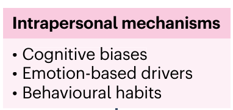
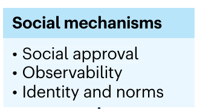
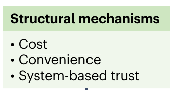

## Behavioural science may have focused too much on individuals

In 2023, the behavioural scientists Nick Chater and George Loewenstein changed their minds:

. . .

"An influential line of thinking in behavioral science, to which the two authors have long subscribed, is that many of society's most pressing problems can be addressed cheaply and effectively at the level of the individual, without modifying the system [...]. We now believe this was a mistake". [@chaterIframeSframeHow2023]

::: {.notes}
Chater & Loewenstein 2023, Behavioral and Brain Sciences 46, e147, p. 1: "The behavioral and brain sciences primarily focus on what we call the i-frame: On individuals, and their thoughts and behaviors. Public policy, by contrast, typically focuses on the s-frame: The system of rules, norms, and institutions usually studied by economists, sociologists, legal scholars, and political scientists."

Chater & Loewenstein 2023, Behavioral and Brain Sciences 46, e147, DOI 10.1017/s0140525x22002023, abstract. Full sentence: "An influential line of thinking in behavioral science, to which the two authors have long subscribed, is that many of society's most pressing problems can be addressed cheaply and effectively at the level of the individual, without modifying the system in which the individual operates. We now believe this was a mistake, along with, we suspect, many colleagues in both the academic and policy communities."

The article appeared as a BBS treatment with 33 open peer commentaries and the authors' response [@chaterWhereNextBehavioral2023].

p. 18: "We have been unwitting accomplices to forces opposed to creating a better society."

On small effects, Chater & Loewenstein 2023, pp. 1–2: "Unlike traditional policies, i-frame interventions don't fundamentally change the rules of the game, but make subtle adjustments to help fallible individuals play the game better."

Chater & Loewenstein 2023, pp. 1–2. On scale they cite DellaVigna & Linos (p. 2): "Although the average impact of nudges reported in academic journals is large – at 8.7% – their analysis yielded a mean impact of just 1.4%." (These are percentage points, DellaVigna & Linos 2022.)

p. 4: "But we now doubt that carbon emissions can be substantially reduced by i-level interventions such as providing small incentives, better (or more transparent) information, more feedback, more awareness of social norms, or greener 'defaults.'"
:::

##

They distinguish two ways of tackling a problem. The **i-frame** ("individual") changes how the players act within the rules of the game. The **s-frame** ("system") changes the rules. [@chaterWhereNextBehavioral2023]

. . .

|  | Climate examples |
|---|---|
| i-frame | energy feedback, smart meters, footprint calculators |
| s-frame | carbon pricing, decarbonised power, green building codes |

[@chaterIframeSframeHow2023, Table 1]{.citation}

::: {.notes}
Chater & Loewenstein 2023, Authors' Response, p. 78: "S-frame interventions involve changing the rules of the game; i-frame interventions attempt to modify the actions of the players, within the existing rules."

Target article, p. 2: "These approaches are not mutually exclusive. For example, the battle against cigarette smoking includes individual and systemic measures" and "the boundary between i- and s-frame policies is not always clear-cut".

Chater & Loewenstein 2023, Table 1, p. 5, "Potential i-frame and s-frame interventions to address public policy problems", climate rows. i-frame examples include social feedback on energy use, smart meters and carbon footprint calculators. s-frame examples include carbon pricing, decarbonising the power sector and green building codes.
:::

##

Footprint calculators appear on the i-frame side of their table. Does this ring a bell from our session on misinformation? Tell your neighbour.

## An oil company popularised the personal carbon footprint

::: {.columns}
::: {.column width="35%"}
![[BP filling station. Photo: Richard Sutcliffe, geograph.org.uk, via Wikimedia Commons]{.citation}](images/bp_station_geograph.jpg){width="100%"}
:::
::: {.column width="65%"}
In the early 2000s, BP and its public relations firm Ogilvy & Mather popularised the term "carbon footprint". In 2004, BP launched a footprint calculator. [@kaufmanCarbonFootprintSham2020]

. . .

In session 9, we met this as "individualism", one of the discourses of climate delay. [@lambDiscoursesClimateDelay2020]
:::
:::

::: {.notes}
Shortened from session 9 (slide "Individualism, made by an oil company").

Kaufman, "The Carbon Footprint Sham", Mashable, 13 July 2020: "British Petroleum, the second largest non-state owned oil company in the world, with 18,700 gas and service stations worldwide, hired the public relations professionals Ogilvy & Mather to promote the slant that climate change is not the fault of an oil giant, but that of individuals. It's here that British Petroleum, or BP, first promoted and soon successfully popularized the term 'carbon footprint' in the early aughts. The company unveiled its 'carbon footprint calculator' in 2004". "In 2004 alone, 278,000 people calculated their footprints." Benjamin Franta, then at Stanford: "This is one of the most successful, deceptive PR campaigns maybe ever."

Lamb et al. 2020, Figure 1: individualism belongs to the family "redirect responsibility" (someone else should take action first).

Supran & Oreskes 2021 [@supranRhetoricFrameAnalysis2021], One Earth, on ExxonMobil, abstract: "they have used rhetoric of climate "risk" and consumer energy "demand" to construct a "Fossil Fuel Savior" (FFS) frame that downplays the reality and seriousness of climate change, normalizes fossil fuel lock-in, and individualizes responsibility."
:::

##

Chater and Loewenstein describe this as a strategy: oil companies "worked to reframe the problem of carbon reduction in i-frame, not s-frame, terms". [@chaterIframeSframeHow2023]

. . .

In their account of a pattern across many policy areas, companies promote the i-frame to the public. At the same time, they work on the rules themselves, "where they know the real leverage lies". [@chaterIframeSframeHow2023]

::: {.notes}
Chater & Loewenstein 2023, p. 4, citing Mann 2021: "Rather than opposing climate science directly, they worked to reframe the problem of carbon reduction in i-frame, not s-frame, terms" and "A key strategy was to promote the personal 'carbon footprint' (Safire, 2008), in part through BP's carbon footprint calculator, which was completed by nearly 300,000 people in 2004 (Solman, 2008)."

Kaufman, Mashable 2020: BP and Ogilvy & Mather, the 2004 calculator, 278,000 users in its first year. Individualism is also one of the discourses of climate delay in Lamb et al. 2020 [@lambDiscoursesClimateDelay2020].

p. 4: "Having a real impact will require systemic transformation on a huge scale", including "a substantial carbon tax alongside extensive regulation".

Chater & Loewenstein 2023, p. 5, step 5 of a pattern they see across domains: corporations cast problems in the i-frame, behavioural scientists engage, i-frame tools are hoped to replace regulation, results disappoint and divert effort, and "(5) Corporations relentlessly target the s-frame, where they know the real leverage lies."

p. 5: "Here, too, an s-frame perspective is appropriate, rather than attributing the problem to the 'greed' or other moral failings of individual executives. They too are working within the incentives and rules of a system".

p. 12: "these problems remain unresolved primarily because of the active and coordinated efforts to block s-frame reform by concentrated commercial interests who benefit from the status quo".
:::

##

Chater and Loewenstein's change of mind is close to a conclusion of our session on misinformation. We concluded that interventions aimed at individuals tend to miss the bigger problems of the media landscape.

. . .

Climate communication, too, often tries to change behaviour one individual at a time. Yet the rules are made, supported and resisted by people.

::: {.notes}
Session 9, statement in Part III: "Individual-level interventions, whether focused on misinformation or strengthening trust, tend to miss bigger-picture issues of today's media landscape."

Today's reading: Fielding & Hornsey 2026, "Understanding and reducing the intention–behaviour gap in climate action", Nature Climate Change [@fieldingUnderstandingReducingIntention2026].
:::

## {.big-center}

::: {.statement}
Today's question: **how far** can climate communication change the behaviour that matters for the climate, and **where** should it aim?
:::

## Overview

We approach it through six smaller questions:

1. Which behaviours matter, and whose?
2. Do intentions become behaviour?
3. How much can communication change behaviour?
4. Do personal measures crowd out support for policy?
5. Do we have to choose between individuals and systems?
6. What can communication do for system change?

# 1. Which behaviours matter, and whose?

##

::: {.exercise}
**Poll** (3 minutes): which **three** would most reduce the emissions of one person in a rich country? Write down three numbers.

::: {.columns}
::: {.column width="50%"}
1. Recycling a lot
2. Buying renewable energy
3. E-car or hybrid
4. LED light bulbs
5. Hang-drying clothes
:::
::: {.column width="50%"}
6. One fewer long flight
7. Not having a car
8. Plant-based diet
9. One fewer child
:::
:::
:::

::: {.notes}
Question from the Ipsos survey "Environmental Perils of Perception" (April 2021, slide 8), with the question and the items shortened [@ipsosEnvironmentalPerilsPerception2021]. Full question: "From this list of options, which three do you think would most reduce the greenhouse gas emissions of an individual living in one of the world's richer countries?" Full wording of the items: "Recycling as much as possible", "Buying energy only from renewable sources (e.g. wind power, hydro-electric)", "Replacing a typical car with an electric car or hybrid", "Replacing traditional incandescent lightbulbs with low energy compact fluorescent (CFL) or LED lightbulbs", "Hang-drying their clothes, instead of using an electric or gas dryer", "Avoiding one long-distance flight (lasting six hours or more)", "Not having a car", "Eating a plant-based diet", "Having one fewer child". Ipsos asked 21,011 online adults aged 16–74 in 30 markets, 19 February to 5 March 2021.
:::

## In 30 countries, recycling was the most common choice

![[@hamptonChoicesClimateAction2023, based on @ipsosEnvironmentalPerilsPerception2021]{.citation}](images/hampton_whitmarsh_2023_fig3_bars.png)

::: {.notes}
Hampton & Whitmarsh 2023, One Earth, Fig. 3 (left part), based on Ipsos 2021, n = 21,011 in 30 countries. Caption: "Survey participants were asked "From this list of options, which three do you think would most reduce the greenhouse gas emissions of an individual living in one of the world's richer countries?" Respondents tend to overestimate the significance of recycling."

Ipsos global shares naming each action among the top three: recycling 59%, renewable energy 49%, electric car or hybrid 41%, LED bulbs 36%, hang-drying 26%, avoiding one long-distance flight 21%, not having a car 17%, plant-based diet 14%, one fewer child 11%. Online panels. Ipsos: 17 of the 30 markets "generate nationally representative samples", Switzerland among them.
:::

## Researchers estimate that recycling saves comparatively little

![[@hamptonChoicesClimateAction2023, based on @ipsosEnvironmentalPerilsPerception2021 and @wynesClimateMitigationGap2017]{.citation}](images/hampton_whitmarsh_2023_fig3_ipsos.png)

::: {.notes}
Hampton & Whitmarsh 2023, Fig. 3, with the actual rank and the tonnes of CO2e saved per year from Wynes & Nicholas 2017: not having a car 2.4, avoiding one long-distance flight 1.6, renewable energy 1.5, electric car or hybrid 1.1, plant-based diet 0.8, recycling 0.2, hang-drying 0.2, light bulbs 0.1, one fewer child 58.6. Ipsos summary (slide 8): "While all actions can make a difference, the most impactful actions are ranked too low, and the least impactful actions ranked too high in the public's estimations of carbon savings."

Wynes & Nicholas 2017: one fewer child has the largest estimate, but it counts the emissions of future descendants.

For rich countries, Wynes and Nicholas recommend living car-free, avoiding long flights and eating plant-based among the high-impact actions. Recycling saves about a quarter as much as a plant-based diet [@wynesClimateMitigationGap2017].

Wynes & Nicholas 2017, Environmental Research Letters, DOI 10.1088/1748-9326/aa7541, abstract: "we consider a broad range of individual lifestyle choices and calculate their potential to reduce greenhouse gas emissions in developed countries, based on 148 scenarios from 39 sources. We recommend four widely applicable high-impact (i.e. low emissions) actions [...]: having one fewer child (an average for developed countries of 58.6 tonnes CO2-equivalent (tCO2e) emission reductions per year), living car-free (2.4 tCO2e saved per year), avoiding airplane travel (1.6 tCO2e saved per roundtrip transatlantic flight) and eating a plant-based diet (0.8 tCO2e saved per year). These actions have much greater potential to reduce emissions than commonly promoted strategies like comprehensive recycling (four times less effective than a plant-based diet) or changing household lightbulbs (eight times less)."

Ipsos footnote: "Emissions saved from having one fewer child is calculated by quantifying future emissions of descendants based on historical rates, based on heredity".

Switzerland: more than half of the Swiss sample put recycling among the three most effective actions, fewer than a fifth a plant-based diet [@ipsosEnvironmentalPerilsPerception2021].

Ipsos 2021, market table (slide 10), column CH: recycling 56%, renewable energy 41%, electric car or hybrid 29%, LED bulbs 31%, hang-drying 29%, avoiding one long-distance flight 29%, not having a car 28%, plant-based diet 17%, one fewer child 15%.

Same survey, slide 24: asked whether a mostly local diet including local meat and dairy or a vegetarian diet with some imported produce would reduce emissions more, 73% of Swiss respondents chose the local diet and 15% the vegetarian one (global: 57% and 20%).
:::

## Other studies also find that people overrate small actions

Swiss participants underrated a sustainable diet and overrated efficient light bulbs. [@colognaKnowledgePerceivedPotential2022]

. . .

A 2026 US study found that people overrate recycling and tend to underrate eating less meat and flying less. [@herberzPsychologicalBarriersImproving2026]

::: {.notes}
Attari et al. 2010, PNAS, abstract: "For a sample of 15 activities, participants underestimated energy use and savings by a factor of 2.8 on average, with small overestimates for low-energy activities and large underestimates for high-energy activities." And: "When asked for the most effective strategy they could implement to conserve energy, most participants mentioned curtailment (e.g., turning off lights, driving less) rather than efficiency improvements". US online survey, n = 505.

Cologna, Berthold & Siegrist 2022, Journal of Environmental Psychology, abstract: "With a sample of N = 547 Swiss participants, we analysed to what extent participants correctly judged the mitigation potential of different behaviours. We found that the mitigation potential of certain behaviours, such as switching to a sustainable diet, was underestimated, while the mitigation potential of other behaviours, such as installing efficient light bulbs, was overestimated. Participants correctly judged reducing car use and avoiding a transatlantic flight to have a strong mitigation potential." Also: "higher levels of objective knowledge positively predicted intentions to engage in high-impact mitigation behaviours and negatively predicted intentions to engage in low-impact mitigation behaviours".

Herberz, Engel, Schneider & Brosch 2026, Nature Sustainability, p. 3: "The mitigation potential of most low- to medium-impact climate actions such as waste recycling and saving paper from printing was on average overestimated. Conversely, the mitigation potential of higher impact climate actions such as limiting (red) meat consumption or reducing plane travels tended to be underestimated". Three preregistered US studies, n = 2,924.

For food, Camilleri et al. 2019 [@camilleriConsumersUnderestimateEmissions2019], abstract: "energy consumption and GHG emission estimates are significantly underestimated for foods".

Attari et al. 2010 [@attariPublicPerceptionsEnergy2010] is the US study quoted above.
:::

##

The same study also asked what people actually do. The actions that many people already take tended to have the smallest impact.

![[@herberzPsychologicalBarriersImproving2026]{.citation}](images/herberz_2026_fig1.png)

::: {.notes}
Herberz et al. 2026, the same US study: the actions that many people already take, such as recycling, tended to have the smallest effect on emissions.

Herberz et al. 2026, Fig. 1: share of participants who engage in each of 34 actions (vertical axis) against its mitigation potential in kgCO2e per capita and year, values adapted from Ivanova et al. 2020. Caption: "The data illustrate the negative relationship between the adoption of climate actions and their mitigation potential (r = −0.51, 95% CI [−0.72; −0.21] [...])". Recycling and reducing food waste are common and low-impact, living car-free and plane-free are rare and high-impact.
:::

## Why do people choose the less effective actions?

::: {.incremental}
- People may judge impact by how easily examples come to mind, and by what they would like to be true. [@herberzPsychologicalBarriersImproving2026]
- Textbooks and official advice may have pointed the same way. [@wynesClimateMitigationGap2017]
- Industry campaigns have put the responsibility on individuals. [@chaterIframeSframeHow2023]
:::

::: {.notes}
Herberz et al. 2026, abstract: "Across three preregistered studies (ntotal = 2,924) we show that low- to medium-impact actions are more frequently adopted than higher-impact actions, and that knowledge about the differential impact of climate actions is limited. Our data suggest that inaccuracies are driven by individuals consistently relying on the availability heuristic and motivated reasoning to form their judgements. [...] Leveraging this insight in two corrective boosting interventions and informing about the most impactful climate actions only partly improved impact estimates, with considerable variations across individuals."
:::

##

Ten Canadian high-school science textbooks rarely mentioned the high-impact actions. Government climate resources from the EU, the USA, Canada and Australia also focused on lower-impact ones. [@wynesClimateMitigationGap2017]

::: {.notes}
Wynes & Nicholas 2017, abstract: "we find that ten high school science textbooks from Canada largely fail to mention these actions (they account for 4% of their recommended actions), instead focusing on incremental changes with much smaller potential emissions reductions. Government resources on climate change from the EU, USA, Canada, and Australia also focus recommendations on lower-impact actions."
:::

##

In their chapter on plastic waste, Chater and Loewenstein describe a US anti-littering campaign, funded by beverage and packaging companies, that told the public: "People start pollution. People can stop it." [@chaterIframeSframeHow2023]

. . .

Chater and Loewenstein cite the US EPA: less than 10% of plastic has been recycled in the last 40 years.

::: {.notes}
Chater and Loewenstein treat plastic waste as another case of the pattern they see behind the carbon footprint (section 2.3, after obesity and retirement savings).

Chater & Loewenstein 2023, p. 8, on the "Crying Indian" advertisement: "People start pollution. People can stop it." "The wider "Keep America Beautiful" campaign (ubiquitous from the 1950s until today), of which the ad was a part, was conceived and funded by beverage and packaging corporations including the American Can Co., Owens-Illinois Glass Co., and later Coca-Cola and Dixie Cup." On recycling: "promoting the myth that large-scale plastic recycling is technically and economically feasible, in order to allay concerns about new plastic. Yet, according to the Environmental Protection Agency (EPA), less than 10% of plastic has been recycled in the last 40 years." An industry partnership slogan (Earth911): "Thousands of individual small changes create a large, positive impact."

Their other cases: obesity, retirement savings, US health care, and more briefly education, discrimination, privacy, misinformation, opioids and guns. Tobacco control is their example of successful s-frame reform.
:::

## Can knowing about impact help?

In the Swiss study from before, people who knew more tended to intend the high-impact actions more, and the low-impact ones less. [@colognaKnowledgePerceivedPotential2022]

. . .

In the US study, telling people which actions matter improved their estimates only partly. [@herberzPsychologicalBarriersImproving2026]

::: {.notes}
Cologna, Berthold & Siegrist 2022, Journal of Environmental Psychology, abstract: "higher levels of objective knowledge positively predicted intentions to engage in high-impact mitigation behaviours and negatively predicted intentions to engage in low-impact mitigation behaviours". N = 547 Swiss participants.

Herberz et al. 2026, abstract: "Leveraging this insight in two corrective boosting interventions and informing about the most impactful climate actions only partly improved impact estimates, with considerable variations across individuals."
:::

##

In a US experiment, explaining which personal actions matter most made people's estimates more accurate and shifted their commitments toward high-impact actions. [@goldwertClimateActionLiteracy2025]

. . .

We will come back to this experiment in section 4.

::: {.notes}
Goldwert, Patel, Nielsen, Goldberg & Vlasceanu 2025, PNAS Nexus, DOI 10.1093/pnasnexus/pgaf191, abstract: "Participants (n = 3,895) were randomly assigned to one of three experimental conditions [...] Both the Prediction and Information interventions led to more accurate efficacy perceptions and increased commitments to engage in higher-impact individual-level actions relative to the Control group. [...] However, we also found evidence for a negative spillover effect from individual to collective actions: participants in the literacy conditions decreased their commitments to collective climate actions such as voting or marching, suggesting an unintended consequence of interventions focusing solely on individual-level actions."

The commitments were stated on a scale from 0 ("definitely not") to 100 ("absolutely yes"). The gain in accuracy was still significant at a one-week follow-up.
:::

## The second half of the question is whose behaviour matters

According to the IPCC, the 10% of households with the highest emissions per person cause 34–45% of global household emissions. The bottom 50% cause 13–15%. [@calvinIPCC2023Climate2023]

. . .

One estimate that also counts the emissions of people's investments finds that the 1% of people with the highest emissions cause 17% of the global total. [@chancelGlobalCarbonInequality2022]

::: {.notes}
IPCC 2023, Synthesis Report: "The 10% of households with the highest per capita emissions contribute 34–45% of global consumption-based household GHG emissions, while the middle 40% contribute 40–53%, and the bottom 50% contribute 13–15%." (high confidence, referring to WGIII SPM B.3.4)

Chancel 2022, Nature Sustainability, DOI 10.1038/s41893-022-00955-z, abstract: "I find that the bottom half of the world population emits 12% of global emissions, while the top 10% emits 48% of the total. The global top 1% share in world emissions rose from 14% in 1990 to 17% in 2019. [...] in 2019, 63% of the global inequality in individual emissions was due to gaps between low and high emitters within countries. Emissions from investments, rather than from consumption, represent the bulk of emissions of the rich: around 70% of global top 1% emissions come from their investments." Chancel ranks individuals by their emissions.

The IPCC counts household consumption. Chancel adds investments.
:::

##

Write down a number: how many times larger is the carbon footprint of the richest 1% in the USA than that of the poorest half?

##

In the USA, the richest 1% emit about 28 times as much as the poorest half. Across the four countries in the study, 93% of participants underestimated this inequality. [@nielsenUnderestimationPersonalCarbon2024]

. . .

Across the four countries, people who underestimated it more tended to support climate policy less. They also tended to find the actual inequality fairer, and so did the participants with high incomes.

::: {.notes}
Nielsen, Bauer, Debnath, Emogor, Geiger, Ghai, Gwozdz & Hahnel 2024, Nature Climate Change, DOI 10.1038/s41558-024-02130-y. The ratio follows from the actual values given in the Methods for the USA: 269.3 tCO2-eq. for the top 1% and 9.7 tCO2-eq. for the bottom 50%.

Abstract: "Here we use an online survey distributed across four diverse countries: Denmark, India, Nigeria and the USA, to show widespread underestimation of carbon footprint inequality, irrespective of participants' country and income segment. Of the 4,003 participants, within each country, 50% of participants were sampled from the top 10% income group."

p. 1137: "Of the participants, 93% had a positive index score, indicating that they underestimated carbon footprint inequality." And: "Participants' own income segment (general population versus top 10% of income within their country) did not explain variance in relative estimation errors". Policy link, p. 1137: "Thus, the more participants underestimated actual carbon footprint inequality, the less they supported climate policies." In separate country models the relationship was significant only in Denmark and Nigeria.

Perceived fairness, p. 1139: "the more participants underestimated carbon footprint inequality, the fairer they perceived the actual inequality", an effect the exploratory country models found only in India. And: "participants from the top 10% income segment perceived the actual carbon footprint inequality as significantly fairer than those from the general population", except in India. Discussion: "Our findings underscore the urgent need to raise awareness about carbon footprint inequality to initiate public debates about its fairness and increase attention to social justice concerns in climate policy."
:::

##

![[@nielsenUnderestimationPersonalCarbon2024, Fig. 1, USA panel]{.citation}](images/nielsen_2024_fig1_usa.png)

::: {.notes}
Fig. 1 of Nielsen et al. 2024, USA panel. Caption: "Each dot represents a participant's estimate of the average carbon footprint (CF) within the respective income group. The red dots show the actual carbon footprint within each income group. The figure only displays carbon footprint estimates within the preregistered 2.5–97.5 percentiles". Boxes show the quartiles and the median. Actual values for the USA (Methods, from the World Inequality Database, including public services and private investments): "bottom 50% (9.7 tCO2-eq.), top 10% (74.7 tCO2-eq.), top 1% (269.3 tCO2-eq.) and country average (21.1 tCO2-eq.)". The other panels of the figure show Denmark, India and Nigeria. Denmark: bottom 50% 6.0, top 10% 29.7, top 1% 93.1 tCO2-eq.

Recruitment (Methods): "Participants were recruited via the market research companies Nielsen (Denmark and Nigeria) and Qualtrics (India and the USA) and received financial compensation." In each country, half of the participants had a personal income in the top 10%. Thresholds: "Denmark (DKK650,000), India (I₹300,000), Nigeria (N₦35,000,000) and the USA (US$130,000)". The top 1% were not sampled separately. All participants estimated the footprints of the three income groups.
:::

## {.big-center}

::: {.statement}
Messages that ask everyone to shrink their own footprint a little may aim at the **wrong behaviours** and at the **wrong people**. Communication could point to the high-impact actions, and to the people who emit the most.
:::

# 2. Do intentions become behaviour?

##

![[Drawing: versusthemachines]{.citation}](images/intention_gap_cartoon_versusthemachines.png){width="75%"}

::: {.notes}
Drawing signed "versusthemachines", as used in Mélusine Boon-Falleur's Sciences Po lecture "Accessibility of sustainable practices".

Fielding & Hornsey 2026, p. 1: "Self-report data indicate strong readiness for climate action. For example, a majority of respondents across 125 countries expressed willingness to contribute 1% of their household income to address climate change. However, the picture is less promising when focusing only on climate-related behaviours."
:::

## Intentions often do not become behaviour

In a German household panel, about one in four planned flood-protection measures had been carried out two to eight years later. For heat protection, it was about one in eight. [@osberghausIntentionbehaviorGapClimate2025]

. . .

These are adaptation measures, but they show how often plans stay plans.

::: {.notes}
Osberghaus, Botzen & Kesternich 2025, Ecological Economics, DOI 10.1016/j.ecolecon.2025.108543. Data: "the final data set contains 5194 households that participated twice or thrice in 2012, 2014 and 2020." Conclusion (p. 11): "share of 24.8 % of all stated intentions in the flood domain and 12.8 % of intentions in the heat domain are implemented after two to eight years." Section 4.1: "between 70.0 and 96.0 % of the intentions having been reported by the survey respondents in earlier waves are not implemented during the survey period". Implementation was itself self-reported in a later wave.

p. 7: "The probability that intentions are realized increases with measure complexity and costs, hence the IBG is lower in these cases." Abstract: "In line with regret theory, the IBG in our data can be partly explained by anticipated regret caused by a feeling of having invested in vain in cases where adaptation measures are installed, but extreme weather events do not occur for the time being."

The reading (p. 1): "less than 25% of householders who intended to implement flood protection measures did so and less than 13% who intended to implement heat reduction measures actually implemented some measure".
:::

##

When choices came with a real cost in money, time or effort, stated willingness to act explained as little as 4% of the differences in behaviour. [@fieldingUnderstandingReducingIntention2026]

::: {.notes}
Fielding & Hornsey 2026, p. 2: "experimental evidence shows that people are less likely to choose a pro-environmental option when the non-environmental option is associated with greater financial benefit, takes less of their time and involves less effort. In these studies, where behavioural trade-offs are made salient, the predictive role of variables reflecting pro-environmental willingness was relatively low (explaining as little as 4% of variance in behaviour)." The reading cites two consequential laboratory tasks for these studies, the carbon emission task (Berger & Wyss 2021) and the work for environmental protection task (Lange & Dewitte 2022).
:::

##

Outside the climate domain, the pattern looks similar. In studies of physical activity, about half of those who intended to be active did not follow through. Almost none of those without the intention became active. [@connerUnderstandingIntentionbehaviorGap2022]

. . .

So the gap comes mainly from people who intend to act and then do not. [@sheeranIntentionBehaviorGap2016]

::: {.notes}
Conner & Norman 2022, p. 8: "Sheeran (2002) noted that in relation to physical activity, 54% of intenders (i.e., those inclined or with positive intentions) failed to act (and 46% did act), while only 3% of non-intenders [...] acted (and 97% failed to act)."

Sheeran & Webb 2016, p. 3: "it is people who intend to change their behavior but do not ('inclined abstainers') who are mainly responsible for the intention-behavior gap".
:::

## How do we know what people actually do?

Many studies ask people to report their own behaviour. Such reports may be biased, for example because people want to look good or misremember. [@fieldingUnderstandingReducingIntention2026]

. . .

Across behaviours in general, intentions accounted for 31% of the differences in self-reported behaviour, but only 20% in objectively measured behaviour. [@connerUnderstandingIntentionbehaviorGap2022]

::: {.notes}
Fielding & Hornsey 2026, p. 1: "many of the studies in these meta-analytic reviews measure behaviour as self-reported recollections of past behaviours, which may be biased." p. 2: "Social desirability is robustly associated with higher pro-environmental intentions".

Conner & Norman 2022, p. 2: "Armitage and Conner (2001) reported that intention and perceived behavioral control explained 31% of the variance in self-reported behaviors, but only 20% of the variance in objective behaviors." These figures combine intentions and perceived behavioural control.
:::

##

Older meta-analyses, which pool the results of many studies, found moderately strong links between intentions and behaviour. Many of those studies asked people to report their own behaviour. [@fieldingUnderstandingReducingIntention2026; @bambergTwentyYearsHines2007]

. . .

Guess: if we know people's intentions, how much of the differences in what they actually do can we account for? 

##

A newer meta-analysis, not yet peer-reviewed, included only studies in which behaviour could be objectively verified, instead of reported by participants. It puts the share at about 5%. [@fieldingUnderstandingReducingIntention2026]

::: {.notes}
Fielding & Hornsey 2026, p. 1: "two meta-analyses (each including more than 50 datasets) suggest that intentions are moderately large predictors of environmentally relevant behaviour, with average correlations ranging from 0.38 to 0.52 (refs. 5,6). However, many of the studies in these meta-analytic reviews measure behaviour as self-reported recollections of past behaviours, which may be biased. A more recent meta-analysis, which drilled down exclusively to studies that quantified the association between intentions and objectively verifiable pro-environmental behaviour, found a relatively small correlation (r = 0.22, k = 224). In other words, self-reported intentions to engage in pro-environmental behaviour explained just 5% of the variance in actual pro-environmental behaviour."

The r = 0.22 meta-analysis is Chapman, McKay, Schultz & Gulliver 2026, a preprint on OSF (osf.io/f4k8j), as cited in the reading.

How the 5% comes about: it is the share of variance explained, the square of the correlation (0.22 × 0.22 ≈ 0.05). Funder & Ozer 2019 [@funderEvaluatingEffectSize2019] warn that squaring a correlation this way makes effects look smaller than they are. They count a correlation of about 0.20 as a medium effect.

Bamberg & Möser 2007, p. 20: "In our meta-analysis, the mean correlation of intention and proenvironmental behaviour is r = .52 (15 studies)". p. 19: "From the 15 retrieved intention–behaviour correlations only two are below .20."

Funder & Ozer 2019, Advances in Methods and Practices in Psychological Science, abstract: "the most common mistakes being to describe them in ways that are uninformative (e.g., using arbitrary standards) or misleading (e.g., squaring effect-size rs)." And: "an effect-size r of .20 indicates a medium effect that is of some explanatory and practical use even in the short run".
:::

##

Even studies that record behaviour may not record the behaviour people stated intentions for. In the control group of a US megastudy, which tests many interventions side by side, 79% said they were likely to commit to flying less and 71% to eating less beef. [@goldwertMegastudyBehavioralInterventions2026]

. . .

Fewer took actions the researchers could observe: 49% donated to environmental organisations and 41% wrote to their representative. These are different behaviours, so the comparison only hints at the gap.

::: {.notes}
Goldwert et al. 2026, PNAS Nexus, DOI 10.1093/pnasnexus/pgaf400, Results p. 5: "At baseline (i.e. in the control condition; n = 1,739), a majority of participants were likely to commit to lifestyle changes such as flying less (79%) or eating less beef (71%) ... Fewer participants, however, engaged in the behavioral outcomes, such as making real donations to environmental organizations (49%), or writing to their representative (41%). Even fewer participants reported joining climate organizations by subscribing to their newsletter (22%), signing petitions (19%), or sharing video information online (16%". The full study had 31,324 participants.
:::

##

Many intervention studies in climate communication measure intentions only. Critics argue that the interventions that raise intentions most need not change behaviour most. [@dablanderExpressingIntentionsNot2025a]

. . .

We will see an example at the start of section 3.

::: {.notes}
Dablander et al. 2025, PNAS letter (DOI 10.1073/pnas.2512457122), replying to Sinclair et al. 2025, an intervention tournament with 7,624 participants that tested 17 interventions. From the preprint version: "rather than measuring actual behavior, the authors measured intentions to share information about climate change and intentions to engage in pro-environmental behaviors." And: "the relative ordering of the effects in their intention-based intervention tournament is unlikely to be the same when targeting actual behavior." And: "A study of almost 16,000 young people found that 52% said they would participate in protests [8], yet our personal experience at protests points to attendance at least a thousand times smaller."

The reading (p. 7): "researchers and practitioners should move beyond treating intentions as a proxy for behaviour".
:::

## Intentions still matter, but less than they promise

In week 4, we saw a survey in 125 countries, where 69% said they would give 1% of their income to fight climate change. [@andreGloballyRepresentativeEvidence2024]

. . .

In a US study, those who said they were willing donated 43% more to a climate charity than those who were not.

. . .

So intentions do go with behaviour, just much less closely than surveys suggest.

::: {.notes}
Andre, Boneva, Chopra & Falk 2024, Nature Climate Change, DOI 10.1038/s41558-024-01925-3. Abstract: "we conducted a representative survey across 125 countries, interviewing nearly 130,000 individuals. [...] 69% of the global population expresses a willingness to contribute 1% of their personal income, 86% endorse pro-climate social norms and 89% demand intensified political action."

p. 254: "respondents who state they would be willing to contribute 1% of their monthly income donate 43% more money to a climate charity (P < 0.001 for a two-sided t-test, N = 1,993; Supplementary Fig. 1) and are 21–39 percentage points more likely to avoid fossil-fuel-based means of transport (car and plane), restrict their meat consumption, use renewable energy or adapt their shopping behaviour". The 43% comes from a separate US sample reported in the same paper (N = 1,993). The behaviours in that comparison were self-reported for the previous 12 months.
:::

##

Across 47 experiments, a medium-to-large change in intentions brought a behaviour change only about half as large. [@webbDoesChangingBehavioral2006]

::: {.notes}
Webb & Sheeran 2006, Psychological Bulletin, DOI 10.1037/0033-2909.132.2.249, abstract: "The present research obtained 47 experimental tests of intention-behavior relations that satisfied these criteria. Meta-analysis showed that a medium-to-large change in intention (d = 0.66) leads to a small-to-medium change in behavior (d = 0.36)."
:::

## Why does the gap arise, and how could it narrow?

The reading traces the gap to three levels: the person, the social context and the structures people live in. [@fieldingUnderstandingReducingIntention2026]

![[@fieldingUnderstandingReducingIntention2026, Fig. 1, top row]{.citation}](images/fielding_hornsey_2026_fig1_levels.png)

::: {.notes}
Fig. 1 of the reading, top row: "Tripartite framework of mechanisms explaining the climate action intention–behaviour gap and proposed strategies to overcome the gap." Intrapersonal: cognitive biases, emotion-based drivers, behavioural habits. Social: social approval, observability, identity and norms. Structural: cost, convenience, system-based trust.
:::

##

::: {.columns}
::: {.column width="40%"}
{width="100%"}

{width="100%"}

{width="100%"}

[@fieldingUnderstandingReducingIntention2026, Fig. 1]{.citation}
:::
::: {.column width="60%"}
::: {.exercise}
**One example per level** (2 minutes, with your neighbour)

For each level, think of a climate-friendly action that someone intends but does not carry out. What gets in the way?
:::
:::
:::

##

We form intentions in the abstract ("I should use the car less") and act facing concrete costs ("I'm running late, and it's raining"). [@fieldingUnderstandingReducingIntention2026]

. . .

For driving and cycling, intentions predicted behaviour only when the habit was weak.

::: {.notes}
Fielding & Hornsey 2026, p. 2: "It may be that people are 'cool' and far-sighted when they express their intentions, but when engaging in behaviour they are influenced by the 'hot' emotional system, which sensitizes them to its short-term costs (for example, time, money and effort)." And: "distant intentions might be thought of in abstract terms ('I should use the car less because I care about the planet'), whereas near-term behaviours are evaluated concretely, with everything that implies in terms of costs and obstacles (for example, 'I'm running late, and it's raining')."

On habits, p. 2: "car-use and bicycle-use intentions predict behaviour when these behaviours are weakly habitual, but not when the behaviours are moderately or strongly habitual". Ouellette & Wood 1998 [@ouelletteHabitIntentionEveryday1998], abstract: "Well-practiced behaviors in constant contexts recur because the processing that initiates and controls their performance becomes automatic."
:::

##

People seem to follow through more often when others can see what they do. [@fieldingUnderstandingReducingIntention2026]

. . .

Friends may draw someone to a climate protest, but the disapproval of family and colleagues can keep them at home.

::: {.notes}
Fielding & Hornsey 2026, p. 3: "people may be more likely to act in line with their climate action intentions if they know they are visible to others. For example, people were especially likely to choose green consumer products over more luxurious non-green products when their decisions were visible to others". p. 2: "Social desirability is robustly associated with higher pro-environmental intentions".

On norms, p. 3: "Behaviour can be undermined, though, when norms are in conflict". And: "Climate activism is a behaviour where negative injunctive (most people don't approve of it) and descriptive norms (most people don't engage in it) might lead to a particularly large intention–behaviour gap. For example, an individual might be carried away by their friends' enthusiasm for attending a climate protest but then balk at attending when they think more deeply about their family's and colleagues' disapproval."
:::

##

Where people lack control over a behaviour, intentions predict it weakly. A tenant cannot replace the heating system, and someone who means to take the bus may not if buses are unreliable. [@fieldingUnderstandingReducingIntention2026]

::: {.notes}
Fielding & Hornsey 2026, p. 3: "the intention–behaviour relationship depends on the extent to which behaviour is within people's control; if there is low control, then a weak intention–behaviour relationship is expected." And: "Or they may be a renter who has no control over the household energy infrastructure. They might find that an electric vehicle is out of their price range and decide to take more public transport, but if public transport is unreliable and inconvenient, they are unlikely to use it."

p. 6: "behaviours such as switching to public transport may be highly intention-sensitive in urban middle-income settings but far less feasible in rural or low-income contexts where infrastructure is lacking."
:::

##

::: {.exercise}
**Your own gap** (2 minutes, with your neighbour)

Name one climate-related thing you meant to do in the past year and did not. Which level explains most of it: you, the people around you, or the structures you live in?

Then hands up by level.
:::

##

"[A] person may intend to cycle more often, but without bike lanes or safe routes, the habitual car commute remains dominant, illustrating how habits and infrastructure co-produce behavioural inertia." [@fieldingUnderstandingReducingIntention2026]

. . .

The levels seem to work together, so a fix at one level may fail if another level blocks it.

::: {.notes}
Fielding & Hornsey 2026, p. 6. The paragraph continues: "Ultimately, closing the intention–behaviour gap will require more than isolated fixes. It demands an appreciation of how personal motives, social relationships and structural conditions co-produce behaviour and how interventions at one level may succeed or fail depending on how well they interact with the others."
:::

## The reading lists interventions for each level

![[@fieldingUnderstandingReducingIntention2026]{.citation}](images/fielding_hornsey_2026_fig1.png)

::: {.notes}
Fig. 1 of the reading: "Tripartite framework of mechanisms explaining the climate action intention–behaviour gap and proposed strategies to overcome the gap."

Each column lists interventions underneath the mechanisms.
:::

## {.big-center}

::: {.statement}
Intentions tend to predict observed behaviour only **weakly**. What gets in the way lies in the **person**, the **social context** and the **structures** people live in.
:::

::: {.notes}
The reading sets one question aside on purpose, p. 1: "We therefore do not discuss factors that reduce intentions in the first place (for example, because of low climate awareness or because individuals may reasonably perceive that private-sphere behaviour has limited direct impact on aggregate emissions)."
:::

# 3. How much can communication change behaviour?

## Many behavioural interventions are communication

Many tools in this field send people a message: information, appeals, feedback on their own behaviour, reminders, or what other people do. [@bergquistFieldInterventionsClimate2023]

. . .

Others change the choice itself, for example its default option or its price. This section asks how much each changes behaviour, starting with messages. [@mertensEffectivenessNudgingMetaanalysis2022]

::: {.notes}
Bergquist et al. 2023, p. 1, the interventions in their second-order meta-analysis: "voluntary change measures such as information, education, prompts, feedback, financial incentives, social influence approaches, and nudging techniques applied in real-world settings".

Mertens et al. 2022, abstract, three kinds of choice architecture: "interventions that target the organization and structure of choice alternatives (decision structure) consistently outperform interventions that focus on the description of alternatives (decision information) or the reinforcement of behavioral intentions (decision assistance)."
:::

## In the week 4 megastudy, no intervention raised tree planting

In the megastudy from week 4, people in 63 countries could plant real trees by doing a tedious online task. [@vlasceanuAddressingClimateChange2024]

. . .

Interventions that strengthened beliefs or policy support did not increase this effortful behaviour, as the critics of intention-only studies warned.

. . .

The interventions that reduced tree planting took longest to complete. Once the authors accounted for length, several interventions increased it.

::: {.notes}
Vlasceanu et al. 2024, Science Advances, abstract: "Across 59,440 participants from 63 countries, the interventions' effectiveness was small, largely limited to nonclimate skeptics, and differed across outcomes: Beliefs were strengthened mostly by decreasing psychological distance (by 2.3%), policy support by writing a letter to a future-generation member (2.6%), information sharing by negative emotion induction (12.1%), and no intervention increased the more effortful behavior—several interventions even reduced tree planting."

On tree planting, pp. 4–5: "The interventions that produced negative effects on the WEPT were also those that took the most time to complete" and "when controlling for intervention length, binding moral foundations, scientific consensus, dynamic norms, pluralistic ignorance, and system justification all increased the number of trees planted compared to the control condition." Discussion: "no group was able to accurately predict how interventions would affect behavior."
:::

##

![[@vlasceanuAddressingClimateChange2024, Fig. 2, panel D]{.citation}](images/vlasceanu_2024_fig2_trees.png)

::: {.notes}
Vlasceanu et al. 2024, Fig. 2, panel D with the legend: effect of each of the eleven interventions on the number of trees planted in the effortful task. The dashed line marks the control condition. Dots are means, bars are 94% credible intervals. The other panels of the figure show belief, policy support and willingness to share.
:::

##

::: {.columns}
::: {.column width="70%"}
::: {.exercise}
**Tournament data** (6 minutes, in pairs)

Open the explorer, tab "Explore the Data", and pick a country.

Pick any outcome except tree planting. Write down the top intervention and how many people it is based on. Then switch to tree planting: does it still come first?
:::
:::
::: {.column width="30%"}
{width="100%"}

[[climate-interventions.shinyapps.io](https://climate-interventions.shinyapps.io/climate-interventions/)]{.citation}
:::
:::

::: {.notes}
Vlasceanu et al. 2024, p. 5: "For further assessing the average effects of each intervention on each outcome within any subsample of interest varying along demographics such as nationality, political ideology, age, gender, education, or income level, we provide an easy to use and disseminate web tool". It reports the "percentage of change compared to the control condition", and users "must take into account the sample sizes when exploring subsamples" (p. 7).
:::

##

Hands up if your intervention lost first place when you switched to tree planting. Was your winner based on only a few people?

. . .

The authors suggest that local results can inform local strategies, "which should then be empirically validated". [@vlasceanuAddressingClimateChange2024]

::: {.notes}
Vlasceanu et al. 2024, p. 7: "for highly educated conservatives in the United States, the top intervention to increase climate policy support was the future self-continuity intervention, increasing support by 18%. ... The scientific consensus intervention increased climate policy support by 9% in Romania but decreased it by 5% in Canada." And: "These results can inform the development of local intervention strategies, which should then be empirically validated".
:::

##

This may help explain the tree-planting result. Across 15 megastudies, interventions worked best when they were designed for the exact outcome being measured. None of the other 18 features tested reliably predicted success. [@patelFeaturesSuccessfulBehavioral2026]

::: {.notes}
Patel, Goldwert, Constantino & Vlasceanu 2026, Current Research in Behavioral Sciences, abstract: "Here, we empirically examine the impact of 19 intervention features ... on the effectiveness of 274 psychological interventions extracted from 15 megastudies that included N =4.13 million participants. We find that only one feature - the interventions' specificity to the outcomes measured - significantly and consistently predicts effectiveness, highlighting the importance of tailoring interventions to outcomes of interest."
:::

## Interventions aimed at individuals tend to have small effects

In week 4, we saw that neighbour comparisons in home energy reports cut energy use by about 2%. [@allcottSocialNormsEnergy2011]

. . .

Across field studies, effects were small on average, and smaller still in the largest trials. [@bergquistFieldInterventionsClimate2023]

::: {.notes}
Allcott 2011, Journal of Public Economics, abstract: "I estimate that the average program reduces energy consumption by 2.0%" and "the effect is equivalent to that of a short-run electricity price increase of 11 to 20%".

Bergquist, Thiel, Goldberg & van der Linden 2023, PNAS, DOI 10.1073/pnas.2214851120, abstract: "In a preregistered second-order meta-analysis, we assess the overall effect of 10 meta-analyses, incorporating a total of 430 primary studies. [...] Results showed that climate change mitigation interventions were generally effective (dunadjusted = 0.31, 95% CI [0.30, 0.32]). A follow-up analysis using only unique primary studies, adjusted for publication bias, provides a more conservative overall estimate (d = 0.18, 95% CI [0.13, 0.24]). This translates into a mean treatment effect of 7 percentage points. Furthermore, in a subsample of adequately powered large-scale interventions (n > 9,000, k = 32), the effect was adjusted downward to approximately 2 percentage points." How the conversion works (Results, p. 3): "an effect size of d = 0.31 indicates that approximately 62% of the treatment group is above the mean of the control group. In other words, climate change mitigation behavior was approximately 12 percentage points higher".

Scope (p. 1): "we excluded traditional nonvoluntary policy tools (e.g., targeting infrastructure and procedural barriers to change ...) while including voluntary change measures such as information, education, prompts, feedback, financial incentives, social influence approaches, and nudging techniques applied in real-world settings".
:::

##

In week 4, we saw that social comparisons and financial incentives had the largest effects in field studies, and education and feedback the smallest. [@bergquistFieldInterventionsClimate2023]

. . .

Studies with weak results are less likely to be published. After correcting for this publication bias, the ranking becomes much less clear.

::: {.notes}
Bergquist et al. 2023, Results: "The largest effects were found for interventions using social comparison (d = 0.37, [0.35, 0.39]) and financial incentives (d = 0.32, [0.30, 0.34]). Appeals (d = 0.28†) and commitment interventions (d = 0.27, [0.26, 0.28]) showed somewhat smaller effects. The smallest effects were found for interventions using feedback (d = 0.16, [0.15, 0.17]) or education (d = 0.09, [0.08, 0.10])."

After correction (Discussion, p. 5): "After adjusting for publication bias using selection models and WAAP, we found the following respective corrected effect sizes for appeal (d = N/A, d = 0.39), commitment (d = 0.14, d = 0.13), education (d = 0.43, d = 0.06), feedback (d = 0.14, d = 0.06), financial incentives (d = 0.34, d = 0.14), and social comparisons (d = 0.12, d = 0.06)."

Financial incentives count in this paper as voluntary, individual-level tools.

Across 10 meta-analyses of field studies. Bergquist et al. 2023, Discussion: "Knowledge, such as basic problem awareness, is likely a necessary but insufficient condition for behavioral change."
:::

## The easiest behaviours to change tend to matter least

This echoes section 1. Interventions moved littering by far the most, and transport, where several high-impact actions lie, the least. [@bergquistFieldInterventionsClimate2023]

. . .

In randomised trials, "critical actions such as the purchase of energy-efficient appliances and private car use were barely affected". [@nisaMetaanalysisRandomisedControlled2019]

::: {.notes}
Bergquist et al. 2023, Results p. 4: "Interventions targeting littering showed by far the strongest effects (d = 0.522). Interventions to promote recycling (d = 0.27, [0.24, 0.31]), conservation (d = 0.25, [0.24, 0.27]), and consumption behaviors (d = 0.20, [0.18, 0.22]) were less effective but still statistically significant. Compared with the other types of proenvironmental behaviors, interventions targeting transportation behaviors showed the smallest effects (d = 0.08, [0.06, 0.09])."

Nisa, Bélanger, Schumpe & Faller 2019, Nature Communications, DOI 10.1038/s41467-019-12457-2, Introduction, p. 2: "critical actions such as the purchase of energy-efficient appliances and private car use were barely affected by the behavioural interventions examined." On car use, p. 5: "Isolating the impact for decreasing private car use substantially reduces the POB to 2.5% with an effect size close to zero (d = −0.036 95% CI −0.039, −0.034)."
:::

##

Across 83 randomised trials, behavioural interventions had a very small effect while they lasted, and no clear lasting effect. [@nisaMetaanalysisRandomisedControlled2019]

. . .

A 2026 reanalysis of the same trials, correcting for publication bias, concludes that the average effect of interventions without incentives is most likely zero. [@hardakerNoEvidenceThat2026]

::: {.notes}
Nisa et al. 2019, abstract: "Here we show that behavioural interventions promote climate change mitigation to a very small degree while the intervention lasts (d = −0.093 95% CI −0.160, −0.055), with no evidence of sustained positive effects once the intervention ends." Negative d means a beneficial effect in their coding. "We present a meta-analysis of randomised controlled trials comprising 3,092,678 observations". "The final sample according to our inclusion criteria comprised 83 studies, providing a total of 144 estimates."

Large samples or no self-selection, p. 4: "results show smaller average impacts (respectively, d = −0.040 [...] and d = −0.028 [...]). This adjustment estimates the aggregate POB between 2% and 3%." POB is the probability of benefit, "the probability that the intervention will promote climate change mitigation behaviours in the experimental group, by comparison to the control no-intervention group."

Persistence, p. 5: "15 studies reported 21 estimates which measured if any lasting changes could be identified. There is no evidence of a durable positive impact (d = −0.13 95% CI −0.42, 0.28). The follow-up period was on average 21 weeks (SD = 23.2 weeks) with a median of 6.5 weeks."

Abstract: "Our results do not imply behavioural interventions are less effective than alternative strategies such as financial incentives or regulations, nor exclude the possibility that behavioural interventions could have stronger effects when used in combination with alternative strategies."

Hardaker et al. 2026 count "144 effect estimates (91 studies) compiled by Nisa et al. (2019)". Nisa et al. report 83 studies in their final sample.
:::

##

![[@hardakerNoEvidenceThat2026]{.citation}](images/hardaker_2026_fig1_crop.png)

::: {.notes}
Fig. 1 of Hardaker et al. 2026: publication bias-adjusted (RoBMA) estimates for the Nisa et al. data, overall and for subgroups, with Bayes factors. Negative values mean a beneficial effect.

The same trials have been reanalysed with different answers, see van der Linden & Goldberg 2020 [@vanderlindenAlternativeMetaanalysisBehavioral2020] below. Hardaker et al. 2026, Fig. 1, cropped to the overall rows, the two target groups and the behaviour domains, without the numeric column.

van der Linden & Goldberg 2020, Nature Communications, abstract: "we find that the average effect-size of behavioral interventions is at least twice as large as initially reported." Hardaker et al. give the number: "d = −0.204".

Hardaker, Asanov, Bartoš & Bruns 2026, PNAS Nexus, DOI 10.1093/pnasnexus/pgag150, abstract: "We applied robust Bayesian meta-analysis (RoBMA), averaging across a full set of publication bias–adjusted models, to the 144 effect estimates (91 studies) compiled by Nisa et al. (2019). After accounting for publication bias and model uncertainty using multilevel RoBMA, the data strongly favor a zero average effect. The posterior probability that the meta-analytic mean equals zero is 0.984, and the Bayes factor comparing a zero mean to a nonzero mean is BF01 = 63.5." And: "There is evidence for small between-study heterogeneity, indicating that some specific interventions might have an effect. These results suggest that, on average, behavioral interventions without incentives on households and individuals are unlikely to deliver material climate benefits."

Their robustness check with selection models only "shows neither evidence for the absence of an average effect nor for its presence (BF01 = 0.776)".

Their conclusion: "Shifting climate policy focus toward incentives on the individual level and beyond, combined with an understanding of structural constraints, seems more promising than standalone behavioral interventions on citizens."
:::

##

Some specific interventions may still work. An earlier reanalysis of the same data had reached a larger estimate, so the answer depends partly on the method. [@vanderlindenAlternativeMetaanalysisBehavioral2020]

##

Nudges change how a choice is presented, for example which option is the default. A meta-analysis of nudges found a small-to-medium average effect. [@mertensEffectivenessNudgingMetaanalysis2022]

. . .

Corrected for publication bias, the estimates shrank, in some analyses to about zero. Depending on the method, critics found a small average effect or no clear evidence of one. [@maierNoEvidenceNudging2022; @szasziNoReasonExpect2022]

. . .

At scale, US government nudge units found clear effects, about a sixth of the size reported in journals, across many policy areas. [@dellavignaRCTsScaleComprehensive2022]

::: {.notes}
Mertens, Herberz, Hahnel & Brosch 2022, PNAS, abstract: "Drawing on more than 200 studies reporting over 440 effect sizes (n = 2,148,439) ... Our results show that choice architecture interventions overall promote behavior change with a small to medium effect size of Cohen's d = 0.43 (95% CI [0.38, 0.48])." Also: "interventions that target the organization and structure of choice alternatives (decision structure) consistently outperform interventions that focus on the description of alternatives (decision information) or the reinforcement of behavioral intentions (decision assistance)."

Maier et al. 2022, PNAS letter: "We propose their finding of "moderate publication bias" (p. 1) is the real headline; when this publication bias is appropriately corrected for, no evidence for the effectiveness of nudges remains (Fig. 1)." Environment domain after correction: "0.01 [−0.18, 0.25]". Their hedge: "all intervention categories and domains apart from "finance" show evidence for heterogeneity, which implies that some nudges might be effective".

DellaVigna & Linos 2022, Econometrica, DOI 10.3982/ecta18709, abstract: "We assemble a unique data set of 126 RCTs covering 23 million individuals, including all trials run by two of the largest Nudge Units in the United States." "In the Academic Journals papers, the average impact of a nudge is very large—an 8.7 percentage point take‐up effect, which is a 33.4% increase over the average control. In the Nudge Units sample, the average impact is still sizable and highly statistically significant, but smaller at 1.4 percentage points, an 8.0% increase." "selective publication in the Academic Journals sample, exacerbated by low statistical power, explains about 70 percent of the difference in effect sizes between the two samples." The trials cover many policy areas.

Szaszi et al. 2022, PNAS letter on the same meta-analysis: "After adjusting for a hypothesized severe to moderate degree of publication bias, their adjusted estimated average effect of nudges is between d = 0.08 (severe) and d = 0.31 (moderate)." And: "Until then, with a few exceptions [e.g., defaults (6)], we see no reason to expect large and consistent effects when designing nudge experiments or running interventions."

Mertens et al. 2022, reply [@mertensReplyMaierSzaszi2022]: "We agree that the publication bias observed in the current choice architecture literature is problematic."
:::

## Defaults change the structure of a choice and can work well

In a German study, making green electricity the default raised its uptake nearly tenfold. [@ebelingDomesticUptakeGreen2015]

. . .

A provider or a regulator sets the default. The customer only decides whether to opt out.

. . .

Across many studies, defaults had a sizeable average effect, but they tended to work less well in environmental domains. [@jachimowiczWhenWhyDefaults2019]

::: {.notes}
Ebeling & Lotz 2015, Nature Climate Change, abstract: "Setting the default choice to more expensive 'green' energy (that is, where consumers have to actively opt out if they do not want it) increased purchases of such nearly tenfold." Also: "county-level political preference for the green party uniquely predicted behaviour in the absence of the nudge, suggesting that default setting potentially overrules motivational aspects of green energy purchases."

Kaiser, Bernauer, Sunstein & Reisch 2020 [@kaiserPowerGreenDefaults2020], Ecological Economics, abstract: "We show that in Germany, green defaults, automatically enrolling customers in renewable energy sources, tend to stick, especially but not only among those who are concerned about the problem of climate change. This finding, based on real-world rather than experimental evidence, attests to the power of automatic enrollment".

Mertens et al. 2022: interventions on decision structure "consistently outperform" those on decision information.

Jachimowicz, Duncan, Weber & Johnson 2019, Behavioural Public Policy, abstract: "While our analysis reveals a considerable influence of defaults (d = 0.68, 95% confidence interval = 0.53–0.83), we also discover substantial variation: the majority of default studies find positive effects, but several do not find a significant effect, and two even demonstrate negative effects." And: "we find that defaults in consumer domains are more effective and in environmental domains are less effective."
:::

## Even a lasting green default may barely cut emissions

In a Swiss field study, about 80% of customers kept a green electricity default for at least four years. [@liebeLargePersistentEffects2021]

. . .

Chater and Loewenstein argue that emissions may barely change, because the default does not immediately produce new green power. Existing green electricity is only assigned to different customers. [@chaterIframeSframeHow2023]

::: {.notes}
Liebe, Gewinner & Diekmann 2021, Nature Human Behaviour, DOI 10.1038/s41562-021-01070-3, abstract: "presenting renewable energy to existing customers as the standard option led to around 80% of the household and business sector customers staying with the green default, and the effects were largely stable over a time span of at least four years."

Chater & Loewenstein 2023, p. 3: "the ultimate impact is likely to be slight. The energy system does not respond by instantaneously producing more green energy for newly defaulted consumers. Rather, existing green energy is reallocated, with no direct impact on the energy mix." p. 2: "the boundary between i- and s-frame policies is not always clear-cut".
:::

##

With your neighbour: is a green default i-frame or s-frame? Then hands up for each.

## {.big-center}

::: {.statement}
Messages that inform people or give them feedback tend to change behaviour only **a little**, possibly not at all. Changing the **structure** of a choice seems to move behaviour more, but it may cut fewer emissions than the uptake suggests.
:::

[@bergquistFieldInterventionsClimate2023; @mertensEffectivenessNudgingMetaanalysis2022; @chaterIframeSframeHow2023]

::: {.notes}
Bergquist et al. 2023, Discussion: "Knowledge, such as basic problem awareness, is likely a necessary but insufficient condition for behavioral change."

Khanna et al. 2021 [@khannaMulticountryMetaanalysisRole2021], Nature Energy, abstract, on household energy trials: "We identify 122 studies and extract 360 effect sizes representing trials on 1.2 million households in 25 countries. We find that all the studied interventions reduce energy consumption of households. Our meta-regression evidences that monetary incentives are on an average more effective than behavioral interventions, but deploying the right combinations of interventions together can increase overall effectiveness."
:::

## Most research on closing the gap targets the person

Most of the intervention research the reading reviews targets the person, and the effects of its tools, from concrete plans to green defaults, tend to be "small to medium". [@fieldingUnderstandingReducingIntention2026]

. . .

In Chater and Loewenstein's terms, many of these tools, such as concrete plans, feedback and green defaults, belong to the i-frame. They had a second worry about such tools.

::: {.notes}
Tables 1–3 of the reading. Examples with the effect sizes as the reading reports them: implementation intentions ("On Monday night we eat vegetarian"), d = 0.47 (meta-analysis of experiments on pro-environmental behaviour), green defaults, d = 0.62 "across behavioural domains (health, food, environment, finance, prosocial and other)", financial incentives, d = 0.32 (second-order meta-analysis of field studies), social comparative feedback in RCTs, d = 0.08. Table notes: "Effect sizes can be interpreted as small at 0.2, medium at 0.5 and large at 0.8."

p. 3: "We did not find climate-related meta-analyses or studies focused on testing interventions to close the intention–behaviour gap". p. 4: "In general, past research suggests that the interventions have small to medium effects on environmentally related behavioural outcomes." p. 4: "Of the three levels of analysis described in this paper, the majority of intervention research has focused on the intrapersonal level."

p. 6: bundling costs and lifetime cost framing "do not alter the financial reality of climate-friendly options". Inconvenience "typically requires infrastructural, regulatory and planning interventions".

p. 7: "Advancing climate action will require coordinated efforts that reduce behavioural costs, reshape social environments and support individuals in acting on their existing motivations, rather than assuming that motivation alone is the primary missing ingredient."
:::

# 4. Do personal measures crowd out support for policy?

## Chater and Loewenstein had a second concern beyond small effects

Small effects are one reason they changed their minds. They add: "There is a deeper concern: i-frame interventions may draw attention and support from crucial s-frame changes." [@chaterIframeSframeHow2023]

. . .

This is called crowding out: taking small personal steps might make people less willing to support bigger policies.

::: {.notes}
Chater & Loewenstein 2023, abstract: "Results from such interventions have been disappointingly modest. But more importantly, ..."

Chater & Loewenstein 2023, p. 3. They list several reasons why this might happen: people tend to represent a problem in a single frame, responsibility seems divisible, a "single-action bias", the fundamental attribution error, and direct experimental evidence.

Three further channels beyond public opinion (pp. 3–4): the time and money of policy makers, research funding, and evidence standards. On the last: "this gold standard itself pushes toward i-frame interventions [...] and away from s-frame interventions where it is rarely possible to change the 'system' for some subset of the population".
:::

##

In hypothetical choices, 70% of US participants supported a carbon tax when it was the only option. [@hagmannNudgingOutSupport2019]

. . .

What if a green energy default was also on offer? Hands up: up, down or the same?

. . .

Support for the tax fell to 55%.

::: {.notes}
Hagmann, Ho & Loewenstein 2019, Nature Climate Change, DOI 10.1038/s41558-019-0474-0, p. 484: "In Study 1A, support for carbon tax is high when participants can only implement the tax (70.30%)." p. 485: "or both policies (55.00%, Δmean (M) = 0.15, 95% confidence interval (CI) (0.02, 0.29) [...] P = 0.025)." Study 1A had 201 participants. Proposed mechanism (abstract): "nudges decrease support for substantive policies by providing false hope that problems can be tackled without imposing considerable costs."

Study 3B asked 641 alumni of a public policy school, more than half of whom had held a position in which they influenced public policy. They "believed the carbon tax to be less effective than the green energy nudge" (p. 486).

Werfel 2017 [@werfelHouseholdBehaviourCrowds2017], abstract: "Subjects who were randomly assigned to report their energy-saving actions following the shutdown of the Fukushima power plant were less likely to support a tax increase on carbon emissions. Treatment effects were larger for subjects who had completed more actions."
:::

##

![[@hagmannNudgingOutSupport2019]{.citation}](images/hagmann2019_fig1_crop.png)

::: {.notes}
Fig. 1 of Hagmann et al. 2019, "Introducing a green energy nudge reduces support for a carbon tax": support for the carbon tax when it is the only option and when the nudge is also offered, Studies 1A and 1B.

Vertical axis: percentage of participants that support a carbon tax.
:::

##

When the authors repeated the first study, support dropped less, and the drop could have been due to chance. [@hagmannNudgingOutSupport2019]

::: {.notes}
Hagmann et al. 2019, Study 1B (n = 800), a "direct replication of Study 1A": "71.86% support implementing the tax, whereas only 63.37% do when the nudge is introduced (ΔM = 0.08, 95% CI (−0.01, 0.18), t(397.85) = 1.82, P = 0.069)". Their internal meta-analysis of the environmental studies: "d+ = 0.30, 95% CI = (0.22, 0.37)". p. 488: "The six studies presented respondents with hypothetical decisions and elicited their support for policies using subjective measures."

Order of presentation, Study 4: 70% supported the tax when they read about it before the green default, and 60% when they read about it after, "only statistically significant at the 10%-level" (p. 487).
:::

##

The US experiment from section 1 found a related effect. Explaining which personal actions matter most slightly lowered people's commitment to collective actions such as voting or marching. [@goldwertClimateActionLiteracy2025]

::: {.notes}
Goldwert et al. 2025, abstract: "we also found evidence for a negative spillover effect from individual to collective actions: participants in the literacy conditions decreased their commitments to collective climate actions such as voting or marching, suggesting an unintended consequence of interventions focusing solely on individual-level actions."

Size: change in commitment to the five collective actions from pretest to posttest, on a 0–100 scale. "participants in the Information condition (M = −2.09, SD = 0.08) and Prediction condition (M = −2.65, SD = 0.08) significantly decreased their commitments to engaging in collective action compared with the control condition (M = −0.88, SD = 0.06)." This was a preregistered hypothesis. Commitments are stated, not observed behaviour. The mediation through perceived efficacy "was not significant at follow-up".

Their caveat: "our study did not provide participants with explicit information on the carbon mitigation efficacy of collective actions (e.g. voting, protesting) [...] Thus, it is possible that if participants had been presented with data on the relative effectiveness of collective engagement, the observed negative spillover could have been mitigated or reversed."

Castro Santa, Drews & van den Bergh 2024 [@castrosantaBehavioralSpilloversGreen2024], Frontiers in Behavioral Economics, abstract: "Using an experiment among US citizens (N = 1,985), we show that spillovers from green purchases differ significantly between pro-environmental behaviors. In particular we find that spillovers are positive for green consumption and negative for climate policy support." And: "pro-environmental identity, previously suggested in the literature as a central moderator of spillover effects from green purchases, appears to be less determinant."
:::

## Other studies find little evidence of crowding out

An Australian panel that followed the same people from 2021 to 2024 found little evidence of crowding out. [@ghasemiPersonalClimateActions2026]

. . .

Across experiments that first encouraged one green behaviour and then measured support for climate policy, that support barely changed on average. [@makiMetaanalysisProenvironmentalBehaviour2019]

::: {.notes}
Ghasemi et al. 2026, npj Climate Action, abstract: "four annual waves of longitudinal survey data from Australia (2021–2024; N = 2778)" and "Random-intercept cross-lagged panel models provided little evidence of systematic spillover across years [...] Overall, the findings challenged the crowding-out effect and suggested that increases in individual action do not undermine broader forms of climate engagement." The authors note that their samples "were not sufficient to reliably detect smaller effects of |β| ≤ 0.10".

Ghasemi et al. 2025, Behavioural Public Policy, two experiments in Iran and Australia: "These findings challenge the crowding-out hypothesis, suggesting that exposure to individual solutions does not diminish support for systemic policies or structural reforms."

Lacroix et al. 2022 [@lacroixDoesPersonalClimate2022], Energy Research & Social Science: "increasing the salience of past personal behavior does not spillover to collective behavioral intentions but does increase support for a carbon tax on companies."

Crowding out found: Goldwert et al. 2025 (commitment to voting and marching), and Knook, Dorner & Stahlmann-Brown 2022 [@knookPrimingIndividualEnergy2022], New Zealand farmers: "The results show a crowding-out effect between individual mitigation measures and support for national policy. Individuals with high levels of worry show a stronger crowding out effect."

Ghasemi et al. 2026: "Thus, the evidence remains mixed regarding the effects of individual pro-environmental actions, on subsequent behaviours, support for collective efforts, and broader climate policies."

Ghasemi et al. 2025 [@ghasemiExposureIndividualClimate2025] is the pair of experiments in Iran and Australia quoted above.

Maki et al. 2019, Nature Sustainability, abstract: "the spillover effect was negative and small for actual behaviour (d+ = −0.03) and policy support (d+ = −0.01) for PEB2."

Geiger et al. 2021 [@geigerMoreGreenGray2021], Journal of Environmental Psychology, a Bayesian update with more studies, on behaviour (abstract): "A three-level Bayesian meta-analysis provided weak support for no spillover on intentions and strong support for no spillover on behaviors."

Chater & Loewenstein 2023, Authors' Response, p. 79: they are "certainly not claiming that crowd-out is one of the most important causes of lack of progress on climate change".

Kukowski et al. 2023 [@kukowskiPerceivedFeasibilityBehavior2023], survey evidence pointing the same way: Abstract (preprint version): "In a pre-registered international survey with mostly North American and European participants (n = 7,349) [...] Our findings underscore the untapped potential of individual behavior change to accelerate climate change mitigation, demonstrating considerable plasticity in several high-impact behaviors and that individual behavior change need not preclude support for political change."
:::

## How might crowding out be avoided?

When participants also learned how little the green default cuts emissions, 72% supported the carbon tax. [@hagmannNudgingOutSupport2019]

. . .

The authors of the US experiment recommend that interventions on personal actions also mention collective ones. [@goldwertClimateActionLiteracy2025]

::: {.notes}
Hagmann et al. 2019, Study 4: presenting the nudge first lowered support from 70% to 60%, "only statistically significant at the 10%-level" (p. 487). "Presenting the nudge and its relative ineffectiveness first, however, increases support for the tax significantly (72%, ΔM = −0.11, 95% CI (−0.21, −0.01), [...] P = 0.024)" and "although adding information about the impact of the nudge does affect support for the tax, it does not affect support for the nudge". p. 488: "Our last study suggests that we may be able to avoid this cost by informing the public that nudges are not a substitute for more substantive policies".

Goldwert et al. 2025, Discussion: "we recommend that climate communicators, policy makers, and other practitioners not omit collective-level actions or civic engagement from climate literacy interventions and other educational programs." And: "Future interventions might reduce negative spillover by emphasizing both individual-level behaviors and the efficacy of collective-level actions".
:::

##

Thinking about one's own green behaviour may also matter. In one study, it lowered policy support only when the policy's costs fell on individuals and people did not link the behaviour to their values. [@sparkmanModeratingSpilloverFocusing2021]

. . .

When people linked their behaviour to their values or identity, support for climate policy rose.

::: {.notes}
Sparkman, Attari & Weber 2021, Energy Research & Social Science, abstract: "we find that reflecting on sustainable behavior rarely harms policy support. It only occurs when policies are framed as having costs fall on individuals (rather than industry) and when reflection on one's behavior is not connected to one's values or identity. [...] Conversely, reflecting on behaviors in connection to one's values or identity actually increases climate policy support".
:::

## {.big-center}

::: {.statement}
Whether personal measures **crowd out** support for policy is contested. Presenting them as a complement to policy and to collective action may help **avoid** it.
:::

# 5. Do we have to choose between individuals and systems?

## Critics argue that individuals and systems need each other

Crowding out was only one point that critics contested. Madva and colleagues argue that system change and individual change cannot be ranked, "because each requires the other". [@madvaItsAlwaysBoth2023]

. . .

With your neighbour (1 minute): which part of their argument, if any, should Chater and Loewenstein give up?

::: {.notes}
Madva, Brownstein & Kelly 2023, BBS commentary "It's always both: Changing individuals requires changing systems and changing systems requires changing individuals", p. 53. Also p. 53: "C&L nowhere acknowledge that changing laws, institutions, and social systems requires a critical mass of individuals – citizens, activists, politicians – to understand and desire system change." They propose a "structure-facing virtue": "the individual-level disposition to know about, care about, and take action to change systems".

Sunstein 2023, BBS commentary "Conspiracy theory", p. 67. It continues: "Nor is there empirical support for the proposition that interventions aimed at helping individuals make systemic reform less likely."

Further commentaries: Hallsworth [@hallsworthBehavioralPublicPolicy2023], p. 39: "Its 'i-frame'/'s-frame' distinction is incoherent, unhelpful, and obscures promising future directions for behavioral public policy." Zhao & Chen [@zhaoIFrameInterventionsEnhance2023]: "Without accompanying i-frame interventions, many s-frame interventions are likely to fail because of low compliance, lack of enforcement, or reactance". Caggiano et al. [@caggianoCommunityengagedResearchBest2023]: "The binary of an i- and s-frame obscures how behavioral science can help foster bottom-up collective action."

Full quotes. Madva, Brownstein & Kelly 2023, p. 53: "There is no sense to be made of prioritizing either system change or individual change, because each requires the other." Sunstein 2023 [@sunsteinConspiracyTheory2023], p. 67: "In the real world of policymaking, behavioral science is mostly being used to reform systems, not to alter individual behavior."
:::

##

"[I]-frame and s-frame policies should be viewed as complements, not substitutes [...]. We agree, and regret if we failed to convey this clearly." [@chaterWhereNextBehavioral2023]

. . .

The IPCC: behavioural interventions "work synergistically with price signals". [@calvinIPCC2023Climate2023]

::: {.notes}
Chater & Loewenstein 2023, Authors' Response, pp. 79–80. p. 79: they are "certainly not claiming that crowd-out is one of the most important causes of lack of progress on climate change". And: "Hagmann et al. (2019) did not intend the conclusion of their paper [...] to be that nudges always crowd out more substantive policies, but as a response to claims that such effects do not occur".

p. 80: "The problem is not primarily that nudges [...] are being oversold by their inventors. The danger is rather that they are being overbought by policy makers hoping that difficult s-frame policy challenges can be avoided by supposed i-frame alternatives."

IPCC 2023, Synthesis Report: "The design of behavioural interventions, including the way that choices are presented to consumers work synergistically with price signals, making the combination more effective (medium confidence)."

Chater & Loewenstein 2023, Authors' Response, pp. 79–80, full sentence: "note that i-frame and s-frame policies should be viewed as complements, not substitutes: That is, that surely both are required. We agree, and regret if we failed to convey this clearly."
:::

##

The IPCC estimates that demand-side measures could cut emissions in buildings, land transport and food by 40–70% by 2050. It counts changes in infrastructure and technology as well as behaviour, so the number does not tell us how much communication alone can do.

##

![[@calvinIPCC2023Climate2023, Figure SPM.7b]{.citation}](images/ipcc_2023_syr_spm7b.png)

::: {.notes}
IPCC 2023, Synthesis Report, Figure SPM.7 caption: "Demand-side measures and new ways of end-use service provision can reduce global GHG emissions in end-use sectors (buildings, land transport, food) by 40–70% by 2050 compared to baseline scenarios, while some regions and socioeconomic groups require additional energy and resources." Baseline: "the sectoral mean GHG emissions in 2050 of the two scenarios (IEA-STEPS and IP_ModAct) consistent with policies announced by national governments until 2020". "Potentials are estimated based on approximately 500 bottom-up studies representing all global regions."

IPCC 2023, Synthesis Report, Figure SPM.7, panel (b): indicative potential of demand-side mitigation options for 2050 per end-use sector.

IPCC AR6 Working Group III, Summary for Policymakers, C.10: "Demand-side mitigation encompasses changes in infrastructure use, end-use technology adoption, and socio-cultural and behavioural change." C.10.2: "With policy support, socio-cultural options and behavioural change can reduce global GHG emissions of end-use sectors by at least 5% rapidly, with most of the potential in developed countries, and more until 2050, if combined with improved infrastructure design and access."
:::

## What do structural policies achieve?

Causal evaluations exist for 21 carbon pricing schemes. At least 17 of them cut emissions, by 5–21%, although prices were mostly low. [@dobbeling-hildebrandtSystematicReviewMetaanalysis2024]

. . .

In Sweden, transport emissions fell by almost 11% after a carbon tax and a value-added tax on fuel were introduced, mostly because of the carbon tax. [@anderssonCarbonTaxesCO22019]

::: {.notes}
Döbbeling-Hildebrandt et al. 2024, Nature Communications, DOI 10.1038/s41467-024-48512-w, abstract: "Based on 483 effect sizes extracted from 80 causal ex-post evaluations across 21 carbon pricing schemes, we find that introducing a carbon price has yielded immediate and substantial emission reductions for at least 17 of these policies, despite the low level of prices in most instances. Statistically significant emissions reductions range between –5% to –21% across the schemes (–4% to –15% after correcting for publication bias)." And: "Our study highlights critical evidence gaps with regard to dozens of unevaluated carbon pricing schemes".

Andersson 2019, American Economic Journal: Economic Policy, DOI 10.1257/pol.20170144, abstract: "After implementation, carbon dioxide emissions from transport declined almost 11 percent, with the largest share due to the carbon tax alone, relative to a synthetic control unit constructed from a comparable group of OECD countries."
:::

##

Across 1,500 climate policies in 41 countries, the authors identified 63 that were followed by large emission reductions. They stress price-based instruments within well-designed mixes of policies. [@stechemesserClimatePoliciesThat2024]

. . .

Such rules first need enough people to support them, which brings us back to individuals.

::: {.notes}
Stechemesser et al. 2024, Science, DOI 10.1126/science.adl6547, abstract: "We provide a global, systematic ex post evaluation to identify policy combinations that have led to large emission reductions out of 1500 climate policies implemented between 1998 and 2022 across 41 countries from six continents. [...] We identified 63 successful policy interventions with total emission reductions between 0.6 billion and 1.8 billion metric tonnes CO2. Our insights on effective but rarely studied policy combinations highlight the important role of price-based instruments in well-designed policy mixes and the policy efforts necessary for closing the emissions gap."
:::

##

Kukowski and colleagues warn of "a false binary that separates individuals and systems". The systems that need to change, they write, "are composed of individuals whose behaviour collectively shapes institutions". [@kukowskiLeveragingAgencyClimate2026]

. . .

If your answers about the green default split, that is one reason to doubt the binary.

::: {.notes}
Kukowski, Nielsen, Kühne, Hogan, van der Linden, Whitmarsh, Zwingenberger, Creutzig & Nicholas 2026, "Leveraging agency for climate change mitigation", Nature Climate Change 16, 627–629, DOI 10.1038/s41558-026-02644-7, p. 627. Full passage: "The first is the individual versus systems framing, which contrasts so-called 'i-frame' interventions that target individual behaviour with 's-frame' approaches focused on institutions and structural reform. This distinction risks hardening into a false binary that separates individuals and systems. Yet the social, political, economic and cultural systems that need to change are composed of individuals whose behaviour collectively shapes institutions and climate outcomes."

p. 627: "Behavioural research has disproportionately focused on consumer behaviour while overlooking behaviour in other roles with potentially greater system-level influence. System-level approaches, by contrast, often aim for large-scale reforms, such as banning fossil fuel vehicles in city centres, that are politically challenging and slow to implement. Both approaches can obscure a key leverage point: role-based behaviours shaping institutions, norms and networks."

Fielding & Hornsey 2026, p. 6: "It demands an appreciation of how personal motives, social relationships and structural conditions co-produce behaviour".

De Ridder & Thomaes 2026 [@deridderWhenHowBehavior2026], abstract: "system change and behavior change are fundamentally co-dependent: system change is often effective to the extent that it promotes individual behavior change and, vice versa, individual behavior change contributes to the critical mass that is needed to spur system change."
:::

## The poll left out how people act beyond consumption

All nine options in the poll were private choices, as consumers or as parents. Which ways of acting on climate change were missing?

. . .

Hampton and Whitmarsh call the missing domains influence and citizenship. [@hamptonChoicesClimateAction2023]

##

![[@hamptonChoicesClimateAction2023]{.citation}](images/hampton_whitmarsh_2023_fig1.png)

::: {.notes}
Hampton & Whitmarsh 2023, Fig. 1 caption: "Food, energy, transport, and shopping represent direct emissions-related choices and constitute the majority of individual carbon footprints. Influence and citizenship are important, indirect domains of choice that have a bearing on climate change." Examples in the figure: citizenship = investing, voting, activism. Influence = talking, community involvement, career choices, volunteering.
:::

##

"Many behavioural scientists implicitly equate individual climate behaviour with consumer behaviour." [@nielsenRealizingFullPotential2024]

. . .

But individuals can also push for change at work and in their communities, move their money, vote, and join social movements.

::: {.notes}
Nielsen, Cologna, Bauer, Berger, Brick, Dietz, Hahnel, Henn, Lange, Stern & Wolske 2024, "Realizing the full potential of behavioural science for climate change mitigation", Nature Climate Change 14, 322–330, DOI 10.1038/s41558-024-01951-1, p. 323: "individuals can promote behavioural changes at work and in their local communities, promote mitigation initiatives within organizations and institutions, shift private financial investments to low-emissions companies and mutual funds, vote for political candidates that support ambitious climate action and participate in social movements that promote transformative political and organizational initiatives."

p. 324: "subsidizing company cars on the system level may go hand in hand with changes on the infrastructural (for example, investment in car parking space) and social levels (for example, travel expectations of employers and family members), and such developments may compound to create situations in which even individuals with strong pro-climate preferences use the car. In turn, individual-level preferences may also change key factors at the system level when actual or perceived public preferences manifest in political action."

Hampton & Whitmarsh 2023, One Earth, summary: "We identify six domains of individual choice for climate action (food, energy, transport, shopping, influence, and citizenship)." p. 1158: "But individuals are much more than consumers. They are also family and community members, workers and professionals, and citizens and voters."

Nielsen et al. 2024, quote on the slide: "Many behavioural scientists implicitly equate individual climate behaviour with consumer behaviour."
:::

## People can make a difference in several roles

Kukowski and colleagues ask where people have agency, the power to make a difference, across five roles: citizen, professional, investor, consumer and role model. [@kukowskiLeveragingAgencyClimate2026]

. . .

Which role will give you the most climate influence in the next five years? Write one down.

::: {.notes}
Kukowski et al. 2026, p. 627: "We introduce the agency frame (a-frame) to meet this need. The a-frame treats behaviour as both shaped by and shaping social systems." "We develop this perspective across three guiding questions: (1) Where is agency located? (2) How can that agency be exercised? and (3) What constrains or enables action?"

Box 1, building on Giddens' structuration theory: "We argue that social systems are shaped and sustained through everyday behaviour while also shaping the scope for action in a two-way relationship."

p. 628, high-agency behaviours: "(1) they are embedded in roles where individuals have influence; (2) they are feasible within those roles given current responsibilities or constraints; and (3) they are relevant for mitigation, either through direct emissions impact or indirect systems effects."
:::

##

![[@kukowskiLeveragingAgencyClimate2026]{.citation}](images/kukowski_2026_fig1.png)

::: {.notes}
Fig. 1 of Kukowski et al. 2026, "The a-frame in action": for each of the five roles, an example of a high-impact behaviour, a constraint, and ways to use and to expand agency. p. 628: "Investors can advance fossil fuel divestment, which can shift social and political expectations, although these effects are limited."
:::

## Some roles carry far more influence than others

A frontline Amazon worker has little say over corporate climate policy. An executive may shape procurement, investment and lobbying. [@kukowskiLeveragingAgencyClimate2026]

. . .

Back to whose behaviour: most emissions of the top 1% come through their investments, so some of their largest levers may lie outside consumption. [@chancelGlobalCarbonInequality2022; @nielsenRoleHighsocioeconomicstatusPeople2021]

::: {.notes}
Kukowski et al. 2026, p. 628: "A frontline worker for Amazon, for example, has limited ability to influence corporate climate policies, while an executive in the same company may shape procurement standards, investment decisions or political lobbying." p. 629: "Yet these same actors can obstruct necessary climate transitions by promoting delay, protecting carbon-intensive behaviours or leveraging political influence to resist transformative climate policy."

Chancel 2022: "around 70% of global top 1% emissions come from their investments."

Nielsen, Nicholas, Creutzig, Dietz & Stern 2021, Nature Energy, abstract: "we analyse key characteristics of high-socioeconomic-status people and explore five roles through which they have a disproportionate impact on energy-driven greenhouse gas emissions and potentially on climate change mitigation, namely as consumers, investors, role models, organizational participants and citizens."

IPCC 2023, Synthesis Report: "Individuals with high socio-economic status contribute disproportionately to emissions, and have the highest potential for emissions reductions, e.g., as citizens, investors, consumers, role models, and professionals (high confidence)."

Kukowski et al. 2026, p. 629: "(1) map behaviour by social role and institutional leverage; (2) prioritize high-impact, high-agency behaviours; and (3) increase agency for those who are constrained."
:::

##

The IPCC sees the highest potential for emissions reductions in people of high socio-economic status, as citizens, investors, consumers, role models and professionals. [@calvinIPCC2023Climate2023]

## Little is known about which interventions help people act in these roles

"Behavioural research has disproportionately focused on consumer behaviour while overlooking behaviour in other roles with potentially greater system-level influence." [@kukowskiLeveragingAgencyClimate2026]

. . .

Nielsen and colleagues add that more research is needed on when changes in individuals lead to changes in the system. [@nielsenRealizingFullPotential2024]

::: {.notes}
Kukowski et al. 2026, p. 627.

Nielsen et al. 2024, abstract: "Behavioural science has yielded insights about the actions of individuals, particularly as consumers, that affect climate change. Behaviours in other spheres of life remain understudied." And: "More research is also needed to understand better when changes at the individual and social levels lead to system-level changes."

Fielding & Hornsey 2026, p. 4: "Of the three levels of analysis described in this paper, the majority of intervention research has focused on the intrapersonal level."
:::

## {.big-center}

::: {.statement}
Individuals act as citizens, professionals and investors as well as consumers, and some of these **roles** give far more influence over the **rules**. Yet most interventions still address people as **consumers**.
:::

# 6. What can communication do for system change?

## Behavioural science could help build support for new rules

This section looks at one of these roles, the citizen. Chater and Loewenstein now see a major role for behavioural science in helping "to mobilize popular support to overcome powerful vested interests", the groups that profit from the current rules. [@chaterWhereNextBehavioral2023]

. . .

They suggest that research has favoured the i-frame partly because randomised trials suit it. A green energy nudge can be tested in a randomised trial. A carbon tax cannot. [@connollySframeAgendaBehavioral2024]

::: {.notes}
Chater & Loewenstein 2023, Response, p. 81: "A major role of behavioral science should, therefore, be to help identify how to mobilize popular support to overcome powerful vested interests." Closing line (p. 82): "Almost always, deep policy problems require us not just to nudge the players, but to change the game."

Their proposals (target article, section 3, pp. 11–17): help people see slow-moving problems, build public support for s-frame policies (for example carbon tax design and the use of its revenue), make s-frame policies easy to live with, study and regulate how industry exploits psychology, use quasi-experimental methods, and protect the information environment.

Connolly, Loewenstein & Chater 2024, Behavioural Public Policy, p. 10: "Green energy nudges can be tested with an RCT; a carbon tax cannot." p. 9: "We believe that researchers should attempt to maximize public support for effective policies via the tools of policy design, implementation and communication. We also believe that researchers should attempt to understand how dramatic policy shifts can and do emerge from mass mobilization absent a technocratic policy development process."
:::

##

Hands up: does knowing more about climate change, or seeing a policy as fair, go with more support?

. . .

Across 33 countries, fairness and effectiveness went with support most strongly, knowledge only weakly. [@bergquistMetaanalysesFifteenDeterminants2022]

. . .

The strongest link was with fairness in how costs and benefits are shared. This may connect to section 1, where people who underestimated carbon inequality tended to support climate policy less, and found the actual inequality fairer.

::: {.notes}
Bergquist, Nilsson, Harring & Jagers 2022, Nature Climate Change, DOI 10.1038/s41558-022-01297-6, abstract: "Fifteen variables were examined by synthesizing 89 datasets from 51 articles across 33 countries, with a total sample of 119,465 participants. Among all factors, perceived fairness and effectiveness were the most important determinants. Self-enhancement values and knowledge about climate change showed weak relationships and demographic variables showed only weak or close to zero effects."

p. 236: "Among all determinants, fairness showed the strongest relationship with public opinion (r = 0.65 [...])", "we found a strong effect for distributional fairness (r = 0.73) [...] A weaker effect was found for personal fairness (r = 0.17", and "we found effectiveness to be the second strongest determinant (r = 0.54 [...])". Knowledge (p. 237): "weakly positively related to public opinion (r = 0.14". Europe makes up 64% of the sample (p. 235).
:::

##

![[@bergquistMetaanalysesFifteenDeterminants2022]{.citation}](images/bergquist_2022_fig1.png)

::: {.notes}
Fig. 1 of Bergquist et al. 2022: "Visual summary of the relationship between determinants and public opinion about climate change taxes and laws. [...] Geometrical centres of the diamond shapes represent mean values and end-points represent ±95% CI."
:::

##

These are correlations. In a survey experiment in 20 countries, videos that explained how climate policies work raised support for them. Videos that only showed the impacts of climate change did not. [@dechezlepretreFightingClimateChange2025]

::: {.notes}
Dechezleprêtre, Fabre, Kruse, Planterose, Sanchez Chico & Stantcheva 2025, American Economic Review, abstract: "We conduct large-scale surveys with 40,000 respondents from 20 countries [...]. We identify three key perceptions affecting policy support: perceived effectiveness of policies in reducing emissions, their impact on low-income households, and their effect on respondents' households (self-interest). Educational videos clarifying policy mechanisms increase support for climate policies; those merely highlighting climate change's impacts do not."
:::

##

Who communicates may matter too. In vignette experiments, people were more likely to support policies when the advocate had a low carbon footprint. [@attariClimateChangeCommunicators2019]

. . .

A large footprint cost the communicator much less credibility when they had reduced it. So personal footprints may still matter for those who ask others to act.

::: {.notes}
Attari, Krantz & Weber 2019, Climatic Change, abstract: "We find that people are more likely to support policies if the advocate for these policies has a low carbon footprint." And: "Our new finding is that their carbon footprint also affects audience support for public policies advocated by the communicator. In a second study, we show that the negative effects of a large carbon footprint on credibility are greatly reduced if the communicator reforms their behavior by reducing their personal carbon footprints." Hypothetical vignettes with online samples.
:::

##

Canada and Switzerland returned carbon tax revenue to residents, but people in both underestimated their rebates. [@mildenbergerLimitedImpactsCarbon2022]

. . .

Learning the true rebate changed support only modestly in Switzerland, and possibly lowered it in Canada.

::: {.notes}
Mildenberger, Lachapelle, Harrison & Stadelmann-Steffen 2022, Nature Climate Change, DOI 10.1038/s41558-021-01268-3, abstract: "Here we use survey data from Canada and Switzerland, the only countries with climate rebate programmes, to show low public awareness and substantial underestimation of climate rebate amounts in both countries." And: "Experimental provision of individualized information about true rebate amounts had modest impacts on public support in Switzerland but potentially deleterious effects on support in Canada, especially among Conservative voters. In both countries, we find that perceptions of climate rebates are structured less by informed assessments of economic interest than by partisan identities."
:::

##

One way to test a rule is to try it out for a while. In Stockholm, people accepted a congestion charge more after a trial period than they had before it. [@schuitemaExplainingDifferencesAcceptability2010]

. . .

Some researchers therefore propose trial runs: let people experience a policy before they vote on it. [@cherryUseBehavioralResearch2023]

::: {.notes}
Schuitema, Steg & Forward 2010, Transportation Research Part A, abstract: "Acceptance of the congestion charge was higher after the trial as opposed to its acceptability judgments before the trial."

Cherry & Kallbekken 2023, BBS commentary, p. 33: "Studies show that opposition to a proposed policy can diminish significantly after the policy is implemented and people experience the benefits of the new policy (Schuitema, Steg, & Forward, 2010). The challenge is that policies are proposed to people who have no experience with the policy. But implementation can be reimagined. For instance, researchers and policymakers have considered a process that starts with a temporary trial run of the policy, followed by a proposal of the policy to a more informed and experienced public".

Chater & Loewenstein 2023, p. 13, on a laboratory congestion game (Janusch et al. 2021): "Although the charge curbed congestion effectively, people often vote against it initially. But when the positive effects of the charge were experienced, many embrace an s-level reform they had previously resisted."
:::

## Switzerland voted on two climate laws

| CO₂ law, 2021 | Climate and Innovation Act, 2023 |
|---|---|
| Higher prices on flights, heating oil | Net zero by 2050, subsidies, no bans |

. . .

Which law passed? Tell your neighbour, with one reason.

. . .

The CO₂ law failed (48.4% Yes). The 2023 law passed (59.1%). [@gfs.bernVOXAnalyseJuni20212021; @gfs.bernVOXAnalyseJuni20232023]

::: {.notes}
Votes on 13 June 2021 (CO2 law) and 18 June 2023 (Climate and Innovation Act).

VOX-Analyse June 2021 (gfs.bern), p. 6: "Das Gesetz wurde mit 48,4 Prozent Ja-Stimmenden abgelehnt." Section 7.1: "Finanzielle Anreize, Investitionen und neue Technologien sollen ein klimafreundliches Verhalten fördern. So wird beispielsweise für Flüge oder Heizöl künftig mehr bezahlt und die Elektromobilität wird gefördert." And: "Das Referendum gegen die Totalrevision des CO2-Gesetzes wurde vom Zusammenschluss der Wirtschafts- und SVP-Kreise gemeinsam mit der Westschweizer Sektion der Klimastreikbewegung ergriffen."

VOX-Analyse June 2023: "Der indirekte Gegenvorschlag zielt nach wie vor auf eine klimaneutrale Schweiz bis ins Jahr 2050 ab. Das Gesetz setzt hierbei auf Subventionen und nicht auf Verbote." And: "Mit einem Ja-Anteil von 59,1 Prozent wurde das Klima- und Innovationsgesetz am 18. Juni 2023 angenommen." The law was the indirect counter-proposal to the Glacier Initiative.

Federal Statistical Office open data (voteinfo): CO2 law 48.41% yes, turnout 59.70%. Climate and Innovation Act 59.07% yes, turnout 42.51%.
:::

##

In 2021, the No voters' reasons were mostly financial. [@gfs.bernVOXAnalyseJuni20212021]

. . .

Mitte and FDP supporters voted Yes far more often in 2023 than in 2021. [@gfs.bernVOXAnalyseJuni20232023]

. . .

In 2021, the campaign against two farm initiatives had mobilised rural voters. The 2023 analysis says this sank the CO₂ law.

. . .

So the difference between the two votes may lie in what the laws asked of voters and in who turned out.

::: {.notes}
VOX 2021, p. 6: "Die Motive der Nein-Stimmenden waren mehrheitlich finanzieller Natur: Das Kosten-Nutzen-Verhältnis des CO2-Gesetzes stimmt nicht und schwächt den Mittelstand. Der Grundsatz eines aktiven Klimaschutzes war in der Gegnerschaft umstritten: 46 Prozent der Nein-Stimmenden stimmten dem Argument für ein entschiedeneres Vorgehen gegen den Klimawandel zu. Die Mehrheit von ihnen vertraut jedoch weder den Umweltverbänden, der Wissenschaft noch der Klimaforschung sehr." Section 7.4: the contra argument with the most agreement, on higher costs for heating and driving and the burden on the middle class, was endorsed by 83% of No voters.

VOX 2023: "Die SVP und der Bauernverband hatten durch ihre Kampagne gegen die beiden Agrarinitiativen eine ausserordentliche Mobilisierung der ländlichen Bevölkerung bewirkt. Diese Mobilisierung führte letztendlich zur Ablehnung des CO2-Gesetzes." Turnout among SVP sympathisers was 24 percentage points lower in 2023 than for the CO2 law.

VOX 2023: "Das Klima- und Innovationsgesetz wurde von Sympathisierenden der Mitte (64% Ja-Anteil) und der FDP (66% Ja-Anteil) klar angenommen. Das CO2-Gesetz hingegen fiel vor zwei Jahren bei den Sympathisierenden dieser beiden Parteien durch (Mitte: 47% Ja-Anteil, FDP: 37% Ja-Anteil)." And: "Für die Ja-Stimmenden war bei der Vorlage eine langfristig sichere Energieversorgung ohne fossile Energieträger und der Umstieg auf klimafreundlichere Heizungen ohne Belastung durch neue Steuern besonders relevant. Beide Argumente wurden von 88 Prozent der Befürwortenden unterstützt."
:::

##

If subsidies pass more easily than prices, communicators face a trade-off. Voters may reject what Chater and Loewenstein consider necessary: "a substantial carbon tax alongside extensive regulation". [@chaterIframeSframeHow2023]

::: {.notes}
Chater & Loewenstein 2023, p. 4: "Having a real impact will require systemic transformation on a huge scale", including "a substantial carbon tax alongside extensive regulation".

VOX 2023: "Mit anderen Worten: Das Bewusstsein für die Klimaproblematik ist vorhanden und ihr soll mit einer möglichst geringen finanziellen Belastung der Bevölkerung entgegengewirkt werden."
:::

## Messages can raise stated commitments to advocacy

In the US megastudy from section 2, a message that collective action works and feels good raised stated advocacy commitments by up to 10 percentage points. [@goldwertMegastudyBehavioralInterventions2026]

. . .

In another study, an activism programme made people feel more engaged and more able to make a difference, but they did not attend more activist events. The intention–behaviour gap seems to apply here too. [@castiglioneDiscoveringPsychologicalBuilding2022]

::: {.notes}
Goldwert et al. 2026, PNAS Nexus, abstract: "Addressing climate change depends on large-scale system changes, which require public advocacy. Here, we identified and tested 17 expert-crowdsourced theory-informed behavioral interventions designed to promote public, political, and financial advocacy in a large quota-matched sample of US residents (n = 31,324). The most consistently effective intervention emphasized both the collective efficacy and emotional benefits of climate action, increasing advocacy by up to 10 percentage points."

Results p. 5: public awareness advocacy +10 percentage points, political advocacy +6. On real behaviour (exploratory): "The "system justification" intervention was most effective at promoting letter writing compared with control (OR = 1.27".

p. 7: "due to a low response rate (25%), the follow-up sample lacked sufficient power to detect longitudinal effects." Scope: "we only tested brief, online, and easy-to-implement information interventions".

Castiglione et al. 2022, Royal Society Open Science, DOI 10.1098/rsos.210006, abstract: "The intervention boosted affective engagement, collective efficacy, and self-efficacy, but did not increase observed attendance of activism events." In the replication, participants "were primarily motivated by payment and lacked time or resources for more engagement".
:::

##

In an online game, groups of about 24 people agreed on a name for a person in a picture. When about a quarter of a group consistently used a new name, the group's convention changed. The authors caution that this threshold need not hold elsewhere. [@centolaExperimentalEvidenceTipping2018]

. . .

Models suggest that green norms tip more easily when change is cheap. [@bergerTippingProenvironmentalNorm2023]

::: {.notes}
Centola, Becker, Brackbill & Baronchelli 2018, Science, DOI 10.1126/science.aas8827. Participants converged "on a single shared name for the person depicted in the image". "when the size of the committed minority reached approximately 25% of the population, a tipping point was triggered, and the minority group succeeded in changing the established social convention." And: "we emphasize that the critical mass value of 25% is not expected to be a universal value for changing social conventions." Groups of about 24 people. "However, in the real world, individuals' emotional and psychological commitments to established behaviors can create additional resistance to behavior change".

Berger, Efferson & Vogt 2023, Behavioural Public Policy, abstract: "Favourable to tip pro-environmental norms are widespread advantageous inequity aversion and low adoption costs." "Adverse are widespread self-regarding preferences or disadvantageous inequity aversion, and high costs."

Constantino et al. 2022 [@constantinoScalingChangeCritical2022], abstract: "Social-norm interventions aimed at addressing climate change or other social dilemmas are promising but no panacea. They require in-depth contextual knowledge, ethical consideration, and situation-specific tailoring and testing to understand whether they can be effectively implemented at scale."
:::

## On thin evidence, communication might help in three ways

::: {.incremental}
- Communication can explain how policies work and stress their fairness and effectiveness, the perceptions most closely tied to support. [@bergquistMetaanalysesFifteenDeterminants2022; @dechezlepretreFightingClimateChange2025]
- Saying that a nudge is no substitute may protect support for bigger policies. [@hagmannNudgingOutSupport2019]
- Messages can raise stated commitments to advocacy a little, and nobody knows yet for how long. [@goldwertMegastudyBehavioralInterventions2026]
:::

::: {.notes}
Kukowski et al. 2026, p. 629: "Meta-analyses show that interventions targeting access (for example, infrastructure, barrier removal) and social support tend to produce larger effects than those focused solely on knowledge or attitudes. Yet informational or normative interventions may still enable change over longer time horizons." And: "Together, these approaches shift the intervention focus from changing minds to improving conditions."
:::

## Communication alone is unlikely to overcome vested interests

::: {.incremental}
- Chater and Loewenstein see vested interests as the main obstacle to new rules. [@chaterIframeSframeHow2023]
- Views of carbon rebates followed partisanship more than self-interest, and correct information did little. [@mildenbergerLimitedImpactsCarbon2022]
- In the Swiss votes, policy design and turnout also seem to have mattered. [@gfs.bernVOXAnalyseJuni20232023]
:::

::: {.notes}
Chater & Loewenstein 2023, p. 12: "these problems remain unresolved primarily because of the active and coordinated efforts to block s-frame reform by concentrated commercial interests who benefit from the status quo".

Mildenberger et al. 2022: rebate perceptions "are structured less by informed assessments of economic interest than by partisan identities."

Constantino et al. 2022, abstract: "Although transnational agreements and national policy are necessary for a transition to a fully decarbonized global economy, fluctuating political priorities and lobbying by vested interests have slowed these efforts."
:::

##

Each group takes one behaviour, depending on where you sit:

1. Driving to campus
2. Flying for short holidays
3. Red meat in the ETH canteens
4. Heating with oil as a tenant
5. Buying new electronics

##

::: {.exercise}
**Groups of 4–5** (15 minutes, then 7 minutes in plenary, one group per behaviour reports)

Agree on one sentence for each:

1. An individual measure: what could it achieve?
2. A system change: who, in which role, could push for it?
3. The best argument against that system change: could communication answer it?
:::

::: {.notes}
Built on the agency frame of Kukowski et al. 2026 (roles: citizen, professional, investor, consumer, role model) and on Bergquist et al. 2022 (fairness and effectiveness). Among the reasons of No voters in 2023 (VOX 2023): costs, bans, and "Schweiz ist zu klein um etwas zu bewirken/Schweizer Alleingang bringt nichts" (7% of first mentions).
:::

# Conclusion

##

Early on, we saw BP's calculator, which asked each of us to measure our own footprint.

. . .

Today's evidence suggests that many people misjudge which personal actions matter, and that emissions are very unequal. Chater and Loewenstein add that a focus on personal footprints may draw attention away from the rules, although the evidence for this is mixed.

## Where should communication aim?

It could aim at people in roles that shape the rules, as citizens, professionals and investors, and especially at people of high socio-economic status.

. . .

It could aim at support for fair and effective policies. Where it addresses personal choices, it could point to the high-impact ones and link them to people's values and to wider action.

. . .

And it could judge its success by what people do, because intentions tend to predict behaviour only weakly.

## {.big-center}

::: {.statement}
Changing individuals one at a time seems to get us only part of the way. Communication may do more by helping people use the **roles** in which they can change the **rules**.
:::

## References

::: {#refs}
:::

# Backup

## Chater and Loewenstein's full table

![[@chaterIframeSframeHow2023, Table 1]{.citation}](images/chater2023_table1_iframe_sframe.png)

::: {.notes}
Table 1, p. 5: "Potential i-frame and s-frame interventions to address public policy problems", for climate change, obesity, retirement savings, health care and plastic waste.
:::

## What nudge practitioners replied

Richard Thaler: "No nudge unit has the ability to say, hey, let's try a carbon tax in half the country and strict emission rules in the other and see how it goes." [@thalerNudgingBeingFramed2023]

. . .

Michael Hallsworth: the distinction is "incoherent, unhelpful, and obscures promising future directions for behavioral public policy". [@hallsworthBehavioralPublicPolicy2023]

::: {.notes}
Thaler 2023, BBS commentary "Nudging is being framed", p. 68. His abstract: "the i-frame and s-frame are not helpful frameworks for thinking about behavioral public policy".

Hallsworth 2023, BBS commentary "Behavioral public policy in practice: Misconceptions and opportunities", p. 39. He quotes a 2010 UK government document saying that behavioural science "powerfully complements and improves conventional policy tools, rather than acting as a replacement for them".

Sunstein 2023, p. 67: "I am unaware of any case in which i-frame interventions operated to deter or stop s-frame interventions."

Chater & Loewenstein's reply to Thaler on pensions (Response, p. 81): "the very framing of retirement provision as a problem of 'saving' reflects an individualist perspective".
:::

## Individual measures can support system change

Without individual-level measures, "many s-frame interventions are likely to fail because of low compliance, lack of enforcement, or reactance". [@zhaoIFrameInterventionsEnhance2023]

. . .

Others call for a community frame: "The binary of an i- and s-frame obscures how behavioral science can help foster bottom-up collective action." [@caggianoCommunityengagedResearchBest2023]

::: {.notes}
Zhao & Chen 2023, BBS commentary "i-Frame interventions enhance s-frame interventions", pp. 73–74: "there is no solid evidence for the claim that i-frame and s-frame interventions generally compete with each other." Example: Vancouver's 2015 food-waste ban, where nudges such as moving bins closer helped people comply.

Caggiano, Constantino, Lees, Majumdar & Weber 2023, BBS commentary, pp. 30–31, propose a "community-focused (c-frame)".

De Ridder & Thomaes 2026 map four pathways that link behaviour change and system change, "driven by consumer activism, consumer demands, policies that address people as part of a community and the provision of collective action arrangements."
:::

## Spillover from one green behaviour to another

On average, a first green behaviour slightly raised intentions for a second, but not the behaviour itself. [@makiMetaanalysisProenvironmentalBehaviour2019]

. . .

In one field experiment, feedback on water use cut it by 6.0% and raised electricity use by 5.6%. [@tiefenbeckBetterWorseEmpirical2013]

::: {.notes}
Maki et al. 2019, Nature Sustainability, abstract: "Analysis of the 77 effect sizes found in these studies showed that the overall spillover from a PEB1 was positive, though small, on the intention to perform a PEB2 (pooled mean effect size estimate d+ = 0.17). However, the spillover effect was negative and small for actual behaviour (d+ = −0.03) and policy support (d+ = −0.01) for PEB2. Positive spillover was most likely when interventions targeted intrinsic motivation and when PEB1 and PEB2 were similar."

Tiefenbeck, Staake, Roth & Sachs 2013, Energy Policy, abstract: "residents who received weekly feedback on their water consumption lowered their water use (6.0% on average), but at the same time increased their electricity consumption by 5.6% compared with control subjects. Income effects can be excluded. While follow-up research is needed on the precise mechanism of the psychological process at work, the findings are consistent with the concept of moral licensing".
:::

## What communication can do for policy support

Communication may help policies win support by showing that they are **fair** and **effective**. In the Swiss votes, policy design, coalitions and turnout also seem to have mattered.
